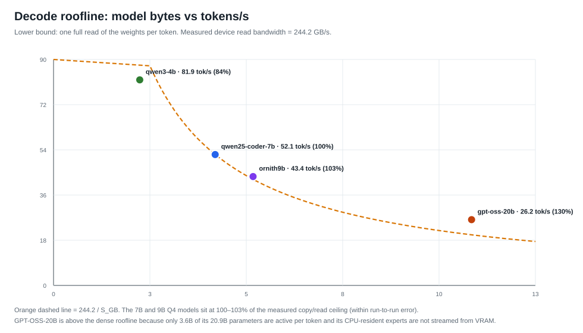
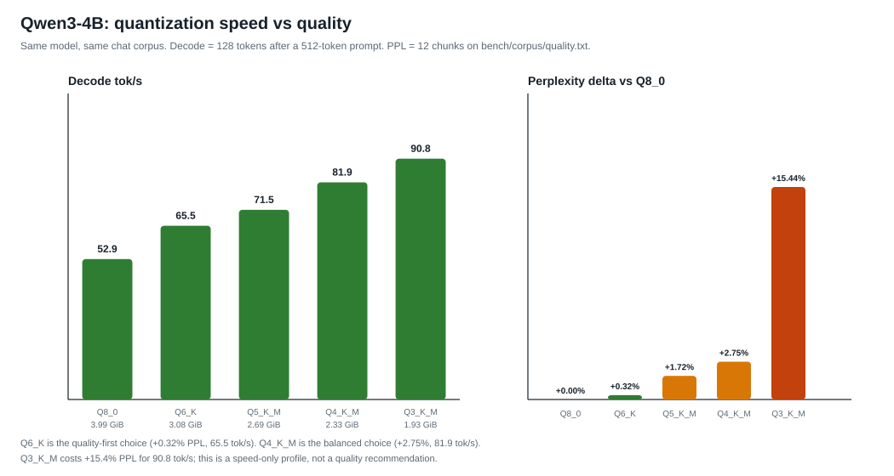
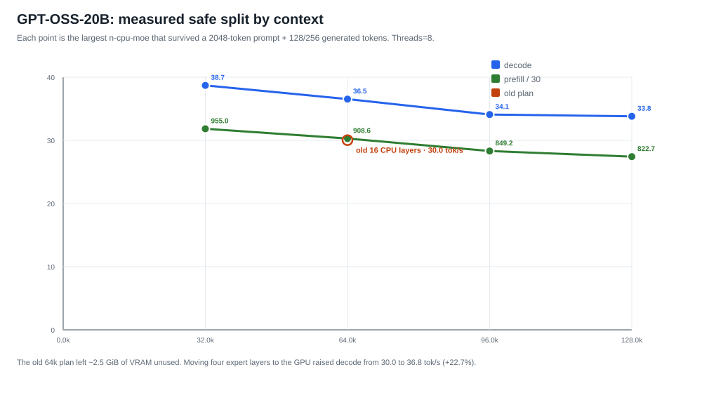
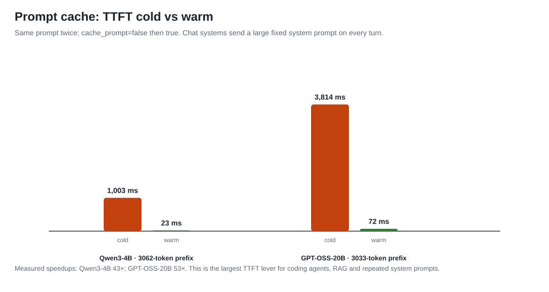

# Benchmarks — RTX 4060 8 GB

Todo lo que aparece aquí se midió en **este** equipo:

- Acer Nitro AN16-41
- NVIDIA RTX 4060 Laptop, 8 GB, `sm_89`, 80 W (máximo 140 W), 24 SMs
- AMD Ryzen 7 7840HS, 8C/16T, AVX-512, 16 GB DDR5-5600
- Windows 10 Enterprise LTSC 19044
- llama.cpp `8642541b255bfb5dc39cd351a178be09013a55d6` (v0.8.0), CUDA 12.9.1, MSVC 19.44
- VRAM medida: **244.2–245.0 GB/s** de lectura (dos ejecuciones del probe; 244.2 se usa como denominador conservador); PCIe 4.0 x8, ~13.3 GB/s H2D/D2H pinned

Los datos crudos, comandos y telemetría están en `reports/bench-*`. Los CSV
maestros se regeneran con `bench/merge_results.py`.

---

## 1. Método

- `llama-bench` con `-r 4`; se descarta la **primera** muestra medida además del
  warm-up interno de llama-bench.
- Cada caso se ejecuta con el modelo ya cargado y un prompt de calentamiento;
  no se mide el primer token en frío.
- Telemetría cada 500 ms: VRAM, potencia, temperatura, clocks, utilización GPU,
  CPU del proceso, RSS. La potencia media se calcula solo con muestras de GPU
  ≥ 50% para excluir la carga del modelo.
- La GPU debe estar libre (< 1 GiB usado) antes de cada caso. Entre casos se
  espera a que baje la temperatura.
- Para MoE se usa `llama-server` y HTTP streaming, porque `llama-bench` no
  reproduce el scheduling real ni el prompt cache. TTFT e ITL se miden desde el
  primer chunk no vacío.
- No se cambian clocks, power limits ni BIOS. El rendimiento es el del equipo
  tal como está configurado.

> **Nota sobre Ornith 9B:** el usuario indicó que su calidad de coding no es
> aceptable. Sigue en la matriz densa como referencia de ancho de banda, pero
> **no** se usa para recomendaciones de coding. Los perfiles de coding se
> centran en GPT-OSS-20B, Qwen3.6-35B-A3B y Qwen3-30B-A3B.

---

## 2. Baseline denso + MoE

Prompt 2048, decode 128, 4 repeticiones, KV f16 (densos) / q8_0 (MoE).

| Modelo | Quant | Peso | Prefill 2048 tok/s | Decode 128 tok/s | % roofline | VRAM pico | GPU W |
|---|---|---:|---:|---:|---:|---:|---:|
| Qwen3 4B 2507 | Q4_K_M | 2.33 GiB | 3,951 | 81.9 | 83.8% | 3,963 MiB | 78.7 |
| Qwen2.5 Coder 7B | Q4_K_M | 4.36 GiB | 2,564 | 52.1 | 100.0% | 5,065 MiB | 79.3 |
| Ornith 1.5 9B | Q4_K_M | 5.38 GiB | 2,213 | 43.4 | 102.6% | 5,763 MiB | 79.5 |
| GPT-OSS 20B | MXFP4 | 11.28 GiB | 762* | 30.0* | — | 5,691 MiB | 35.2 |

\* GPT-OSS se midió con el plan anterior (16 capas CPU, 12 hilos). La tabla
optimizada está en §4.

**Lectura:** los modelos densos de 7B/9B están en el techo de memoria (100–103%
del ancho de banda medido). No hay margen para un kernel GEMV milagroso: el
decode está limitado por los bytes del modelo. El 4B está al 84% porque el
overhead fijo (atención, sampler, lanzamientos) pesa más a 82 tok/s.



### 2.1 Especialización MMVQ para sm_89 (build `lab-mvq2`)

`mul_mat_vec_q` es el 88% del decode denso. En sm_89 usa la tabla genérica (4
warps para batch 1). El parche `0001-mmvq-4060-nwarps` prueba 2 warps **solo
para Q4_K/Q5_K/Q6_K y `ncols_dst=1`**. El resultado no es universal: ayuda al
4B, es neutro en 9B/Q8 y cuesta 0.4% en el 7B.

| Modelo / quant | Control tok/s | mvq2 tok/s | Δ |
|---|---:|---:|---:|
| Qwen3-4B Q4_K_M (512+128) | 82.0 | **85.8** | **+4.6%** |
| Qwen3-4B Q4_K_M (depth 4096) | 67.8 | **70.15** | **+3.5%** |
| Qwen3-4B Q6_K | 65.8 | 66.9 | +1.6% |
| Qwen3-4B Q8_0 | 52.97 | 53.06 | +0.2% (neutro) |
| Qwen2.5-Coder-7B Q4_K_M | 52.22 | 51.99 | −0.4% |
| Qwen3.5-9B Q3_K_M | 50.49 | 50.57 | +0.2% (neutro) |

Servidor real, 2,048-token prompt / 256 decode: 73.8 → **77.0 tok/s** (+4.3%).
El prefill no cambia (3,979 → 3,996 tok/s). `test-backend-ops`:
**2,490/2,490 MUL_MAT cases pass** con el build parcheado.

### 2.2 CUDA Graphs: on vs off

| Build | Decode 128 | Prefill 2048 |
|---|---:|---:|
| `lab-control` (graphs ON) | **82.0 tok/s** | 4,018 tok/s |
| `lab-nographs` (graphs OFF) | 73.2 tok/s | 4,016 tok/s |

Sin CUDA Graphs el decode cae **10.7%**; el prefill no cambia. Se quedan
activas. El build `lab-nographs` está en `bin/builds/lab-nographs/` como
evidencia, no como recomendación.

El build `lab-mvq2` se instala en `bin/builds/lab-server-mvq2/bin/` y el
launcher lo prefiere si existe. El binario estable externo sigue siendo el
fallback. El parche está documentado en `forks/patches/` y no se aplica a
upstream.

---

## 3. Cuantización del mismo modelo (Qwen3-4B)

Mismo prompt, mismo corpus, mismas 4 repeticiones. PPL sobre
`bench/corpus/quality.txt` (12 chunks de 512 tokens).

| Quant | Peso | Decode tok/s | Prefill 2048 tok/s | PPL | Δ PPL vs Q8 | VRAM pico |
|---|---:|---:|---:|---:|---:|---:|
| Q8_0 | 3.99 GiB | 52.95 | 4,197 | 11.9276 | — | 5,665 MiB |
| Q6_K | 3.08 GiB | 65.54 | 3,651 | 11.9654 | +0.32% | 4,735 MiB |
| Q5_K_M | 2.69 GiB | 71.53 | 3,840 | 12.1321 | +1.71% | 4,337 MiB |
| Q4_K_M | 2.33 GiB | 81.90 | 3,951 | 12.2553 | +2.75% | 3,963 MiB |
| Q3_K_M | 1.93 GiB | 90.83 | 3,622 | 13.7688 | +15.44% | 3,561 MiB |

**No asumas que Q4 es siempre más rápido en prefill.** En este equipo Q8_0
gana el prefill (4,197) y Q4_K_M queda segundo (3,951); Q6/Q5/Q3 son más
lentos. El decode sí escala con el tamaño: Q4 es un 35% más rápido que Q6 y
Q3 otro 11% más que Q4, a costa de calidad.

**Recomendación:** Q6_K para `max_quality` (+0.32% PPL, 65.5 tok/s), Q4_K_M
para `balanced` (+2.75%, 81.9 tok/s), Q3_K_M solo para `max_speed` y contextos
donde el tamaño es el límite. Q8_0 no compensa para chat en 8 GB.



---

## 4. MoE que sí programa: GPT-OSS-20B

El plan anterior usaba `--n-cpu-moe 16 --threads 12` a 64k. La tabla medida
muestra que caben **12 capas CPU / 12 capas GPU** y que **8 hilos** son mejores
que 12. La calidad no cambia: mismos pesos, mismo sampler, mismo prompt.

| Contexto | n-cpu-moe | GPU experts | Decode tok/s | Prefill 2048 tok/s | TTFT 2k ms | VRAM pico |
|---:|---:|---:|---:|---:|---:|---:|
| 32k | 11 | 13/24 | **38.65** | 960 | 1,611 | 7,275 MiB |
| **64k** | **12** | **12/24** | **36.8** | **908** | **1,707** | **7,309 MiB** |
| 96k | 13 | 11/24 | 34.1 | 849 | 1,817 | 7,373 MiB |
| 128k | 14 | 10/24 | 33.65 | 823 | 1,874 | 7,473 MiB |

Comparación directa a 64k, mismo binario y mismo prompt:

| Config | Decode | Prefill | TTFT | VRAM | Δ decode |
|---|---:|---:|---:|---:|---:|
| 16 CPU / 12 hilos (antes) | 30.03 | 761.6 | 2,021 ms | 5,691 MiB | — |
| **12 CPU / 8 hilos (ahora)** | **36.80** | **908** | **1,707 ms** | **7,309 MiB** | **+22.7%** |

El precio es +1.6 GiB de VRAM; quedan ~879 MiB libres, el mismo margen que el
proyecto ya exigía. `n-cpu-moe 11` a 64k no arranca (OOM). La tabla completa
está en `config/measured-moe-profiles.json`.



### Hilos del servidor (64k, n-cpu-moe=12)

| Hilos | Decode tok/s |
|---:|---:|
| **8** | **36.8** |
| 10 | 36.4 |
| 12 | 34.4 |
| 14 | 34.6 |
| 16 | 32.4 |

El Ryzen 7 7840HS tiene 8 cores físicos; 12/16 hilos añaden contención SMT y
bajan el throughput de los expertos en CPU.

### Otros MoE de coding

| Modelo | Ctx | n-cpu-moe | Hilos | Decode | Prefill | VRAM | Nota |
|---|---:|---:|---:|---:|---:|---:|---|
| Qwen3.6 35B-A3B | 32k | 19 | 8 | **44.79** | 856 | 7,409 MiB | +5.4% vs 22 CPU |
| Qwen3.6 35B-A3B | 64k | 21 | 8 | 43.92 | 814 | 7,327 MiB | máximo validado |
| Qwen3-30B-A3B 2507 | 32k | 26 | 8 | **46.61** | 848 | 7,535 MiB | n=25 OOM |

---

## 5. TTFT, ITL y prompt cache (llama-server)

Qwen3-4B, 16k contexto, KV f16, 128 tokens de salida:

| Prompt real | TTFT | Prefill tok/s | Decode tok/s | ITL mediana | ITL p95 |
|---:|---:|---:|---:|---:|---:|
| 116 | 43.8 ms | 3,190 | 79.9 | 12.40 ms | 12.74 ms |
| 401 | 114.5 ms | 3,780 | 77.9 | 12.73 ms | 13.37 ms |
| 1,545 | 434 ms | 3,979 | 73.8 | 13.47 ms | 13.81 ms |
| 6,115 | 1,848 ms | 3,510 | 60.9 | 16.33 ms | 16.81 ms |

Prompt cache, mismo prefijo de 3,062 tokens:

| Modelo | Cold TTFT | Warm TTFT | cache_n | Aceleración |
|---|---:|---:|---:|---:|
| Qwen3-4B | 1,002.6 ms | 23.3 ms | 3,062 | **43.0×** |
| GPT-OSS-20B | 3,814.3 ms | 72.2 ms | 3,033 | **52.8×** |

Este es el mayor ahorro de TTFT para agentes de coding, RAG y system prompts
fijos. El proyecto ya lo soporta; el perfil `balanced` lo activa.



---

## 6. Reproducir

```powershell
# Baseline denso + GPT-OSS
python bench\bench_suite.py --suite core --label baseline --runs 1 --publish

# Cuantización (Q8 de referencia + Q6/Q5/Q4/Q3)
python bench\quality_suite.py --out reports\bench-quality
python bench\bench_suite.py --suite quant --label quant

# Servidor: TTFT, ITL, cache
python bench\server_suite.py --model qwen3-4b --context 16384 --prompts 128,512,2048,8192 --cache-test
python bench\server_suite.py --model gpt-oss-20b --context 65536 --prompts 2048,8192 --n-cpu-moe 12 --threads 8 --cache-test

# MoE: barrido de reparto
python bench\server_suite.py --model gpt-oss-20b --context 65536 --prompts 2048 --n-predict 128 --n-cpu-moe 12 --threads 8
```

Cada ejecución escribe `benchmark_results.csv`, `.json`, `benchmark_report.md`,
logs crudos y manifiesto con hashes del binario.
