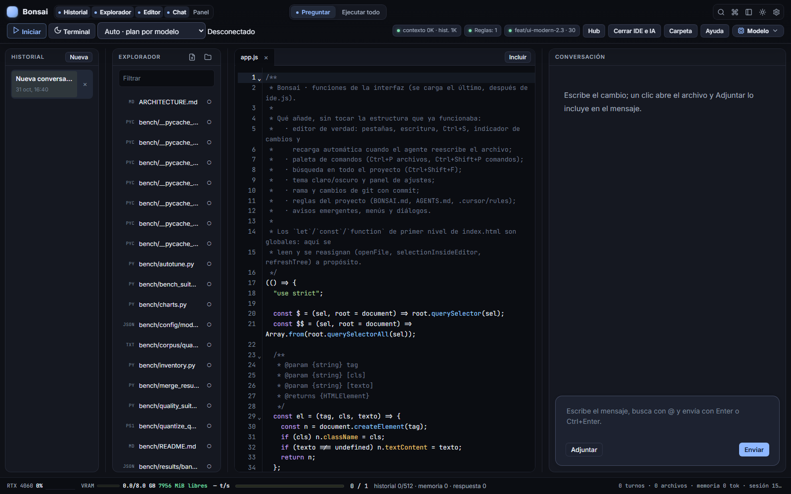
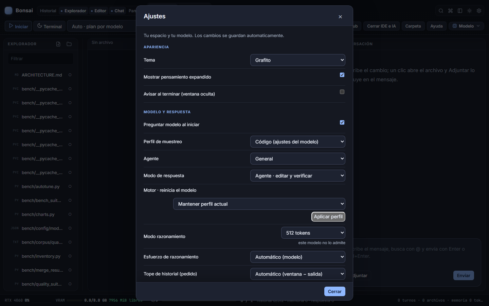

# 🌳 Bonsai Local IDE

**El mejor entorno de coding agent local sobre Windows + llama.cpp + GPU modesta.**

Bonsai no intenta ser VS Code. Es un IDE completo y opinionado para trabajar con
un agente de código **100 % local**: editor moderno, terminal, Git, búsqueda,
navegador controlado y visión, todo contra tu propia GPU. Sin nube, sin
telemetría y sin claves de API.

<p>
  
  
  
  
  
</p>

> **v2.3.6 — Detener y Cerrar IDE e IA de verdad.** El cierre reconoce el build
> de laboratorio que usa el lanzador optimizado, espera a que mueran el modelo y
> el wrapper, comprueba el puerto y borra el marcador. La UI ya no depende de un
> `#servidor-toggle` inexistente: Cerrar IDE e IA vuelve a funcionar y la ventana
> intenta cerrarse. Incluye el prompt de refactor 2.4 en
> [PROMPT-REFACTOR-2.4](docs/PROMPT-REFACTOR-2.4.md).
> Notas: [RELEASE-2.3.6](docs/RELEASE-2.3.6.md).



---

## Qué cambia en 2.3

- **Un solo editor.** Se eliminó el editor textarea/pre paralelo. CodeMirror 6
  aporta undo/redo, multi-cursor, búsqueda, plegado, autocompletado, resaltado
  por lenguaje y ajuste de línea. El bundle sigue siendo local, sin CDN.
- **Diff/merge moderno.** Ctrl+K ya no enseña un `<pre>` con marcas: usa
  `unifiedMergeView` de `@codemirror/merge`, con líneas añadidas/borradas y
  números de línea reales. Ver [captura del diff](docs/graficos/ui-2.3-diff.png).
- **Nueva capa visual.** Navegación lateral con pestañas, editor central, chat
  adaptable, doce temas, iconos por acción y animaciones que respetan el
  movimiento reducido. El diseño se comprueba a 560, 720, 960, 1280 y 1600 px.
- **Tool calling con una sola fuente de verdad.** Las tools nativas + Zod/JSON
  Schema son el camino canónico. El parser de llamadas escritas como texto vive
  en `chat/legacy-tool-parser.mjs` y se apaga con
  `BONSAI_LEGACY_TOOL_PARSER=0`. Detalle: [TOOL-CALLING](docs/TOOL-CALLING.md).
- **GPT-OSS 20B como agente principal.** Plantilla Harmony del GGUF,
  `reasoning_effort` en vez de `enable_thinking`, tool calls nativas (varias si
  son independientes), fallback JSON y salida cruda con `BONSAI_RAW_STREAM=1`.
- **Arranque medido.** El lanzador usa `AUTO` por defecto: el plan por modelo
  elige contexto, KV y reparto MoE. Los presets manuales siguen disponibles.
- **Acceso directo listo.** `scripts/crear-acceso-directo.ps1` crea
  **Bonsai IDE** en el escritorio y abre la UI moderna en una ventana de
  aplicación (Edge/Chrome, sin GPU para el navegador).

### Galería

| Diff/merge en Ctrl+K | Ajustes 2.3 | Estado vacío |
|---|---|---|
|  |  |  |

---

## Lo que hace

| Área | Capacidad |
|---|---|
| **Agente** | Edita archivos, ejecuta comandos, corre tests, lee y crea archivos, plan persistente y hasta 192 pasos por turno |
| **Editor** | CodeMirror 6, pestañas, Ctrl+S, Ctrl+K con diff/merge, paleta Ctrl+P, búsqueda y plegado |
| **Contexto** | Tokenizer real del servidor, historial adaptativo y presupuesto honesto (ventana / solicitado / efectivo / reserva) |
| **Herramientas** | Terminal persistente con xterm + ConPTY, diagnósticos, esquema, F12 ir a definición y procesos en segundo plano |
| **Búsqueda** | ripgrep con `.gitignore` y búsqueda estructural con ast-grep en JS/TS/TSX/HTML/CSS |
| **Navegador** | Playwright MCP aislado, evaluación de JS y pruebas de WebGL/workers/HMR |
| **Visión** | Imágenes pegadas o arrastradas, OCR local opcional y proyector en GPU o CPU |
| **Model Hub** | Catálogo de GGUF, plan por modelo, descarga reanudable y SHA-256 |
| **Git** | Estado por archivo y commits con selección explícita, sin `add -A` |
| **Seguridad** | Guardados atómicos, punto de deshacer por escritura, rutas confinadas y git seguro |

---

## Rendimiento medido (RTX 4060 Laptop 8 GB)

Los números de 2.2 siguen siendo la referencia: 2.3 cambia el IDE, no el motor.
El laboratorio es reproducible y cada dato tiene su registro A/B.


| Cambio medido | Antes | Después | Ganancia |
|---|---:|---:|---:|
| GPT-OSS-20B 64k (MoE) | 30,0 tok/s | **36,8 tok/s** | **+22,7 %** |
| GPT-OSS-20B prefill 2k | 762 tok/s | **908 tok/s** | **+19,2 %** |
| GPT-OSS prompt cache | 3.814 ms | **72 ms** | **52,8x** |
| Qwen3.6-35B-A3B 32k | 42,5 tok/s | **44,8 tok/s** | +5,3 % |
| Qwen3-30B-A3B 32k | 44,3 tok/s | **46,6 tok/s** | +5,2 % |
| Qwen3-4B servidor | 73,8 tok/s | **77,0 tok/s** | +4,3 % |

La causa principal no fue un kernel: fue **usar la VRAM que el plan anterior
dejaba libre** (GPT-OSS 64k pasó de 16 a 12 capas de expertos en CPU) y **8 hilos
físicos** en vez de 12. El único cambio de kernel que sobrevivió es MMVQ a 2
warps para K-quants en sm_89: +4,6 % en el 4B, neutro en 9B y -0,4 % en el 7B.

> **Coding:** Ornith 9B no se recomienda para coding. Su calidad medida está por
> debajo de GPT-OSS-20B, Qwen3.6-35B-A3B y Qwen3-30B-A3B.

Detalle: [BENCHMARKS.md](BENCHMARKS.md) · [OPTIMIZATIONS.md](OPTIMIZATIONS.md) ·
[TUNING.md](TUNING.md).

---

## Arranque rápido

Requisitos: **Windows 10/11**, **Node ≥ 22**, una GPU compatible con el build
CUDA de llama.cpp (probado en RTX 4060 8 GB) y ~15 GB libres para modelos.

```powershell
git clone https://github.com/Vahlame/bonsai-local-ide.git
cd bonsai-local-ide

# Node, chat/node_modules y runtime local (sin lanzar la UI).
.\scripts\setup-clone.ps1 -NoLaunch
```

Si aún no tienes `llama-server.exe`, el mismo script puede instalar la toolchain
CUDA y compilar el build sm89 (~20 min):

```powershell
.\scripts\setup-clone.ps1 -BuildRuntime -NoLaunch
```

Abre el IDE:

```powershell
.\scripts\bonsai-rtx4060.ps1 launch
```

O crea el acceso directo y ábrelo desde el escritorio:

```powershell
.\scripts\crear-acceso-directo.ps1
```

El acceso directo ejecuta el lanzador sin consola y abre
`http://127.0.0.1:8787` en una **ventana de aplicación** (sin barra de
direcciones, con perfil aislado y sin GPU para el navegador). El modelo se
arranca desde **Iniciar** o desde el diálogo **¿Qué modelo quieres cargar?**.

> Si el acceso directo no abre nada, no debe llevar `-NoBrowser`: regenéralo con
> `.\scripts\crear-acceso-directo.ps1`.

Guía paso a paso: [PRIMER-ARRANQUE](docs/PRIMER-ARRANQUE.md).

---

## Editor y atajos

| Atajo | Acción |
|---|---|
| `Ctrl+P` | Buscar archivo |
| `Ctrl+Shift+P` | Paleta de comandos |
| `Ctrl+Shift+F` | Buscar en todo el proyecto |
| `Ctrl+K` | Editar la selección con el modelo (diff/merge) |
| `Ctrl+S` | Guardar el archivo activo |
| `Ctrl+B` | Mostrar/ocultar explorador |
| ``Ctrl+` `` | Abrir/cerrar terminal |
| `F2` | Renombrar el archivo abierto |
| `F12` | Ir a definición |

El editor se guarda de forma atómica y avisa si el archivo cambió en disco
mientras tenías cambios sin guardar. El agente ve el estado real del proyecto,
no una copia en memoria.

---

## Presets (RTX 4060 8 GB)

`AUTO` es el default: el plan por modelo decide contexto, KV, visión y reparto
MoE con los perfiles medidos. Los presets manuales siguen en el desplegable para
cuando quieras fijar un comportamiento.

| Preset | Contexto | KV | Visión | Uso |
|---|---:|:--:|:--:|---|
| **`AUTO`** | plan por modelo | auto | auto | **Default medido** |
| `8GB-VISION-MAX-Q8-100K` | 110.592 | q8_0 | CPU | Contexto máximo con KV casi sin pérdida |
| `8GB-VISION-MAX-Q8` | 71.680 | q8_0 | GPU | Visión rápida (~2 s/imagen) |
| `8GB-VISION-MAX-F16` | 43.008 | f16 | GPU | Precisión máxima de KV |
| `8GB-CODE-MAX` | 49.152 | q4_0 | — | Código largo |
| `8GB-CODE-FAST` | 16.384 | f16 | — | Máximo throughput |

Tabla completa y justificación: [TUNING.md](TUNING.md) · 
[README 2.2 archivado](docs/archive/README-2.2.md).

### Qwen3.8 27B (denso, 4 bits)

Es el primer denso que no cabe entero en 8 GB. Se reparte con un `-ngl` medido
(últimas capas + salida en GPU) y el resto vive en RAM con `mmap`; la cabeza
MTP del propio GGUF acelera el decode con `--spec-type draft-mtp`. Usa un
runtime aparte (llama.cpp master) porque necesita DeltaNet en CUDA y MTP.
Detalle, comandos y números: [QWEN38-27B](docs/QWEN38-27B.md).

---

## Tool calling

El agente principal de coding es **GPT-OSS 20B**. Usa la plantilla **Harmony**
del GGUF, tool calls nativas y `reasoning_effort` (no `enable_thinking`).

La fuente de verdad son las **tool calls nativas** del servidor OpenAI local,
con argumentos validados por **Zod** y publicados como **JSON Schema**. La build
opcional con **llguidance** fuerza ese schema durante la decodificación.

El parser antiguo de llamadas escritas como texto (` ```ejecutar `,
`<tool_call>`, “voy a ejecutar…”) se conserva solo por compatibilidad con modelos
locales viejos, aislado en `chat/legacy-tool-parser.mjs`:

```powershell
# Desactiva por completo las heurísticas legacy.
$env:BONSAI_LEGACY_TOOL_PARSER = "0"
```

No se añaden regex nuevas para modelos concretos: si hace falta una tool, se
añade su schema nativo y su handler. GPT-OSS/Harmony usa su plantilla nativa,
`reasoning_effort` (no `enable_thinking`), tool calls nativas —varias si son
independientes— y un fallback JSON estructurado. Contrato y ejemplos:
[TOOL-CALLING](docs/TOOL-CALLING.md).

---

## Documentación

| Documento | Contenido |
|---|---|
| [RELEASE-2.3.6](docs/RELEASE-2.3.6.md) | Detener y Cerrar IDE e IA verificados; prompt de refactor 2.4 |
| [RELEASE-2.3.5](docs/RELEASE-2.3.5.md) | Guía de tools, `buscar_codigo.ruta`, historial saneado y app GPT-OSS |
| [RELEASE-2.3.4](docs/RELEASE-2.3.4.md) | Contexto automático y menos restricciones para GPT-OSS |
| [RELEASE-2.3.3](docs/RELEASE-2.3.3.md) | Parser Harmony propio y GPT-OSS sin `--skip-chat-parsing` |
| [RELEASE-2.3.2](docs/RELEASE-2.3.2.md) | Reintento `peg-native` y recuperación JSON |
| [RELEASE-2.3.1](docs/RELEASE-2.3.1.md) | GPT-OSS, tool calls nativas, salida cruda y verificación |
| [RELEASE-2.3.0](docs/RELEASE-2.3.0.md) | Alcance, migración, verificación y límites de esta release |
| [QWEN38-27B](docs/QWEN38-27B.md) | 27B denso en 4 bits entre VRAM y RAM: reparto, MTP, build y límites |
| [TOOL-CALLING](docs/TOOL-CALLING.md) | Tools nativas, Zod/JSON Schema y flag legacy |
| [PRIMER-ARRANQUE](docs/PRIMER-ARRANQUE.md) | Clon, runtime, modelos y primer turno |
| [ARCHITECTURE](ARCHITECTURE.md) | Capas del IDE y flujo de un turno |
| [BENCHMARKS](BENCHMARKS.md) | Metodología y resultados medidos |
| [OPTIMIZATIONS](OPTIMIZATIONS.md) | Registro A/B de los cambios que sobrevivieron |
| [TUNING](TUNING.md) | Presets, contexto, KV y muestreo |
| [HARDWARE](HARDWARE.md) | Inventario y límites de la máquina de referencia |
| [SECURITY](SECURITY.md) | Modelo de confianza y rutas confinadas |
| [CHANGELOG](CHANGELOG.md) | Historial completo por versión |

---

## Pruebas

```powershell
npm test                  # 48 suites aisladas, sin GPU ni modelo real
npm run test:navegador    # 7 suites con Edge/Chrome headless
npm run docs:links        # enlaces relativos de la documentación
npm run build:ui-vendor   # reconstruye editor.js, terminal.js y xterm.css
```

Cobertura de esta release: 48/48 aisladas, 7/7 navegador, ciclo de vida real
(Detener/Cerrar) y `docs:links` sin enlaces rotos.

---

## Estructura

```text
chat/            servidor Node, agente, tools, UI y pruebas
  ui/            HTML/CSS/JS del IDE y bundles locales (CodeMirror, xterm)
  actions.mjs    parsing y efectos de herramientas
  tool-schemas.mjs  contratos Zod y JSON Schema
  legacy-tool-parser.mjs  compatibilidad legacy aislada
scripts/         lanzadores, builds, benchmarks y utilidades
docs/            documentación, release notes y gráficos
reports/         resultados reproducibles de benchmarks
bin/             runtime llama.cpp local (no viaja en Git)
models/          GGUF locales (no viajan en Git)
```

---

## Seguridad y límites

- Rutas confinadas al workspace; escrituras atómicas y undo por escritura.
- Git sin `add -A`; el agente solo commitea lo que seleccionas.
- Sin telemetría, sin nube y sin CDN en la UI.
- No hay debugger multi-lenguaje, ecosistema de extensiones ni remote
  development: eso es VS Code. Bonsai se enfoca en el agente local sobre
  Windows + llama.cpp + GPU modesta.

## Licencia

MIT. Ver [LICENSE](LICENSE).
