# 🌳 Bonsai Local IDE

**El mejor entorno de coding agent local sobre Windows + llama.cpp + GPU modesta.**

Bonsai no intenta ser VS Code. Es un IDE completo y opinionado para trabajar con
un agente de código **100 % local**: editor moderno, terminal, Git, búsqueda,
navegador controlado y visión, todo contra tu propia GPU. Sin nube, sin
telemetría y sin claves de API.

<p>
  
  
  
  
  
  
</p>

> **v2.4.2 - CI verde y arranque reproducible en clon limpio.** La suite
> aislada pasa **51/51** sin GGUF instalados, la UI carga Qwen3.6 con **0
> errores de consola** y GitHub Actions valida enlaces y tests en Windows. La
> release corrige el `-DryRun` del lanzador y las comprobaciones que depend�an
> de pesos locales. Notas: [RELEASE-2.4.2](docs/RELEASE-2.4.2.md).

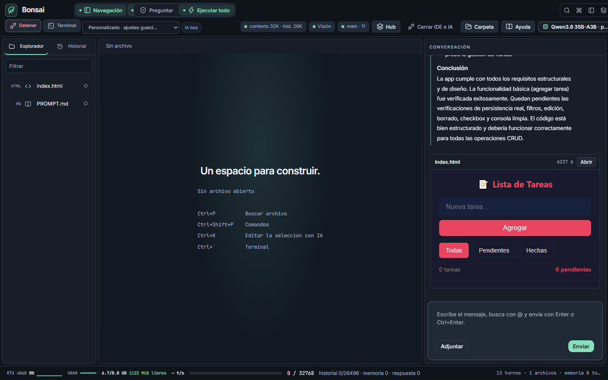

---

## Novedades principales

- **Un solo editor.** Se eliminó el editor textarea/pre paralelo. CodeMirror 6
  aporta undo/redo, multi-cursor, búsqueda, plegado, autocompletado, resaltado
  por lenguaje y ajuste de línea. El bundle sigue siendo local, sin CDN.
- **Diff/merge moderno.** Ctrl+K ya no enseña un `<pre>` con marcas: usa
  `unifiedMergeView` de `@codemirror/merge`, con líneas añadidas/borradas y
  números de línea reales. Ver [captura del diff](docs/graficos/ui-2.3-diff.png).
- **Nueva capa visual.** Navegación lateral con pestañas, editor central, chat
  adaptable, doce temas, iconos por acción y animaciones que respetan el
  movimiento reducido. El diseño se comprueba a 560, 720, 960, 1280 y 1600 px.
- **Tool calling con una sola fuente de verdad.** Las tools nativas + Zod/JSON
  Schema son el camino canónico. El parser de llamadas escritas como texto vive
  en `chat/legacy-tool-parser.mjs` y se apaga con
  `BONSAI_LEGACY_TOOL_PARSER=0`. Detalle: [TOOL-CALLING](docs/TOOL-CALLING.md).
- **Qwen3.6 35B-A3B como agente recomendado.** MoE con expertos en CPU, visión
  y pensamiento libre; 35–40 tok/s en las cuatro tareas del benchmark. GPT-OSS
  20B se mantiene para Harmony (`reasoning_effort`, tool calls nativas y salida
  cruda con `BONSAI_RAW_STREAM=1`).
- **Qwen3.8-27B denso local.** Perfil `qwen38-27b-perf-iq4` con IQ4_XS mixto,
  MTP 2, caché recurrente por checkpoints y pensamiento sin tope de tokens
  (`--reasoning-budget -1`, esfuerzo `xhigh`). Tool calling nativo validado en
  dos turnos reales. Detalle y límites en la sección Qwen3.8.
- **Arranque medido.** El lanzador usa `AUTO` por defecto: el plan por modelo
  elige contexto, KV y reparto MoE. Los presets manuales siguen disponibles.
- **Acceso directo listo.** `scripts/crear-acceso-directo.ps1` crea
  **Bonsai IDE** en el escritorio y abre la UI moderna en una ventana de
  aplicación (Edge/Chrome, sin GPU para el navegador).

### Galería

| Diff/merge en Ctrl+K | Ajustes 2.4 | Estado vacío |
|---|---|---|
| 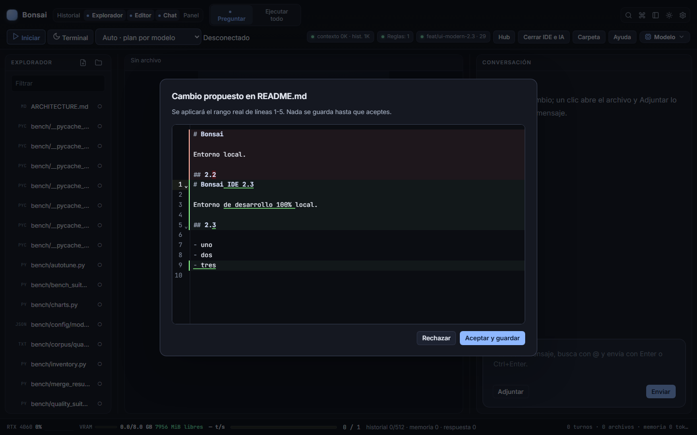 | 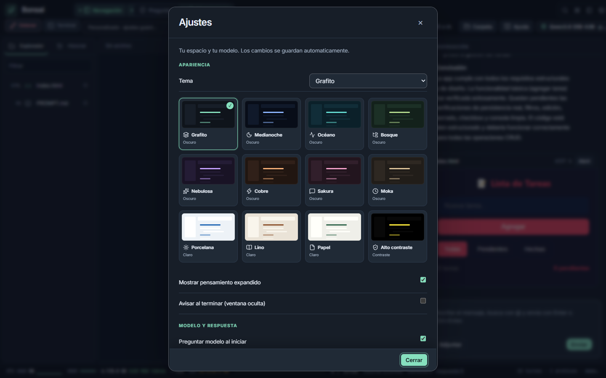 | 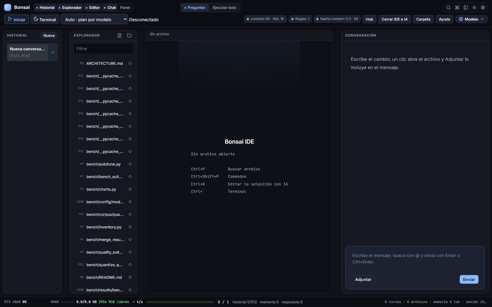 |

---

## Lo que hace

| Área | Capacidad |
|---|---|
| **Agente** | Edita archivos, ejecuta comandos, corre tests, lee y crea archivos, plan persistente y hasta 192 pasos por turno |
| **Editor** | CodeMirror 6, pestañas, Ctrl+S, Ctrl+K con diff/merge, paleta Ctrl+P, búsqueda y plegado |
| **Contexto** | Tokenizer real del servidor, historial adaptativo y presupuesto honesto (ventana / solicitado / efectivo / reserva) |
| **Herramientas** | Terminal persistente con xterm + ConPTY, diagnósticos, esquema, F12 ir a definición y procesos en segundo plano |
| **Búsqueda** | ripgrep con `.gitignore` y búsqueda estructural con ast-grep en JS/TS/TSX/HTML/CSS |
| **Navegador** | Playwright MCP aislado, evaluación de JS y pruebas de WebGL/workers/HMR |
| **Visión** | Imágenes pegadas o arrastradas, OCR local opcional y proyector en GPU o CPU |
| **Model Hub** | Catálogo de GGUF, plan por modelo, descarga reanudable y SHA-256 |
| **Git** | Estado por archivo y commits con selección explícita, sin `add -A` |
| **Seguridad** | Guardados atómicos, punto de deshacer por escritura, rutas confinadas y git seguro |

---

## Rendimiento medido (RTX 4060 Laptop 8 GB)

Los números de 2.2 siguen siendo la referencia para los modelos que usan el
runtime histórico. Qwen3.8-27B usa un runtime aparte y añade la sección
siguiente. El laboratorio es reproducible y cada dato tiene su registro A/B.

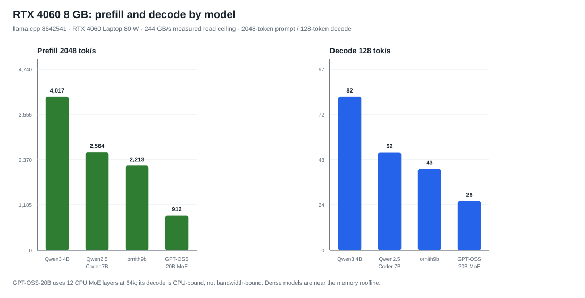

| Cambio medido | Antes | Después | Ganancia |
|---|---:|---:|---:|
| GPT-OSS-20B 64k (MoE) | 30,0 tok/s | **36,8 tok/s** | **+22,7 %** |
| GPT-OSS-20B prefill 2k | 762 tok/s | **908 tok/s** | **+19,2 %** |
| GPT-OSS prompt cache | 3.814 ms | **72 ms** | **52,8x** |
| Qwen3.6-35B-A3B 32k | 42,5 tok/s | **44,8 tok/s** | +5,3 % |
| Qwen3-30B-A3B 32k | 44,3 tok/s | **46,6 tok/s** | +5,2 % |
| Qwen3-4B servidor | 73,8 tok/s | **77,0 tok/s** | +4,3 % |

La causa principal no fue un kernel: fue **usar la VRAM que el plan anterior
dejaba libre** (GPT-OSS 64k pasó de 16 a 12 capas de expertos en CPU) y **8 hilos
físicos** en vez de 12. El único cambio de kernel que sobrevivió es MMVQ a 2
warps para K-quants en sm_89: +4,6 % en el 4B, neutro en 9B y -0,4 % en el 7B.

> **Coding:** Ornith 9B es el perfil GPU-completa de referencia (todo en VRAM),
> pero no se recomienda como agente de coding: su calidad medida está por debajo
> de Qwen3.6-35B-A3B, Qwen3-Coder-30B-A3B y Qwen3-30B-A3B.

Detalle: [BENCHMARKS.md](BENCHMARKS.md) · [OPTIMIZATIONS.md](OPTIMIZATIONS.md) ·
[TUNING.md](TUNING.md).

---

## Benchmark de tareas (2026-11-01)

Probé **7 modelos × 4 tareas** con el mismo stack: pensamiento libre
(`--reasoning-budget -1`), motor `build-RTX4060-Opt-sm89`, MoE con expertos en
CPU y verificación real en Edge headless. Las tareas fueron **fluidos con
física**, **juego arcade**, **app CRUD con `localStorage`** y **Skyblock
Three.js**. Cada captura y cada resultado están versionados.

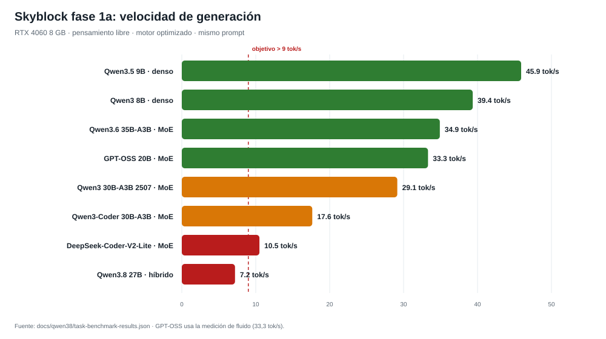

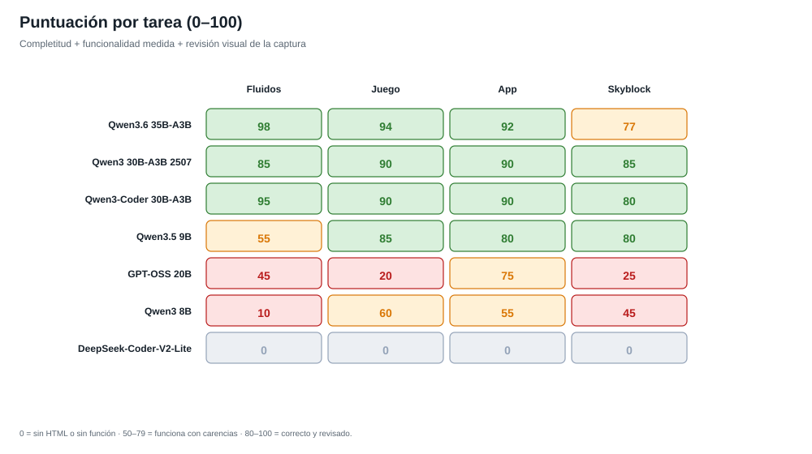

| Modelo | Skyblock | Fluidos | Juego | App | Score |
| --- | ---: | ---: | --- | --- | ---: |
| **Qwen3.6 35B-A3B** | 34,9 tok/s | 37,8 tok/s | OK | OK | **90** |
| Qwen3-Coder 30B-A3B | 17,7 tok/s | 22,4 tok/s | OK | OK | 89 |
| Qwen3 30B-A3B 2507 | 29,1 tok/s | 35,5 tok/s | OK | OK | 87 |
| Qwen3.5 9B | 45,9 tok/s | HUD 0 | OK | OK | 75 |
| Qwen3 8B | 39,4 tok/s | fallo | OK | OK | 43 |
| GPT-OSS 20B | — | física pobre | timeout | parcial | 41 |
| DeepSeek-Coder-V2-Lite | 10,5 tok/s | sin HTML | sin HTML | sin HTML | 0 |
| Qwen3.8 27B | 7,2 tok/s | — | — | — | control |

El **score** combina completitud, funcionalidad medida y revisión visual de la
captura (0–100). Para Qwen3.6 es la **media de 3 repeticiones** (12/12 checks);
fluidos 98, juego 94, app 92 y Skyblock 77. **Qwen3.6 35B-A3B es la
recomendación principal**: hace las cuatro tareas a 35–40 tok/s y con buena
calidad. **Qwen3.5 9B** es el más
rápido (45–46 tok/s) para juego/app/Skyblock, pero su fluido no cumple.
**Qwen3-Coder 30B-A3B** es el especialista de código a 17–22 tok/s.
**Qwen3 8B** sirve para tareas simples. **DeepSeek-Coder-V2-Lite** no produjo
archivos y **GPT-OSS 20B** fue variable en tareas visuales.

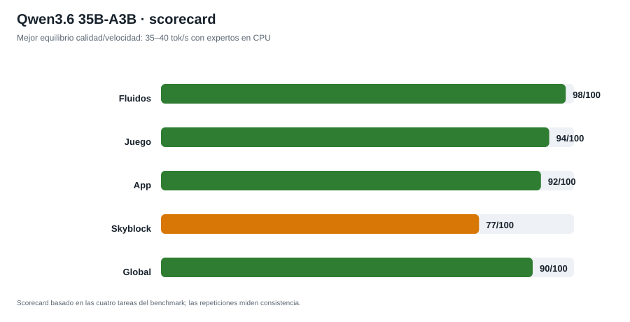

### Motor y offload

<p>
  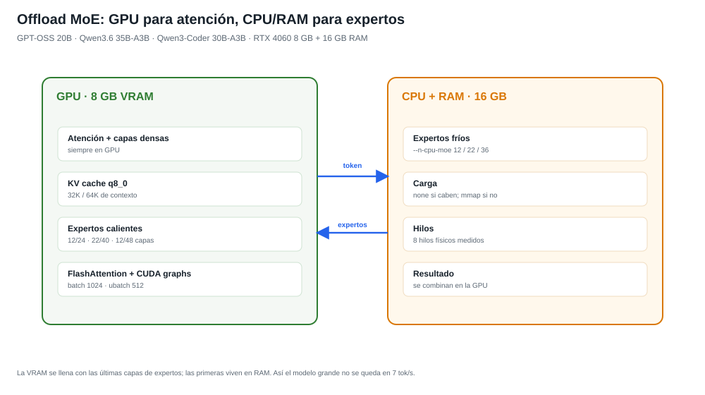
  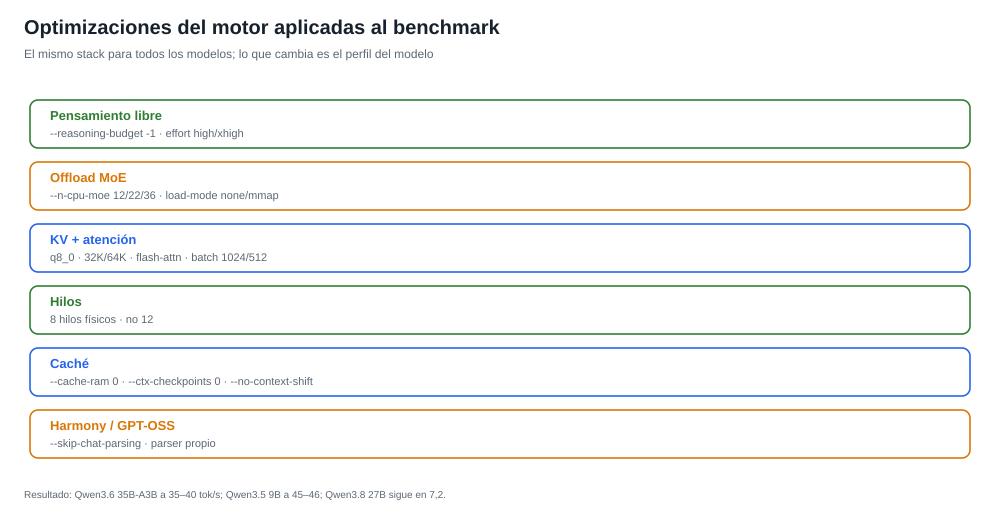
</p>

- **MoE híbrido:** atención y capas densas en GPU; capas de expertos frías en
  CPU/RAM (`--n-cpu-moe 12/22/36`). GPT-OSS 20B: 12/24; Qwen3.6 35B-A3B:
  22/40; Qwen3-Coder 30B-A3B: 36/48.
- **Carga:** `--load-mode none` cuando los expertos caben en RAM; `mmap`
  cuando no. La VRAM se llena con las últimas capas de expertos.
- **KV y atención:** `-ctk q8_0 -ctv q8_0`, `--flash-attn on`, batch
  1024/512 y 8 hilos físicos.
- **Caché y contexto:** `--cache-ram 0`, `--ctx-checkpoints 0`,
  `--no-context-shift`; 32K/64K según el plan del modelo.
- **Pensamiento:** `--reasoning-budget -1` y effort `high`/`xhigh`; GPT-OSS
  usa Harmony con `--skip-chat-parsing` y el parser propio.

### Descargas y correcciones

Se descargaron **Qwen3-Coder-30B-A3B** (16,45 GiB),
**DeepSeek-Coder-V2-Lite** (9,65 GiB) y **Qwen3-8B** (4,68 GiB) con
`fast-download.mjs` a ~10,3 MiB/s. También se corrigieron la delegación de
`moe-hibrido` al lanzador optimizado, el binario `optimized-sm89-user`, la
restauración con `pensar=-1`, el nombre real del GGUF de GPT-OSS y el contexto
de Qwen3-30B a 32K.

Informe completo: [TASK-BENCHMARK-2026-11-01.md](docs/qwen38/TASK-BENCHMARK-2026-11-01.md) ·
Scorecard: [MODEL-SCORECARD-2026-11-01.md](docs/qwen38/MODEL-SCORECARD-2026-11-01.md) ·
Resultados: [task-benchmark-results.json](docs/qwen38/task-benchmark-results.json) ·
Capturas: [task-benchmark-shots](docs/qwen38/task-benchmark-shots/) ·
Pipeline: [benchmark-pipeline.svg](docs/graficos/benchmark-pipeline.svg).

---

## Arranque rápido

Requisitos: **Windows 10/11**, **Node ≥ 22**, una GPU compatible con el build
CUDA de llama.cpp (probado en RTX 4060 8 GB) y ~15 GB libres para modelos.

```powershell
git clone https://github.com/Vahlame/bonsai-local-ide.git
cd bonsai-local-ide

# Node, chat/node_modules y runtime local (sin lanzar la UI).
.\scripts\setup-clone.ps1 -NoLaunch
```

Si aún no tienes `llama-server.exe`, el mismo script puede instalar la toolchain
CUDA y compilar el build sm89 (~20 min):

```powershell
.\scripts\setup-clone.ps1 -BuildRuntime -NoLaunch
```

Abre el IDE:

```powershell
.\scripts\bonsai-rtx4060.ps1 launch
```

O crea el acceso directo y ábrelo desde el escritorio:

```powershell
.\scripts\crear-acceso-directo.ps1
```

El acceso directo ejecuta el lanzador sin consola y abre
`http://127.0.0.1:8787` en una **ventana de aplicación** (sin barra de
direcciones, con perfil aislado y sin GPU para el navegador). El modelo
guardado se arranca con el lifecycle, incluidos los perfiles `gpu-parcial`
como Qwen3.8; si no hay ninguno, usa **Iniciar** o el diálogo **¿Qué modelo
quieres cargar?**. El lanzador es idempotente: una segunda apertura no
duplica el servidor.

> Si el acceso directo no abre nada, no debe llevar `-NoBrowser`: regenéralo con
> `.\scripts\crear-acceso-directo.ps1`.

Guía paso a paso: [PRIMER-ARRANQUE](docs/PRIMER-ARRANQUE.md).

---

## Editor y atajos

| Atajo | Acción |
|---|---|
| `Ctrl+P` | Buscar archivo |
| `Ctrl+Shift+P` | Paleta de comandos |
| `Ctrl+Shift+F` | Buscar en todo el proyecto |
| `Ctrl+K` | Editar la selección con el modelo (diff/merge) |
| `Ctrl+S` | Guardar el archivo activo |
| `Ctrl+B` | Mostrar/ocultar explorador |
| ``Ctrl+` `` | Abrir/cerrar terminal |
| `F2` | Renombrar el archivo abierto |
| `F12` | Ir a definición |

El editor se guarda de forma atómica y avisa si el archivo cambió en disco
mientras tenías cambios sin guardar. El agente ve el estado real del proyecto,
no una copia en memoria.

---

## Presets (RTX 4060 8 GB)

`AUTO` es el default: el plan por modelo decide contexto, KV, visión y reparto
MoE con los perfiles medidos. Los presets manuales siguen en el desplegable para
cuando quieras fijar un comportamiento.

| Preset | Contexto | KV | Visión | Uso |
|---|---:|:--:|:--:|---|
| **`AUTO`** | plan por modelo | auto | auto | **Default medido** |
| `8GB-VISION-MAX-Q8-100K` | 110.592 | q8_0 | CPU | Contexto máximo con KV casi sin pérdida |
| `8GB-VISION-MAX-Q8` | 71.680 | q8_0 | GPU | Visión rápida (~2 s/imagen) |
| `8GB-VISION-MAX-F16` | 43.008 | f16 | GPU | Precisión máxima de KV |
| `8GB-CODE-MAX` | 49.152 | q4_0 | — | Código largo |
| `8GB-CODE-FAST` | 16.384 | f16 | — | Máximo throughput |

Tabla completa y justificación: [TUNING.md](TUNING.md) · 
[README 2.2 archivado](docs/archive/README-2.2.md).

### Qwen3.8 27B (denso, 4 bits, pensamiento libre)

Es el primer denso que no cabe entero en 8 GB. Se reparte con un `-ngl` medido
(últimas capas + salida en GPU) y el resto vive en RAM con `mmap`; la cabeza
MTP del propio GGUF acelera el decode con `--spec-type draft-mtp`. Usa un
runtime aparte (llama.cpp master) porque necesita DeltaNet en CUDA y MTP.
El perfil de entrega es **`qwen38-27b-perf-iq4`**; el perfil y el GGUF
originales se conservan para rollback. Detalle, comandos y límites:
[QWEN38-27B](docs/QWEN38-27B.md).

**Pensamiento libre.** Para Qwen3.8 el IDE arranca con
`--reasoning-budget -1` y `--reasoning-effort xhigh`, y cada petición envía
`thinking_budget_tokens: -1`. No hay tope de 512/4096 tokens cuando el agente
decide pensar; el tope total de salida del turno (la reserva de contexto)
sigue aplicándose, y si el modelo agota esa salida el IDE continúa sin
pensar para cerrar la respuesta. El agente sigue decidiendo **cuándo** pensar
(planificación y tras un fallo) para no convertir cada salto rutinario en
minutos de espera. El ajuste se elige en **Ajustes → Modo razonamiento →
Sin límite (Qwen3.8)**.

Qwen3.8 se deja **sin límite**: el único tope es el contexto de 32K y la
respuesta final. No se optimiza para turnos rápidos; una prueba real de un plan
de migración usó 9.523 tokens de una slice libre y tardó 25 minutos. Los límites
512/1024/2048/4096 quedan para otros modelos, no para este perfil.

**Caché recurrente.** El servidor guarda checkpoints del estado recurrente en
límites de mensaje de usuario y un ancla estable del primer mensaje. En un
turno de agente el segundo paso pasó de `cache_n 0 / 7840` a `6508 / 8930`
(38,5 s → 12,4 s de prefill); un follow-up nuevo reutilizó 4551 tokens
(114,7 s → 41,0 s). Con el GGUF mixto final, un prefijo repetido de 25K
reutiliza 24.997 tokens y responde en ~0,42-0,45 s tras 122,3 s de prefill
frío. Es una prueba de prefijo repetido/residente, no una promesa para
cualquier turno con herramientas.

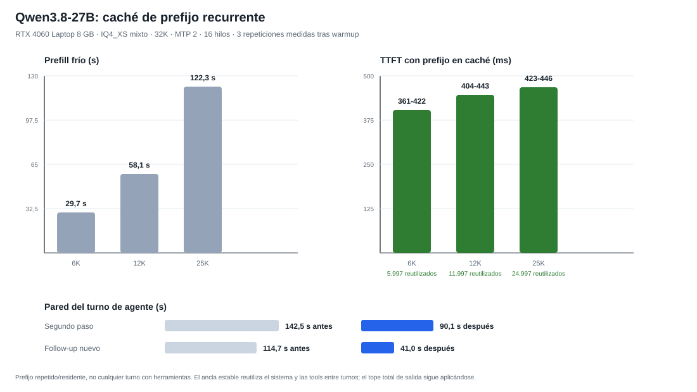

**Tool calling nativo validado.** En una tarea real de dos turnos: dos
`leer` en un mismo mensaje, fallo de test real, corrección con `reemplazar`,
archivo UTF-8 con `Ángel`, test original intacto y recuperación de una
denegación de política. No hubo rechazo `peg-native`, ni fallback de texto,
ni llamada perdida. La misma tarea se repitió con dos turnos de agente
(4/4 tests externos OK). El lanzador oficial `launch-ide.ps1` ya arranca
Qwen3.8 `gpu-parcial` y el acceso directo deja de fallar por el preset
`8GB-CODE-BALANCED`.

| Medición Qwen3.8-27B | Antes | Después |
|---|---:|---:|
| Segundo paso de agente, `cache_n` | 0 / 7840 | 6508 / 8930 |
| Segundo paso, prefill | 38,5 s | 12,4 s |
| Follow-up nuevo, pared | 114,7 s | 41,0 s |
| 25K repetido, TTFT | 122,3 s frío | 0,42-0,45 s |
| Memoria de entrega, working set | 11,8 GB sin trim | 9,6 GB con trim |
| RAM física disponible | 0,12-0,32 GB | 2,26 GB |

La memoria se midió con ETW: el GGUF se lee durante la carga y no aparecen
hard faults del modelo después de 12,9 s en la captura de entrega; quedan
59 hard faults de pagefile (0,85 MB), así que no se afirma paging cero. Con
un navegador headless de 512 MiB el decode quedó en 9,24 frente a 9,34 tok/s
(dentro del ruido) y la RAM disponible bajó a ~1,49 GB.

Informes completos, parche de runtime y evidencia:
[docs/qwen38](docs/qwen38/README.md).

---

## Tool calling

El agente recomendado es **Qwen3.6 35B-A3B**: MoE con expertos en CPU, tool
calls nativas y pensamiento libre. **GPT-OSS 20B** sigue disponible con la
plantilla **Harmony** del GGUF y `reasoning_effort` (no `enable_thinking`).

La fuente de verdad son las **tool calls nativas** del servidor OpenAI local,
con argumentos validados por **Zod** y publicados como **JSON Schema**. La build
opcional con **llguidance** fuerza ese schema durante la decodificación.

El parser antiguo de llamadas escritas como texto (` ```ejecutar `,
`<tool_call>`, “voy a ejecutar…”) se conserva solo por compatibilidad con modelos
locales viejos, aislado en `chat/legacy-tool-parser.mjs`:

```powershell
# Desactiva por completo las heurísticas legacy.
$env:BONSAI_LEGACY_TOOL_PARSER = "0"
```

No se añaden regex nuevas para modelos concretos: si hace falta una tool, se
añade su schema nativo y su handler. GPT-OSS/Harmony usa su plantilla nativa,
`reasoning_effort` (no `enable_thinking`), tool calls nativas —varias si son
independientes— y un fallback JSON estructurado. Contrato y ejemplos:
[TOOL-CALLING](docs/TOOL-CALLING.md).

---

## Documentación

| Documento | Contenido |
|---|---|
| [AUDIT-2026-11-01](docs/AUDIT-2026-11-01.md) | Inventario, sintaxis, enlaces, UI, runtime y límites |
| [CONTRIBUTING](CONTRIBUTING.md) | Setup, pruebas, estilo, modelos y releases |
| [RELEASE-2.4.2](docs/RELEASE-2.4.2.md) | CI verde, `-DryRun` sin GGUF y arranque reproducible |
| [RELEASE-2.4.1](docs/RELEASE-2.4.1.md) | Auditoría completa, CI, portabilidad y 51/51 tests |
| [RELEASE-2.4.0](docs/RELEASE-2.4.0.md) | Benchmark de 7 modelos × 4 tareas, MoE, UI verificada y release 2.4.0 |
| [RELEASE-2.3.6](docs/RELEASE-2.3.6.md) | Detener y Cerrar IDE e IA verificados; prompt de refactor 2.4 |
| [RELEASE-2.3.5](docs/RELEASE-2.3.5.md) | Guía de tools, `buscar_codigo.ruta`, historial saneado y app GPT-OSS |
| [RELEASE-2.3.4](docs/RELEASE-2.3.4.md) | Contexto automático y menos restricciones para GPT-OSS |
| [RELEASE-2.3.3](docs/RELEASE-2.3.3.md) | Parser Harmony propio y GPT-OSS sin `--skip-chat-parsing` |
| [RELEASE-2.3.2](docs/RELEASE-2.3.2.md) | Reintento `peg-native` y recuperación JSON |
| [RELEASE-2.3.1](docs/RELEASE-2.3.1.md) | GPT-OSS, tool calls nativas, salida cruda y verificación |
| [RELEASE-2.3.0](docs/RELEASE-2.3.0.md) | Alcance, migración, verificación y límites de esta release |
| [QWEN38-27B](docs/QWEN38-27B.md) | 27B denso en 4 bits entre VRAM y RAM: reparto, MTP, build y límites |
| [TOOL-CALLING](docs/TOOL-CALLING.md) | Tools nativas, Zod/JSON Schema y flag legacy |
| [PRIMER-ARRANQUE](docs/PRIMER-ARRANQUE.md) | Clon, runtime, modelos y primer turno |
| [ARCHITECTURE](ARCHITECTURE.md) | Capas del IDE y flujo de un turno |
| [BENCHMARKS](BENCHMARKS.md) | Metodología y resultados medidos |
| [OPTIMIZATIONS](OPTIMIZATIONS.md) | Registro A/B de los cambios que sobrevivieron |
| [TUNING](TUNING.md) | Presets, contexto, KV y muestreo |
| [HARDWARE](HARDWARE.md) | Inventario y límites de la máquina de referencia |
| [SECURITY](SECURITY.md) | Modelo de confianza y rutas confinadas |
| [CHANGELOG](CHANGELOG.md) | Historial completo por versión |

---

## Pruebas

```powershell
npm test                  # 51 suites aisladas, sin GPU ni modelo real
npm run test:navegador    # 9 suites con Edge/Chrome headless
npm run docs:links        # enlaces relativos de la documentación
npm run build:ui-vendor   # reconstruye editor.js, terminal.js y xterm.css
```

Cobertura de esta release: 51/51 aisladas, 9/9 navegador, ciclo de vida real
(Detener/Cerrar) y `docs:links` sin enlaces rotos. La suite aislada corre en CI
sin GGUF instalados.

---

## Estructura

```text
chat/            servidor Node, agente, tools, UI y pruebas
  ui/            HTML/CSS/JS del IDE y bundles locales (CodeMirror, xterm)
  actions.mjs    parsing y efectos de herramientas
  tool-schemas.mjs  contratos Zod y JSON Schema
  legacy-tool-parser.mjs  compatibilidad legacy aislada
scripts/         lanzadores, builds, benchmarks y utilidades
docs/            documentación, release notes y gráficos
reports/         resultados reproducibles de benchmarks
bin/             runtime llama.cpp local (no viaja en Git)
models/          GGUF locales (no viajan en Git)
```

---

## Seguridad y límites

- Rutas confinadas al workspace; escrituras atómicas y undo por escritura.
- Git sin `add -A`; el agente solo commitea lo que seleccionas.
- Sin telemetría, sin nube y sin CDN en la UI.
- No hay debugger multi-lenguaje, ecosistema de extensiones ni remote
  development: eso es VS Code. Bonsai se enfoca en el agente local sobre
  Windows + llama.cpp + GPU modesta.

## Licencia

MIT. Ver [LICENSE](LICENSE).
