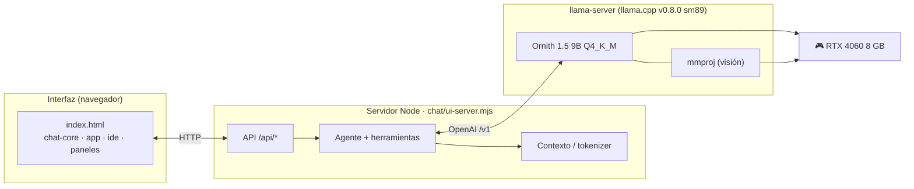
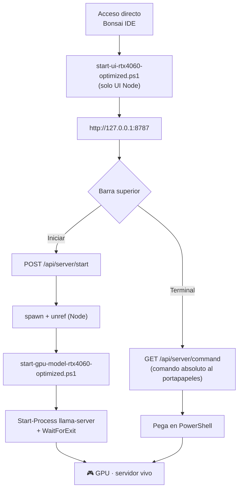
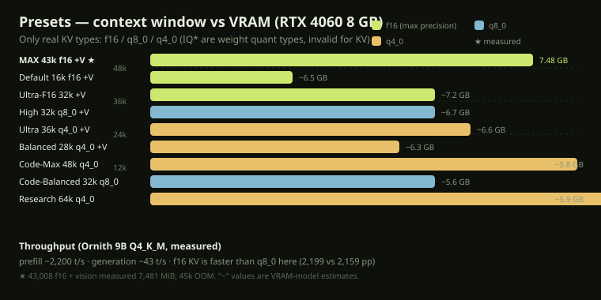
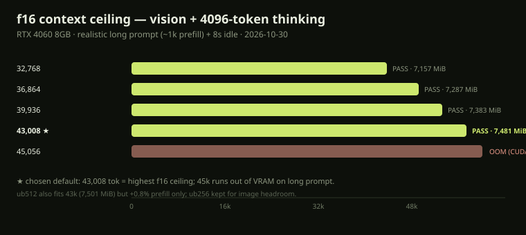
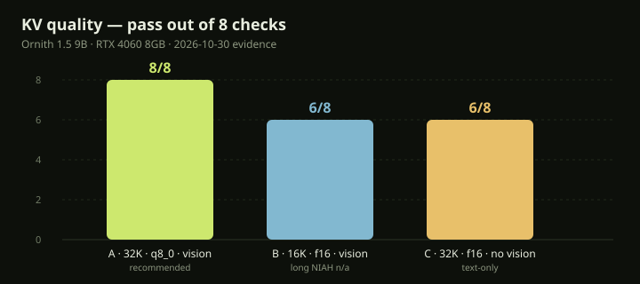
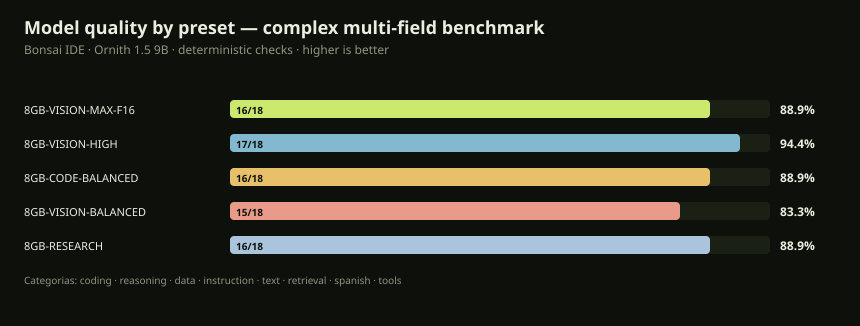

# 🌳 Bonsai Local IDE

**Entorno de desarrollo con IA 100 % local para Windows 10/11.**
Chat con agente, editor con pestañas, diffs, git, terminal integrado, navegador
controlado y visión — todo en tu GPU, sin nube.

<p>
  
  
  
  
  
</p>

> **v1.5.0** — build optimizada de llama.cpp para sm89, plantilla oficial de
> Ornith 1.5 9B (visión + herramientas + razonamiento) y **43.008 tokens por
> defecto con KV f16, visión y pensamiento**. Notas: [RELEASE-1.5.0](docs/RELEASE-1.5.0.md).

---

## ✨ Lo que hace

| Área | Capacidad |
|---|---|
| **Agente** | Edita archivos, ejecuta comandos, corre tests, lee/crea archivos, plan persistente, hasta 192 pasos por turno |
| **Editor** | Pestañas, Ctrl+S, Ctrl+K (edición con diff y guardado atómico), paleta (Ctrl+P), búsqueda (Ctrl+Shift+F) |
| **Contexto** | Tokenizer real del servidor, historial adaptativo y presupuesto honesto (ventana / solicitado / efectivo / reserva de salida) |
| **Visión** | Imágenes pegadas o arrastradas, OCR local opcional, proyector en GPU |
| **Razonamiento** | Panel desplegable del *thinking*; presupuesto configurable (por defecto 4096 tokens) |
| **Herramientas** | Terminal persistente, problemas/diagnósticos, esquema, ir a definición (F12), procesos en segundo plano |
| **Navegador** | Playwright MCP aislado, `evaluar` para diagnósticos JS, WebGL/workers/HMR |
| **Git** | Estado por archivo, selección explícita, sin `add -A` |
| **Seguridad** | Guardados atómicos, punto de deshacer por escritura, rutas confinadas, git seguro |

---

## 🧭 Arquitectura



---

## 🚀 Arranque rápido

```powershell
# 1) Abre el IDE (esto también lo hace el acceso directo del escritorio)
.\scripts\bonsai-rtx4060.ps1 launch

# 2) En la barra superior del IDE elige el preset y pulsa "Iniciar"
#    (o pulsa "Terminal" para copiar el comando exacto de PowerShell)
```



> **Por qué así:** en Windows el hijo muere si el padre termina. El wrapper de
> PowerShell **no sale** (`WaitForExit()`), y Node lo lanza con `windowsHide` +
> `unref()` **sin `detached`**. Resultado: el modelo sigue vivo aunque cierres el
> navegador. [Detalle](docs/RTX4060_OPTIMIZATION_GUIDE.md#how-the-server-lifecycle-works-important).

---

## 🎛️ Presets (RTX 4060 8 GB)



| Preset | Contexto | KV | Visión | Uso |
|---|---:|:--:|:--:|---|
| **`8GB-VISION-MAX-F16`** | **43.008** | **f16** | ✅ | **Por defecto** · máxima precisión y contexto |
| `8GB-VISION-DEFAULT-F16` | 16.384 | f16 | ✅ | Seguro, mucho margen |
| `8GB-VISION-ULTRA-F16` | 32.768 | f16 | ✅ | Precisión alta, contexto medio |
| `8GB-VISION-ULTRA` | 36.864 | q4_0 | ✅ | Contexto alto y barato |
| `8GB-VISION-HIGH` | 32.768 | q8_0 | ✅ | Mejor equilibrio (calidad 8/8) |
| `8GB-VISION-BALANCED` | 28.672 | q4_0 | ✅ | Conservador |
| `8GB-VISION-SAFE` | 24.576 | q4_0 | ✅ | Mucho margen |
| `8GB-CODE-MAX` | 49.152 | q4_0 | — | Código largo |
| `8GB-CODE-BALANCED` | 32.768 | q8_0 | — | Casi sin pérdida |
| `8GB-CODE-FAST` | 16.384 | f16 | — | Máximo throughput |
| `8GB-RESEARCH` | 65.536 | q4_0 | — | Experimental |

---

## 📊 Rendimiento medido (RTX 4060 Laptop 8 GB)

### Techo de contexto con f16 + visión + pensamiento



| Contexto | Resultado | VRAM pico |
|---:|:--:|---:|
| 32.768 | PASS | 7.157 MiB |
| 36.864 | PASS | 7.287 MiB |
| 39.936 | PASS | 7.383 MiB |
| **43.008** | **PASS** | **7.481 MiB** |
| 45.056 | **OOM** | — |

**43.008 es el techo real.** 45k falla con `CUDA error: out of memory` en prefill
largo. El antiguo fallo en reposo a contexto alto era por *context checkpoints*;
el lanzador usa `--ctx-checkpoints 0` para f16 y desaparece.

### Ajuste de parámetros (llama-bench, f16)

| Configuración | pp t/s | tg t/s | Veredicto |
|---|---:|---:|---|
| base b512 ub256 t4 mmap | 2.199,9 | 43,34 | referencia |
| ub512 | **2.218,5** | 43,44 | +0,85 % prefill |
| ub128 | 2.036,6 | 43,38 | peor |
| threads 8 | 2.181,7 | 43,43 | sin mejora |
| no-mmap / mlock | 2.178 / 2.174 | 43,4 | peor |
| **q8_0 KV** | 2.159,3 | 43,15 | más lento y menos preciso |

- **f16 es más rápido que q8_0 aquí**, además de más preciso → se queda f16.
- Prefill ~2.200 t/s, generación ~43 t/s.
- Speculative decoding (~2× generación) necesita ~0,7 GB y **no cabe a 43k f16 + visión**; solo a ≤16k.

### Calidad de KV (A/B/C)



### Calidad por preset — benchmark de tareas complejas



Benchmark determinista (sin jurado humano) sobre **18 tareas** en 8 campos:
implementación y depuración de código (ejecutadas en un sandbox con timeout),
predicción de salida, **parser de expresiones**, **caché LRU**, matemáticas,
lógica, **problemas de tasas**, SQL, instrucciones JSON (**incluido JSON anidado**),
transformación de texto, retrieval de contexto largo (**1 y 2 agujas**), extracción
en español y *tool-calling*. Se ejecuta con pensamiento (1024) y temperatura 0.2
para comparar la precisión real de cada nivel de KV.

```powershell
node scripts/bench-model-quality.mjs                 # 5 presets
node scripts/bench-model-quality.mjs --presets 8GB-VISION-MAX-F16,8GB-RESEARCH
node scripts/bench-model-quality.mjs --tasks coding_hard_calc,data_sql_result
```

Resultados crudos en `reports/bench-quality-<fecha>/`. La gráfica se regenera en
`docs/graficos/bench-quality.svg`.

**Resultado (30-oct-2026, una pasada por preset):**

| Preset | KV | Ctx | Puntos | % | Gen t/s |
|---|---|---:|---:|---:|---:|
| `8GB-VISION-HIGH` | q8_0 | 32.768 | 17/18 | 94,4% | 42,1 |
| `8GB-VISION-MAX-F16` | f16 | 43.008 | 16/18 | 88,9% | 42,3 |
| `8GB-CODE-BALANCED` | q8_0 | 32.768 | 16/18 | 88,9% | 42,1 |
| `8GB-RESEARCH` | q4_0 | 65.536 | 16/18 | 88,9% | 42,1 |
| `8GB-VISION-BALANCED` | q4_0 | 28.672 | 15/18 | 83,3% | 42,1 |

Lectura honesta: con **n=18 y una sola pasada**, las diferencias de 1–2 tareas
**no son significativas**; no hay evidencia de que q8_0/f16/q4_0 cambien la calidad
aquí. Elige por **VRAM y contexto**, no por miedo a la cuantización del KV.

Debilidad común detectada (falla en **todos** los presets): la caché **LRU** — el
modelo hace `delete(key)` y *después* `get(key)`, devolviendo `undefined`. El parser
de expresiones es intermitente (`2+3*4`). Son límites del modelo de 9B, no del KV.

---

## 🧱 Requisitos

- **Windows 10/11** con Windows PowerShell 5.1.
- **Node.js ≥ 22**.
- **GPU NVIDIA** que quepa el modelo entero en VRAM (probado en RTX 4060 8 GB).
  No hay capas en CPU.
- `bin/` con `llama-server.exe` (CUDA) o el build optimizado en
  `.local/opt/bonsai-inference/build-RTX4060-Opt-sm89/bin/`.
- `models/` con el GGUF del catálogo y, para visión, su `mmproj`.
- **Edge/Chrome** para la herramienta `navegador` y las pruebas de navegador.

---

## 🛠️ Build optimizada (opcional, ~20 min)

```powershell
.\scripts\build-rtx4060-optimized.ps1
```

Configura llama.cpp para **sm89** (Ada): FlashAttention v2, CUDA graphs,
`FATTN_TILE_SIZE=128`, 4 warps, `GGML_CUDA_FA_ALL_QUANTS=ON`. La comparativa y
flags están en [RTX4060_OPTIMIZATION_GUIDE](docs/RTX4060_OPTIMIZATION_GUIDE.md).

---

## 🧪 Pruebas

```powershell
npm test                    # 40 suites aisladas (sin GPU) ~2 min
npm run test:navegador      # Edge/Chrome headless (UI, Ctrl+K, humo)
npm run test:gpu            # requiere el modelo real cargado
npm run test:gpu-exclusiva  # calidad KV; exige GPU libre
node scripts/run-tests.mjs --listar   # ver suites por grupo
```

Verificación de la **1.5.0**: `npm test` → **40/40**, arranque por la UI a 43k,
prefill largo (1.982 t/s), 15 s en reposo vivo y parada sin procesos huérfanos.

Herramientas reproducibles añadidas:

```powershell
.\scripts\benchmark-rtx4060-matrix.ps1          # matriz batch/ubatch/threads/mmap/KV
.\scripts\probe-rtx4060-context.ps1 -ContextList "32768,43008,45056" -Vision
```

---

## 📁 Estructura

```text
chat/            servidor de UI, agente, contexto, herramientas y suites de prueba
chat/ui/         index.html, chat-core.js, app.js, ide.js, paneles.js, tema.css, fuentes
scripts/         arranque (start-*.ps1), build, calibración, bench y run-tests.mjs
config/          presets de motor (clásicos + optimizados RTX 4060)
bin/             llama.cpp con CUDA (llama-server y DLL)
models/          GGUF del modelo y proyector de visión (no versionados)
docs/            guía RTX 4060, releases, evidencia y gráficos SVG
reports/         mediciones reproducibles (bench, sonda de contexto, investigación)
salida/          adjuntos y artefactos del agente (no es tu carpeta de trabajo)
```

---

## 🔒 Seguridad y fiabilidad

- Rutas confinadas al proyecto; guardados **atómicos** con copia de recuperación.
- Un **punto de deshacer** por escritura del agente; reversión por turno.
- Git por archivo, con selección explícita (nunca `add -A`).
- Navegador con perfil efímero; puertos del IDE/modelo protegidos.
- La inferencia es local; buscar/descargar dependencias/CDN requiere internet.

---

## 📚 Documentación

| Documento | Contenido |
|---|---|
| [RELEASE-1.5.0](docs/RELEASE-1.5.0.md) | Techo de 43k, mediciones y cambios |
| [RTX4060_OPTIMIZATION_GUIDE](docs/RTX4060_OPTIMIZATION_GUIDE.md) | Ciclo de vida, presets, tuning, troubleshooting |
| [CONTEXTO-Y-DIAGNOSTICO](docs/CONTEXTO-Y-DIAGNOSTICO.md) | Métricas, límites y diagnóstico |
| [SMALL-LOCAL-CODER](docs/SMALL-LOCAL-CODER.md) | Perfil de coding con contexto selectivo |
| [ARQUITECTURA-Y-PLAN-MAESTRO](ARQUITECTURA-Y-PLAN-MAESTRO.md) | Decisiones de diseño |
| [CHANGELOG](CHANGELOG.md) | Historial de versiones |

---

## 📄 Licencia

El código se publica bajo **MIT** ([LICENSE](LICENSE)). Los pesos del modelo, los
binarios de `llama.cpp` y las dependencias de `chat/package.json` conservan sus
propios términos. El repositorio no incluye modelos, binarios ni datos locales.
