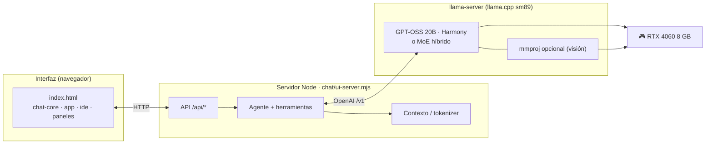
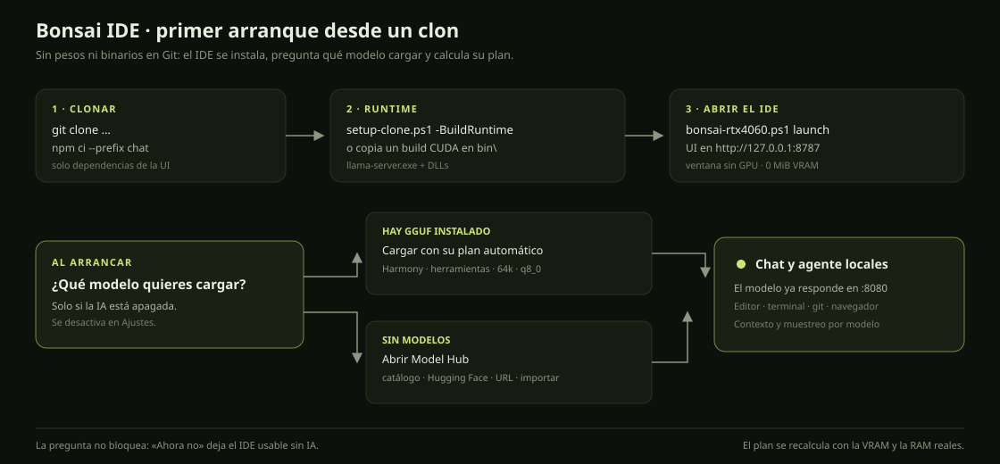
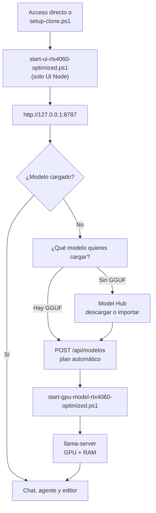

# 🌳 Bonsai Local IDE

**Entorno de desarrollo con IA 100 % local para Windows 10/11.**
Chat con agente, editor con pestañas, diffs, git, terminal integrado, navegador
controlado y visión — todo en tu GPU, sin nube.

<p>
  
  
  
  
  
</p>

> **v1.9.0** — **MoE híbrido**: Qwen3.6-35B-A3B, Qwen3-30B-A3B, GPT-OSS-20B y
> Nemotron 3 Nano reparten expertos entre 8 GB de VRAM y 16 GB de RAM.
> Qwen3.6-35B-A3B corre a **42,5 tok/s** con `--load-mode none`; **GPT-OSS-20B
> gana el benchmark de proyecto real (18/18 tests)** y trabaja a **64k por
> defecto / 128k máximo** con Harmony y muestreo oficial. Catálogo de 34 GGUF
> con plantilla auditada. Al abrir, la UI pregunta qué modelo cargar; si no hay
> ninguno, te lleva al Model Hub. Notas: [RELEASE-1.9.0](docs/RELEASE-1.9.0.md).

---

## ✨ Lo que hace

| Área | Capacidad |
|---|---|
| **Agente** | Edita archivos, ejecuta comandos, corre tests, lee/crea archivos, plan persistente, hasta 192 pasos por turno |
| **Editor** | Pestañas, Ctrl+S, Ctrl+K (edición con diff y guardado atómico), paleta (Ctrl+P), búsqueda (Ctrl+Shift+F) |
| **Contexto** | Tokenizer real del servidor, historial adaptativo y presupuesto honesto (ventana / solicitado / efectivo / reserva de salida) |
| **Visión** | Imágenes pegadas o arrastradas, OCR local opcional, proyector en GPU |
| **Razonamiento** | Panel desplegable del *thinking*; presupuesto configurable (por defecto 4096 tokens) |
| **Herramientas** | Terminal persistente, problemas/diagnósticos, esquema, ir a definición (F12), procesos en segundo plano |
| **Navegador** | Playwright MCP aislado, `evaluar` para diagnósticos JS, WebGL/workers/HMR |
| **Git** | Estado por archivo, selección explícita, sin `add -A` |
| **Seguridad** | Guardados atómicos, punto de deshacer por escritura, rutas confinadas, git seguro |

---

## 🧭 Arquitectura



---

## 🚀 Arranque rápido

### Desde un clon

```powershell
git clone https://github.com/Vahlame/bonsai-local-ide.git
cd bonsai-local-ide

# Comprueba Node, instala chat/node_modules y busca el runtime.
.\scripts\setup-clone.ps1 -NoLaunch
```

Si todavía no tienes `llama-server.exe`, el mismo script puede instalar la
toolchain CUDA y compilar el build sm89 (unos 20 minutos):

```powershell
.\scripts\setup-clone.ps1 -BuildRuntime -NoLaunch
```

Después abre el IDE:

```powershell
.\scripts\bonsai-rtx4060.ps1 launch
```

También puedes copiar un build CUDA compatible en `bin\`
(`llama-server.exe` + sus DLL). Los pesos y el runtime **no viajan en Git**:
el repositorio es el IDE, no un disco de 15 GB.

Al abrir la UI:

1. si la IA está apagada, aparece **¿Qué modelo quieres cargar?** con los
   modelos instalados y el recomendado primero;
2. si `models/` está vacío, el diálogo explica cómo empezar y abre el
   **Model Hub** para descargar un GGUF o importar uno local;
3. el modelo elegido arranca con su plantilla, muestreo y contexto automáticos
   (GPT-OSS-20B usa **64k** por defecto).

La pregunta se puede desactivar en **Ajustes → Preguntar modelo al iniciar**.
Guía paso a paso: [PRIMER-ARRANQUE](docs/PRIMER-ARRANQUE.md).



El IDE se abre en una **ventana de aplicación** (sin barra de direcciones) y **sin
GPU**: `scripts/open-ide.ps1` usa Edge/Chrome con `--disable-gpu` y un perfil aislado,
así que la NVIDIA queda entera para el modelo. Comprobado con la ventana abierta:
**0 MiB de VRAM**. La barra de estado muestra «UI · CPU». ¿Prefieres una pestaña
normal? `.\scripts\open-ide.ps1 -Tab`.

> **Si el acceso directo no abre nada:** no debe llevar `-NoBrowser` (arranca la
> interfaz pero no abre ventana). Regenéralo con
> `.\scripts\crear-acceso-directo.ps1`.



> **Por qué así:** en Windows el hijo muere si el padre termina. El wrapper de
> PowerShell **no sale** (`WaitForExit()`), y Node lo lanza con `windowsHide` +
> `unref()` **sin `detached`**. Resultado: el modelo sigue vivo aunque cierres el
> navegador. [Detalle](docs/RTX4060_OPTIMIZATION_GUIDE.md#how-the-server-lifecycle-works-important).

---

## 🎛️ Presets (RTX 4060 8 GB)


| Preset | Contexto | KV | Visión | Uso |
|---|---:|:--:|:--:|---|
| **`8GB-VISION-MAX-Q8-100K`** | **110.592** | **q8_0** | ✅ CPU | **Por defecto** · contexto máximo con KV casi sin pérdida |
| `8GB-VISION-MAX-Q8` | 71.680 | q8_0 | ✅ GPU | Visión rápida (~2 s/imagen) |
| `8GB-VISION-MAX-Q4` | 110.592 | q4_0 | ✅ GPU | Contexto máximo con visión rápida |
| `8GB-VISION-MAX-F16` | 43.008 | f16 | ✅ GPU | Precisión máxima de KV |
| `8GB-VISION-DEFAULT-F16` | 16.384 | f16 | ✅ | Seguro, mucho margen |
| `8GB-VISION-ULTRA-F16` | 32.768 | f16 | ✅ | Precisión alta, contexto medio |
| `8GB-VISION-ULTRA` | 36.864 | q4_0 | ✅ | Contexto alto y barato |
| `8GB-VISION-HIGH` | 32.768 | q8_0 | ✅ | Equilibrio (calidad 8/8) |
| `8GB-VISION-BALANCED` | 28.672 | q4_0 | ✅ | Conservador |
| `8GB-VISION-SAFE` | 24.576 | q4_0 | ✅ | Mucho margen |
| `8GB-CODE-MAX` | 49.152 | q4_0 | — | Código largo |
| `8GB-CODE-BALANCED` | 32.768 | q8_0 | — | Casi sin pérdida |
| `8GB-CODE-FAST` | 16.384 | f16 | — | Máximo throughput |
| `8GB-RESEARCH` | 65.536 | q4_0 | — | Experimental |

---

## 🗂️ Model Hub: trae tus propios modelos

El botón **Modelos** de la barra superior abre el catálogo. Desde ahí puedes:

- **Descubrir** en vivo los GGUF con más tracción en Hugging Face, sin listas
  que envejezcan;
- buscar en **Hugging Face** y ver los GGUF de cada repo con su tamaño y
  cuantización;
- descargar del catálogo curado (Qwen3 4B, Qwen2.5 Coder 7B, Gemma 3 4B con
  visión, Llama 3.2 3B, DeepSeek R1 Distill 7B…), por **URL directa** o
  importando un `.gguf` que ya tengas;
- seguir el progreso, cancelar y **reanudar** una descarga cortada;
- verificar el **SHA-256** y registrar el modelo sin reiniciar el IDE;
- correr **MoE grandes** repartiendo expertos entre VRAM y RAM: Qwen3.6-35B-A3B
  a **42 tok/s** con 8 GB de VRAM (`--n-cpu-moe` + `--load-mode none`);
- **benchmark de coding real** con proyecto multifichero y tests ocultos:
  GPT-OSS-20B **18/18** en el proyecto, Qwen3.6-35B-A3B **17/18 + 10/10** en
  bugfix;
- **benchmark de web app real**: Taskboard full-stack con API y UI probada en
  navegador; GPT-OSS-20B **8/8 API + 3/3 UI**.

Cada modelo recibe su propio **plan automático**: el IDE lee la cabecera del
GGUF (capas, cabeceras KV, contexto nativo, `full_attention_interval`) y decide
contexto, KV f16/q8_0/q4_0 y si el proyector de visión va en GPU o CPU. También
se puede lanzar desde la línea de comandos:

```powershell
node scripts/hub.mjs list
node scripts/hub.mjs search "qwen2.5 coder"
node scripts/hub.mjs download qwen3-4b-2507
node scripts/model-lab.mjs probe --all
```

El **Model Lab** arranca cada modelo con su plan y mide arranque, VRAM pico,
TTFT, tok/s, JSON, código ejecutado, tool-calling, retrieval y visión. Los
resultados quedan en `reports/model-lab-<fecha>/` y en el registro local.

👉 [Guía del Model Hub](docs/MODEL-HUB.md) ·
[Strata y la memoria: cómo meter más en menos RAM](docs/STRATA-Y-MEMORIA.md)

**Estado de este equipo:** 29 modelos curados instalados (15 con visión) + Ornith;
**30 modelos utilizables** en total, incluidos 4 MoE de 20–35B. El catálogo, los
planes medidos y el ranking de coding están en
[MODEL-CATALOG-2026-10-31](reports/MODEL-CATALOG-2026-10-31.md),
[MOE-2026-10-31](reports/MOE-2026-10-31.md) y
[CODING-2026-10-31](reports/CODING-2026-10-31.md).
**Para un proyecto complicado desde cero: GPT-OSS-20B. Para bugfix rápido:
Qwen3.6-35B-A3B o Qwen3-30B-A3B.**

---

## 📊 Rendimiento medido (RTX 4060 Laptop 8 GB)

### Techo de contexto con f16 (histórico, 28-oct-2026)


| Contexto | Resultado | VRAM pico |
|---:|:--:|---:|
| 32.768 | PASS | 7.157 MiB |
| 36.864 | PASS | 7.287 MiB |
| 39.936 | PASS | 7.383 MiB |
| **43.008** | **PASS** | **7.481 MiB** |
| 45.056 | **OOM** | — |

**43.008 es el techo con KV f16** (45k falla con `CUDA error: out of memory` en
prefill largo). Por eso f16 ya no es el preset por defecto: con q8_0/q4_0 la ventana
sube a 71k/110k. El antiguo fallo en reposo a contexto alto era por *context
checkpoints*; el lanzador usa `--ctx-checkpoints 0` para todos los KV.

### Ajuste de parámetros (llama-bench, f16)

| Configuración | pp t/s | tg t/s | Veredicto |
|---|---:|---:|---|
| base b512 ub256 t4 mmap | 2.199,9 | 43,34 | referencia |
| ub512 | **2.218,5** | 43,44 | +0,85 % prefill |
| ub128 | 2.036,6 | 43,38 | peor |
| threads 8 | 2.181,7 | 43,43 | sin mejora |
| no-mmap / mlock | 2.178 / 2.174 | 43,4 | peor |
| **q8_0 KV** | 2.159,3 | 43,15 | más lento y menos preciso |

- **f16 es más rápido que q8_0 aquí**, además de más preciso → se queda f16.
- Prefill ~2.200 t/s, generación ~43 t/s.
- Speculative decoding (~2× generación) necesita ~0,7 GB y **no cabe a 43k f16 + visión**; solo a ≤16k.

### Calidad de KV (A/B/C)


### Calidad por preset — benchmark de tareas complejas


Benchmark determinista (sin jurado humano) sobre **18 tareas** en 8 campos:
implementación y depuración de código (ejecutadas en un sandbox con timeout),
predicción de salida, **parser de expresiones**, **caché LRU**, matemáticas,
lógica, **problemas de tasas**, SQL, instrucciones JSON (**incluido JSON anidado**),
transformación de texto, retrieval de contexto largo (**1 y 2 agujas**), extracción
en español y *tool-calling*. Se ejecuta con pensamiento (1024) y temperatura 0.2
para comparar la precisión real de cada nivel de KV.

```powershell
node scripts/bench-model-quality.mjs                 # 5 presets
node scripts/bench-model-quality.mjs --presets 8GB-VISION-MAX-F16,8GB-RESEARCH
node scripts/bench-model-quality.mjs --tasks coding_hard_calc,data_sql_result
```

Resultados crudos en `reports/bench-quality-<fecha>/`. La gráfica se regenera en
`docs/graficos/bench-quality.svg`.

**Resultado (30-oct-2026, una pasada por preset):**

| Preset | KV | Ctx | Puntos | % | Gen t/s |
|---|---|---:|---:|---:|---:|
| `8GB-VISION-HIGH` | q8_0 | 32.768 | 17/18 | 94,4% | 42,1 |
| `8GB-VISION-MAX-F16` | f16 | 43.008 | 16/18 | 88,9% | 42,3 |
| `8GB-CODE-BALANCED` | q8_0 | 32.768 | 16/18 | 88,9% | 42,1 |
| `8GB-RESEARCH` | q4_0 | 65.536 | 16/18 | 88,9% | 42,1 |
| `8GB-VISION-BALANCED` | q4_0 | 28.672 | 15/18 | 83,3% | 42,1 |

Lectura honesta: con **n=18 y una sola pasada**, las diferencias de 1–2 tareas
**no son significativas**; no hay evidencia de que q8_0/f16/q4_0 cambien la calidad
aquí. Elige por **VRAM y contexto**, no por miedo a la cuantización del KV.

Debilidad común detectada (falla en **todos** los presets): la caché **LRU** — el
modelo hace `delete(key)` y *después* `get(key)`, devolviendo `undefined`. El parser
de expresiones es intermitente (`2+3*4`). Son límites del modelo de 9B, no del KV.

**Prueba de varianza (5 repeticiones, q8_0 vs f16):** ambos **6/10**. La tarea
`coding_hard_calc` alterna OK/FAIL en **los dos** (q8_0: OK,FAIL,FAIL,FAIL,OK;
f16: FAIL,FAIL,OK,FAIL,FAIL). Es la prueba de que el 94,4 % de q8_0 fue **una
muestra con suerte**, no precisión del KV.

### Techo de contexto por tipo de KV (GPU dedicada)


En una RTX 4060 dedicada al modelo (pantalla en la APU). **Visión siempre activada**;
cada valor pasó una prueba de 3 agujas al 10/50/90 % con ese número real de tokens:

| KV | Proyector de visión | Contexto máximo | Retrieval real | VRAM pico | Siguiente paso |
|---|---|---:|---:|---:|---:|
| f16 | GPU | 43.008 | PASS 33.373 tok | 7.481 MiB | 45.056 OOM |
| q8_0 | GPU | 71.680 | PASS 56.306 tok | 7.543 MiB | 73.728 OOM |
| q4_0 | GPU | 110.592 | PASS 87.433 tok | 7.497 MiB | 114.688 OOM |
| **q8_0** | **CPU (`--no-mmproj-offload`)** | **110.592** | **PASS 87.433 tok** | **7.650 MiB** | 114.688 OOM |
| q8_0 | sin visión | 110.592 | — | 7.481 MiB | 114.688 OOM |

**La clave para los ~100k con q8_0 + visión**: el proyector de visión (879 MiB) se
saca de la VRAM (`mmprojCPU`). La ventana sube de **71.680 → 110.592** sin tocar el
KV (sigue q8_0, casi sin pérdida). Coste honesto: cada imagen se codifica en CPU y
tarda **~15 s** (captura 1200×528 + respuesta de 120 tokens), frente a ~2 s con el
proyector en GPU. Si usas capturas constantemente, el preset de 71k con visión en
GPU es más cómodo; si quieres contexto máximo, el de 110k.


Por eso el preset por defecto es **`8GB-VISION-MAX-Q8-100K`** (110.592 · q8_0 ·
visión · 4096 de pensamiento). Alternativas: `8GB-VISION-MAX-Q8` (71k, visión
rápida), `8GB-VISION-MAX-Q4` (110k, visión en GPU), `8GB-VISION-MAX-F16` (43k, f16).
Reproducir: `scripts/probe-rtx4060-context.ps1` y `scripts/probe-longctx.ps1 -Image`.

### Reparto del contexto (estilo modelos frontera)

La ventana no se reparte a mano: **historial = ventana − reserva de salida − margen**.
La reserva incluye el pensamiento, así que el razonamiento no se come la respuesta.
Con el preset por defecto (110.592):


| Parte | Tokens | Qué es |
|---|---:|---|
| Historial | ~98.176 | Conversación, archivos, resultados de herramientas y resumen compactado |
| Pensamiento | 4.096 | Presupuesto de razonamiento (se gasta antes de responder) |
| Respuesta / edición | ~7.936 | Texto final o escritura de archivo |
| Margen | 128 | Red de seguridad del servidor |

En `8GB-VISION-MAX-Q8` (71.680) queda en ~59.264 de historial + 12.288 de salida.
`historial = 0` en Ajustes significa **automático** (lo anterior); un número fijo
pone un techo manual. Los turnos viejos no se tiran: se **compactan** con el modelo
en notas estructuradas (`OBJETIVO`, `DECISIONES`, `ARCHIVOS`, `COMANDOS Y PRUEBAS`,
`ERRORES ABIERTOS`, `PENDIENTE`) de hasta ~6 % de la ventana (1k–8k tokens), y el
historial original sigue guardado en la sesión.

### Muestreo: la mejor configuración medida


Matriz de 10 configuraciones (temp / top_p / top_k / min_p / penalizaciones) sobre
12 tareas difíciles, 2 repeticiones; los 3 primeros se revalidaron a 5 repeticiones:

| Config | Puntuación |
|---|---:|
| **T0.6 · p0.90 · k20 · min_p0.05** | **73,3 %** (22/30) |
| T0.6 · p0.95 · k20 (tarjeta code) | 70,0 % (21/30) |
| T0.2 · p0.95 · k20 | 63,3 % (19/30) |
| T0.6 · p0.90 · k20 · m0.05 (1.ª pasada, 24 muestras) | 87,5 % (21/24) |
| T0.7 · p0.80 · k20 (tarjeta chat) | 83,3 % (20/24) |
| T1.0 · p0.95 · k20 · m0.05 (tarjeta razón) | 83,3 % (20/24) |
| T0.6 · p0.95 · k20 · presence1.5 | 83,3 % (20/24) |
| T0.8 · p0.95 · k20 · m0.05 | 83,3 % (20/24) |
| T0.6 · p0.95 · k20 · repeat1.1 | 79,2 % (19/24) |
| greedy (T0) | 75,0 % (18/24) |

Honesto: 22 vs 21 es **una** tarea; la ventaja no es enorme. Pero el ganador se
mantuvo en las dos pasadas y **greedy fue el peor** (repite el mismo error siempre)
mientras `repeat_penalty 1.1` **rompió la puntuación**. Es el default actual en
`chat/modelo.json` y en el lanzador.

```powershell
# media con repeticiones
node scripts/bench-model-quality.mjs --presets 8GB-VISION-HIGH,8GB-VISION-MAX-F16 `
  --tasks coding_hard_calc,text_transform_reverse --repeat 5
# reconstruir solo la grafica desde un results.json
node scripts/bench-model-quality.mjs --chart-from reports/bench-quality-<fecha>/results.json
```

### Proyecto complejo real (honesto: el 9B sufre)


`scripts/bench-project.mjs` pide un proyecto Node ESM multi-archivo (`taskforge`:
cola de prioridad con FIFO + scheduler con concurrencia y reintentos + tests
`node:test`), escribe los archivos y **ejecuta `node --test`**. La nota es el
porcentaje de tests que pasan de verdad, no "parece correcto". 2 repeticiones por
preset, pensamiento 2048, visión activada:

| Preset | Tests | Pasan | % | Todo OK | Visión |
|---|---:|---:|---:|:--:|:--:|
| `8GB-VISION-MAX-F16` | 14 | 8 | **57 %** | no | no |
| `8GB-VISION-MAX-Q8` | 18 | 6 | **33 %** | no | no |
| `8GB-VISION-MAX-Q4` | 9 | 2 | **22 %** | no | no |

Lectura honesta: ninguna pasada deja la suite entera en verde; el modelo genera los
5 archivos y una parte de los tests, pero falla en la cola de prioridad y en los
reintentos del scheduler. La comprobación de visión sobre una captura del IDE
**falló en los tres** (respuestas que no nombraban los paneles esperados). No es un
problema de KV ni de contexto: es el límite del modelo de 9B en tareas multi-archivo.
Sirve para comparar presets, no para prometer que el proyecto saldrá perfecto.

---

## 🧱 Requisitos

- **Windows 10/11** con Windows PowerShell 5.1.
- **Node.js ≥ 22**.
- **GPU NVIDIA**. Los modelos densos caben enteros en VRAM; los MoE híbridos
  reparten expertos entre VRAM y RAM (probado en RTX 4060 8 GB + 16 GB RAM).
- `bin/` con `llama-server.exe` (CUDA) o el build optimizado en
  `.local/opt/bonsai-inference/build-RTX4060-Opt-sm89/bin/`.
  `.\scripts\setup-clone.ps1` comprueba la ruta y `-BuildRuntime` compila.
- `models/` con los GGUF. Si está vacío, la UI arranca igual y ofrece el
  **Model Hub** para descargar el catálogo curado o importar un `.gguf`.
- **Edge/Chrome** para la herramienta `navegador` y las pruebas de navegador.

---

## 🛠️ Build optimizada (opcional, ~20 min)

```powershell
.\scripts\build-rtx4060-optimized.ps1
```

Configura llama.cpp para **sm89** (Ada): FlashAttention v2, CUDA graphs,
`FATTN_TILE_SIZE=128`, 4 warps, `GGML_CUDA_FA_ALL_QUANTS=ON`. La comparativa y
flags están en [RTX4060_OPTIMIZATION_GUIDE](docs/RTX4060_OPTIMIZATION_GUIDE.md).

---

## 🧪 Pruebas

```powershell
npm test                    # 42 suites aisladas (sin GPU) ~2 min
npm run test:navegador      # Edge/Chrome headless (UI, Ctrl+K, primer arranque)
npm run test:gpu            # requiere el modelo real cargado
npm run test:gpu-exclusiva  # calidad KV; exige GPU libre
node scripts/run-tests.mjs --listar   # ver suites por grupo
```

Verificación de la **1.9.0**: `npm test` → **42/42**, `npm run test:navegador` →
**6/6**, primer arranque sin modelos verificado, IDE en ventana propia con
**0 MiB de VRAM** y capturas revisadas a 1920×1080, 1600×900, 1366×768 y
1024×768.

Herramientas reproducibles añadidas:

```powershell
.\scripts\benchmark-rtx4060-matrix.ps1          # matriz batch/ubatch/threads/mmap/KV
.\scripts\probe-rtx4060-context.ps1 -ContextList "32768,43008,45056" -Vision
```

---

## 📁 Estructura

```text
chat/            servidor de UI, agente, contexto, herramientas y suites de prueba
chat/ui/         index.html, chat-core.js, app.js, ide.js, paneles.js, tema.css, fuentes
scripts/         arranque (start-*.ps1), build, calibración, bench y run-tests.mjs
config/          presets de motor (clásicos + optimizados RTX 4060)
bin/             llama.cpp con CUDA (llama-server y DLL)
models/          GGUF del modelo y proyector de visión (no versionados)
docs/            guía RTX 4060, releases, evidencia y gráficos SVG
reports/         mediciones reproducibles (bench, sonda de contexto, investigación)
salida/          adjuntos y artefactos del agente (no es tu carpeta de trabajo)
```

---

## 🔒 Seguridad y fiabilidad

- Rutas confinadas al proyecto; guardados **atómicos** con copia de recuperación.
- Un **punto de deshacer** por escritura del agente; reversión por turno.
- Git por archivo, con selección explícita (nunca `add -A`).
- Navegador con perfil efímero; puertos del IDE/modelo protegidos.
- La inferencia es local; buscar/descargar dependencias/CDN requiere internet.

---

## 📚 Documentación

| Documento | Contenido |
|---|---|
| [PRIMER-ARRANQUE](docs/PRIMER-ARRANQUE.md) | Clon limpio: dependencias, runtime, modelos y primer modelo |
| [RELEASE-1.9.0](docs/RELEASE-1.9.0.md) | MoE híbrido: 30–35B en 8 GB VRAM |
| [RELEASE-1.8.0](docs/RELEASE-1.8.0.md) | Catálogo de 25 modelos y descubrimiento online |
| [RELEASE-1.7.0](docs/RELEASE-1.7.0.md) | Model Hub, plan por modelo y Model Lab |
| [MODEL-HUB](docs/MODEL-HUB.md) | Catálogo, descargas, API y plan automático |
| [INFERENCE-TOOLCHAIN](docs/INFERENCE-TOOLCHAIN.md) | CUDA, compilación y profiling reproducible |
| [STRATA-Y-MEMORIA](docs/STRATA-Y-MEMORIA.md) | Qué es Strata y qué ideas de memoria aplican aquí |
| [MODEL-HUB-2026-10-31](reports/MODEL-HUB-2026-10-31.md) | Evidencia: planes, VRAM, calidad y tuning por modelo |
| [MODEL-CATALOG-2026-10-31](reports/MODEL-CATALOG-2026-10-31.md) | Catálogo completo: 30 modelos usables, visión y planes |
| [MOE-2026-10-31](reports/MOE-2026-10-31.md) | MoE de 30-35B en 8 GB VRAM: reparto VRAM/RAM/SSD y tok/s |
| [CODING-2026-10-31](reports/CODING-2026-10-31.md) | Proyecto real con tests ocultos: ranking de coding y pipeline |
| [GPTOSS-2026-10-31](reports/GPTOSS-2026-10-31.md) | Perfil GPT-OSS: Harmony, 64k/128k, muestreo y Hub |
| [CODER-PIPELINE-2026-10-31](reports/CODER-PIPELINE-2026-10-31.md) | Agente con herramientas: ablaciones y perfil `moe-fast` |
| [WEBAPP-2026-10-31](reports/WEBAPP-2026-10-31.md) | Taskboard full-stack: API + UI real en navegador |
| [ENGINE-2026-10-31](reports/ENGINE-2026-10-31.md) | Tuning de tok/s, ngram, draft, batch, VRAM y clocks |
| [RELEASE-1.6.2](docs/RELEASE-1.6.2.md) | Acceso directo: abre el IDE de verdad (sin `-NoBrowser`) |
| [RELEASE-1.6.1](docs/RELEASE-1.6.1.md) | IDE sin GPU, ventana propia y pulido de interfaz |
| [RELEASE-1.6.0](docs/RELEASE-1.6.0.md) | 110k con visión, reparto de contexto automático y compactación |
| [RELEASE-1.5.1](docs/RELEASE-1.5.1.md) | KV preset fix y benchmark de calidad |
| [RTX4060_OPTIMIZATION_GUIDE](docs/RTX4060_OPTIMIZATION_GUIDE.md) | Ciclo de vida, presets, tuning, troubleshooting |
| [CONTEXTO-Y-DIAGNOSTICO](docs/CONTEXTO-Y-DIAGNOSTICO.md) | Métricas, límites y diagnóstico |
| [SMALL-LOCAL-CODER](docs/SMALL-LOCAL-CODER.md) | Perfil de coding con contexto selectivo |
| [ARQUITECTURA-Y-PLAN-MAESTRO](docs/archive/ARQUITECTURA-Y-PLAN-MAESTRO.md) | Decisiones de diseño (histórico) |
| [CHANGELOG](CHANGELOG.md) | Historial de versiones |

---

## 📄 Licencia

El código se publica bajo **MIT** ([LICENSE](LICENSE)). Los pesos del modelo, los
binarios de `llama.cpp` y las dependencias de `chat/package.json` conservan sus
propios términos. El repositorio no incluye modelos, binarios ni datos locales.
