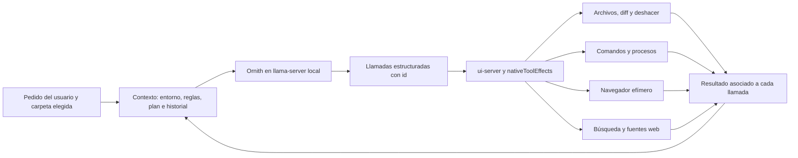

# Auditoría y corrección del harness local · 28 de octubre de 2026

El producto debe permitir desarrollar aplicaciones web y nativas, juegos, scripts,
servidores y proyectos con varios procesos usando inferencia local. Eso incluye
compilar, probar, depurar, instalar dependencias, usar SDKs y herramientas de análisis,
ingeniería inversa, codificación y decodificación, y consultar documentación en internet.

Las herramientas del IDE deben permitir esos flujos. El resultado de cada proyecto
todavía depende del modelo, de las herramientas instaladas y de la validación técnica
del software que produzca. Esta auditoría no certifica juegos completos ni drivers.

## Evidencia de la conversación

Se examinó `chat/ui-session.json`, conservando el historial del usuario. Contenía
1.327 mensajes, 1.310 plegados y 681 llamadas: 302 lecturas, 123 comandos, 87 acciones
de navegador, 61 escrituras, 58 reemplazos, 25 índices, 14 planes, 7 gestiones de
procesos y 4 borrados. El cierre registrado era `step_limit`, con 192 pasos.

| Evidencia | Causa | Corrección |
|---|---|---|
| Mensajes 47, 247, 315, 347 y 1170: URL local en `ruta` rechazada como archivo | El navegador escogía el campo `ruta` antes que `url` y nunca identificaba una URL en ese campo | Se normaliza el destino; `url` explícita tiene prioridad y una URL en `ruta` se acepta |
| Mensajes 251, 690 y 830: `indice(carpeta: ".")` denegado | La comprobación prohibía el componente `.` incluso cuando representaba la raíz | Se resuelve contra la carpeta seleccionada y se acepta su raíz |
| Mensajes 55 y 1155: `taskkill` denegado | Lista de palabras prohibidas aplicada incluso en Permisos → todo | El modo autónomo permite comandos de desarrollo y gestión de procesos |
| Mensajes 617 y 1164: `head` y `Out-File` enviados a cmd | Contexto insuficiente y mezcla de sintaxis | Se anuncia Windows real, build, shell, cwd, Python y tiempo configurado |
| Intentos de escribir JavaScript en `body`, `#status` y mediante `tecla` | Faltaba una operación de evaluación JavaScript | `navegador evaluar` recibe `expresion`; también se inspecciona texto oculto y stack de errores |
| Selección de tema con `escribir` sobre un select | La herramienta solo ejecutaba `fill()` | Se usa `selectOption()` cuando el control es un select |
| Mensajes contradictorios sobre el servidor | Se preparaba un resultado correcto y después se sobrescribía con el texto antiguo “hasta el final del turno” | Un único resultado conserva id, pid y duración real |
| Muchas lecturas y capturas repetidas | Un índice o una captura idéntica contaban como progreso | La evidencia repetida se devuelve al modelo, pero no mantiene el bucle indefinidamente |

También había errores reales de la aplicación: el historial muestra un canvas con
`id="scene"`, un módulo alternativo buscando `id="canvas"` y un HTML de diagnóstico
que busca un canvas ausente. El harness contribuyó al atasco, pero no explica todos
los defectos del juego. No se modificó ese proyecto externo durante esta auditoría.

## Interacción del modelo con el IDE

`bonsai-chat.mjs` empaqueta mensajes y consulta el servidor local. `actions.mjs`
declara las herramientas y traduce sus argumentos. `ui-server.mjs` ejecuta los
efectos y devuelve resultados con el id de la llamada correspondiente. El contexto
se actualiza con hechos observados, un plan persistente y notas del historial.

La repetición tiene dos límites distintos: el presupuesto configurable de pasos y
la falta de evidencia nueva. Ocho pasos consecutivos sin evidencia nueva cierran
el turno como `stalled`, dejando explícito que está incompleto. Una secuencia de
lecturas distintas o cambios reales sigue avanzando; no existe un veto a releer.

## Contrato de archivos, comandos y procesos

La carpeta seleccionada, actualmente externa a la instalación del IDE en la sesión
analizada, es la raíz real de las herramientas de archivos y el cwd inicial de los
comandos. `entorno.mjs` detecta Windows 10 build 19044 en este equipo; no presupone
Windows 11 ni PowerShell 7. El agente y la terminal comparten la shell cmd y el
entorno preparado para encontrar Python.

Las herramientas aceptan rutas relativas y absolutas contenidas en el proyecto.
Aceptan texto en formatos nativos, por ejemplo `.csproj`, `.godot`, `.tscn`, `.tres`,
archivos de configuración y nombres sin extensión como `Dockerfile`. Los nombres
`bin`, `models`, `logs` y `node_modules` no hacen privada una carpeta del proyecto.
El recorrido general sigue omitiendo dependencias y salidas voluminosas para no
llenar el contexto; una petición explícita puede trabajar con ellas.

Los binarios se generan o transforman con compiladores y scripts mediante
`ejecutar`. El guardado de texto conserva reemplazo atómico y puntos de deshacer;
rechaza cruces de raíz, enlaces descendientes, nombres inválidos de Windows y
escritura directa en `.git`. La comprobación de enlaces sigue siendo best effort,
con la ventana TOCTOU documentada en `archivos-seguros.mjs`.

Permisos → todo permite rutas de herramientas, instaladores, comandos largos,
tuberías, scripts y gestión de procesos. Se conservan comprobaciones de tamaño,
NUL y operaciones destructivas evidentes del sistema. Una expresión regular no
aísla código arbitrario: los comandos tienen los permisos del usuario de Windows.
El modo de confirmación conserva el comportamiento limitado anterior.

Un proceso con `segundo_plano: true` sobrevive al turno. `proceso listar` devuelve
ids y pids; `proceso leer` devuelve salida actual, estado y código final, y
`proceso detener` detiene ese árbol. Se conservan hasta 50 resultados terminados.
Eso permite observar compilaciones e instalaciones largas sin dejarlas sin salida.
El cierre normal del IDE detiene sus procesos; una terminación forzada del sistema
no garantiza que se ejecuten los manejadores de limpieza.

Las comprobaciones HTTP se vuelven a ejecutar aunque no hayan cambiado archivos.
`ejecutar(repetir: true)` permite forzar otra comprobación del estado externo.
Los límites de pasos, continuación y duración del comando ahora se guardan realmente
desde Ajustes; la API antes descartaba esos campos. El tiempo admite hasta 30 min.

## Navegador e investigación

El perfil predeterminado `desarrollo` conserva WebGL, workers, service workers,
dependencias web, APIs y WebSocket/HMR. Cada navegador usa un perfil temporal propio,
sin las sesiones personales del usuario. Los puertos del IDE y del modelo siguen
protegidos. El perfil `aislado`, seleccionable mediante `BONSAI_BROWSER_POLICY`,
conserva el confinamiento al origen y el bloqueo de conexiones auxiliares.

`evaluar` ejecuta JavaScript en la página de prueba, devuelve un resultado acotado
y cierra el navegador si la evaluación supera seis segundos. Los errores incluyen
stack y el estado de canvas. El proxy cierra también las conexiones actualizadas a
WebSocket para evitar que el navegador quede pendiente al finalizar.

La investigación tiene dos operaciones: `buscar` devuelve fuentes con título, URL
y resumen; `leer_web` lee la fuente, informa de su URL final y permite paginar el
texto y seguir sus enlaces. Usa DuckDuckGo y, si no obtiene fuentes extraíbles,
Bing RSS. Los errores, captchas, formatos no textuales y cancelaciones se comunican
sin inventar contenido. Las descargas tienen límites de tamaño y redirecciones.

La revisión final extendió la protección de puertos a `buscar`/`leer_web`: no pueden
consultar la interfaz ni la API del modelo, tampoco mediante redirecciones. Las APIs
locales del proyecto en otros puertos siguen disponibles. La regresión comprueba
el rechazo antes de descargar y la devolución del error al modelo con el id correcto.

Se probó una búsqueda y lectura reales de la documentación de Node.js. Las pruebas
automáticas cubren el buscador alternativo, orden variable de atributos HTML,
extracción de artículos, paginación, cancelación y límites. Las instrucciones al
modelo piden contrastar documentación original, comprobar versiones y citar las
URLs leídas. Buscar, descargar dependencias y cargar recursos externos requiere
internet; la inferencia no sale del equipo.

## Alcance de la validación

Las suites aisladas usan un modelo simulado y proyectos temporales; verifican el
contrato y la ejecución real de comandos, archivos y servidores. Incluyen el flujo
`indice(".") → servidor → dos consultas HTTP → cierre del turno`, lectura de logs
de procesos, repetición explícita y lectura de fuentes devuelta al modelo.

Las suites de navegador verifican Edge real, WebGL2, workers, service workers,
WebSocket, varias APIs locales, recursos de dependencias, inspección, JavaScript,
cancelación y el modo aislado. Las pruebas de GPU real son independientes y sus
resultados deben citar el contexto, KV, visión y log exactos de cada arranque.

La validación del harness no equivale a validar cada SDK, driver o aplicación que
pueda producir Ornith. Los proyectos con herramientas especiales deben comprobar
su compilación, ejecución y comportamiento en su entorno real.

## Mapa de restricciones y modelo de permisos

| Recurso/operación | Componente | Política aplicada y alcance |
|---|---|---|
| Leer e indexar el proyecto | `lecturas.mjs`, `ui-server.mjs`, `archivos-seguros.mjs` | Raíz seleccionada, rutas absolutas internas y `.`; rechaza escapes y enlaces descendientes |
| Escribir, mover y borrar texto | `actions.mjs`, `archivos-seguros.mjs` | Formatos nativos, tamaño y NUL; reemplazo atómico, precondiciones y deshacer; `.git` protegido |
| Ejecutables, SDKs y package managers externos | `actions.mjs`, `procesos.mjs`, `terminal.mjs` | Rutas externas admitidas en modo autónomo; procesos con permisos del usuario de Windows |
| Confirmación | `ui-server.mjs`, `actions.mjs` | Selección explícita Preguntar/todo; el modo limitado aún conserva reglas por sintaxis y ruta |
| Builds y servidores largos | `procesos.mjs`, `ui-server.mjs` | Registro id/pid, lectura actual de logs, código final y parada del árbol; sobreviven al turno |
| Preview y depuración | `navegador.mjs` | Perfil temporal; desarrollo admite varios servicios, workers y WebGL; aislamiento opcional |
| Puertos del IDE y del modelo | `navegador.mjs`, `investigacion.mjs`, `ui-server.mjs` | Protegidos ante navegación, recursos web, WebSocket y lectura HTTP, también tras redirección |
| Contexto y límites del agente | `context.mjs`, `bonsai-chat.mjs`, `ui-server.mjs` | Sistema/build, shell, cwd, presupuesto real y ajustes persistidos; atasco no se presenta como éxito |

Las restricciones de raíz, enlaces, integridad de guardado y estado del IDE son
justificadas. Prohibir por nombre `bin/models/logs`, rechazar `.` o confundir una
URL local con un archivo eran excesos. Impedir workers, WebGL y todas las APIs
auxiliares en el navegador predeterminado cortaba flujos normales de desarrollo.

La arquitectura objetivo usa capacidades con recurso, operación, propietario,
origen, raíz/cwd, duración y aprobación. La clasificación propuesta es:

| Nivel | Ejemplos | Decisión objetivo |
|---|---|---|
| 0: inspección | Leer código, logs, versiones y documentación | Permitido dentro del alcance concedido |
| 1: desarrollo | Crear código, instalar dependencias del proyecto, compilar, probar, iniciar/consultar/parar procesos propios | Permitido para la tarea y sus recursos |
| 2: impacto externo | Instalar SDK global, escribir fuera del proyecto, gestionar un servicio preexistente | Concesión explícita por recurso y operación |
| 3: destructivo | Eliminación masiva, cambios críticos o irreversibles | Aprobación específica de la acción |
| 4: prohibido | Operaciones ajenas al desarrollo que destruyen o comprometen el sistema | Bloqueo |

**Estado implementado:** hay alcance en las herramientas de archivos, propiedad de
procesos por id/pid, dos políticas de navegador y autorización de comandos por modo.
No se ha implementado un motor general de concesiones temporales ni un clasificador
semántico que haga cumplir los cinco niveles para código arbitrario. El modo todo
es autorización amplia de ejecución local; la lista de comandos evidentes no es una
barrera de seguridad del sistema operativo. Las lecturas externas y los SDKs se
acceden mediante comandos autorizados; las herramientas de archivos siguen dentro
del proyecto. Se conserva esta distinción al anunciar el entorno al modelo.

## Perfil final de GPU: 39.936 tokens, q8_0 y visión

Se conserva el servidor que ya estaba activo en 8080, sin nuevas calibraciones ni
reinicios del modelo. El log exacto de ese arranque es
`logs/ornith-39936-final.err.log`. Anuncia 39.936 tokens, 34/34 capas en GPU,
pesos y KV en CUDA0, y proyector CLIP en CUDA0, sin buffers de pesos o KV en CPU.

La prueba visual directa anterior leyó «4758» en una imagen de 1200×528 con 539
tokens de entrada y mínimo 426 MiB libres. Se comprobó después el flujo del IDE:

| Validación con el perfil final | Resultado observado | Evidencia local |
|---|---|---|
| Residencia CUDA y herramienta nativa `sumar(19,23)` seguida de su resultado | 34/34 capas, KV y proyector en GPU; respuesta 42 | `logs/ornith-validacion-39936.json` |
| Texto largo por API del modelo | 27.997 tokens de entrada; `VALIDADO_42`; mínimo 426 MiB libres | Mismo JSON |
| Texto largo por `/api/chat` del IDE | 28.057 tokens; `VALIDADO_42` | `logs/ornith-vision-ide-39936.json` |
| Adjunto visual en ese mismo chat temporal, conservando el texto largo | Imagen 1200×528; leyó «4758» al primer intento sin OCR; 28.617 tokens de entrada totales según timings | Mismo JSON |
| Memoria durante texto largo y visión integral | Mínimo 426 MiB libres, sin error CUDA | Mismo JSON y log de arranque |

El test visual desactiva OCR solo en el proceso temporal mediante un script de
prueba, usa `/api/attach` y `/api/chat`, y guarda resultados y timings. `--exigir`
impide que la ausencia del modelo o de visión se convierta en una omisión exitosa.
Esto prueba los píxeles y el transporte de imágenes del IDE, además de la respuesta.

`modelo.json` conserva las métricas y referencias de evidencia. La reserva estimada
para 39.936/q8_0 con visión es 7.696 MiB; la asignación real incluye buffers dinámicos
y no se deduce solo de esa fórmula. El techo de texto sin visión de 53.248 es
histórico y no se confunde con el perfil multimodal final. 40.960 falló con imagen
grande; no se vuelve a probar ni se aumenta el techo de visión.

El arranque automático ahora prueba primero el techo exacto de 39.936 y después
los bloques inferiores de 4.096 si necesita reducir memoria. La caché acepta ese
valor exacto, sin exigir divisibilidad por 4.096. Una firma del catálogo incluye
modelo, techo, reservas, arquitectura KV, ubatch y proyector: invalida la caché
antigua de 32.768 y evita reutilizar cálculos anteriores tras cambiar el perfil.
Las pruebas deterministas comprueban migración, reutilización, menos VRAM y rechazo
si no cabe. Son DryRun; no cargan ni recalibran modelos.

La caché local `logs/perfil-servidor-8080.json` se sincronizó con 39.936/q8_0/visión.
Se guardó la copia anterior y se verificaron selección y posterior reutilización
con DryRun y el presupuesto previo de 7.956 MiB libres, porque el modelo ya cargado
ocupa la GPU. Ese valor simulado solo sirve para comprobar el arranque: el margen
real validado es 426 MiB.

## Resultados finales de regresión

- `npm test`: **30/30 suites**, 0 fallos, 83,0 s.
  Evidencia: `logs/harness-tests-39936-final.log`.
- `npm run test:navegador`: **4/4 suites**, 0 fallos, 13,2 s.
  Evidencia: `logs/harness-navegador-39936-final.log`.
- GPU real: todas las comprobaciones de residencia, herramienta y texto largo pasan.
- Visión integral: texto largo y adjunto en el IDE pasan sin OCR y sin plegar historial.
- Perfil automático: selección exacta, migración desde 32.768, reutilización de
  39.936, reducción por VRAM y rechazos explícitos pasan sin cargar otro modelo.

## Integridad del estado y puesta en marcha

La comprobación con datos reales al abrir el IDE reveló otro fallo:
`BonsaiChat.loadSession()` conservaba los mensajes pero descartaba `plan` y
`lastStop`; `loadChat()` hacía lo mismo al cambiar de conversación. Se corrigieron
ambas rutas con una lectura compartida de metadatos validados. Las regresiones en
`prueba-contexto.mjs` y `prueba-api.mjs` exigen conservar el plan, sus pasos hechos y
el motivo de parada después de guardar, volver a cargar y cambiar de chat.

Antes de abrir la interfaz se copiaron la sesión, los ajustes, los permisos, la
carpeta, la elección de modelo y los archivos de conversaciones a
`logs/respaldo-estado-39936-20261028/`. Tras corregir el cargador se restauró el
archivo de conversación previo a esa primera apertura y se comprobó el arranque.
Los dos chats (1.327 y 505 mensajes) conservan contenido, herramientas, acciones,
plan y motivo de parada; sigue seleccionado el mismo chat. La sesión de trabajo,
los ajustes, los permisos y la carpeta mantienen su SHA-256 original. El índice de
chats actualiza su fecha al abrir, como parte del archivado normal.

Evidencia: `logs/estado-conservado-39936.json`. El IDE queda escuchando en
`http://127.0.0.1:8787`, conectado al mismo servidor GPU en 8080, con visión y
`C:\Users\user\Documents\test2` seleccionada. El historial solicitado sigue en
32.768, como estaba guardado por el usuario; no se confunde con la ventana del
servidor, que es de 39.936. No se enviaron turnos de prueba al chat del usuario.

## Riesgos restantes y recomendaciones

- Código, instaladores y scripts en modo todo tienen los permisos del usuario.
  Para hacer cumplir los niveles 2–4 frente a código arbitrario se necesita un
  ejecutor con aislamiento del sistema operativo y concesiones explícitas; regex
  y descripciones de herramientas no proporcionan ese aislamiento.
- La propiedad de procesos de desarrollo reside en memoria. Conviene persistir
  pid, hora de creación, cwd y puertos y usar Windows Job Objects para recoger
  árboles tras una caída del IDE sin confundirlos con procesos ajenos.
- El perfil de desarrollo permite red y recursos de terceros. Debe usarse el
  perfil aislado cuando se necesite confinamiento al origen; las fuentes siguen
  tratándose como datos no confiables. Las conexiones no pasan por una VM.
- La comprobación de rutas tiene una ventana TOCTOU. El endurecimiento futuro
  debe usar operaciones sobre handles cuando el entorno lo permita.
- La validación demuestra herramientas y flujos concretos con proyectos temporales.
  No certifica todos los SDKs, compiladores, juegos, aplicaciones nativas ni la
  capacidad de Ornith de completar cualquier encargo sin supervisión técnica.

No se modificó `C:\Users\user\Documents\test2`. Las pruebas de chat y visión usan
estado y proyectos temporales; se conservan la carpeta seleccionada, los ajustes
y las conversaciones del usuario. Los cambios del repositorio permanecen sin commit.
