# Ciclo de vida del servidor administrado

Bonsai administra únicamente procesos identificados por el marcador de su instalación
y puerto. La salud HTTP y la propiedad de un proceso son datos distintos: un servidor
externo puede contestar `/health` y seguir siendo `foreign`.

## Responsabilidades

| Archivo | Responsabilidad |
|---|---|
| [Registro de binarios](../config/llama-binaries.json) | Identificadores, rutas y orden de preferencia del lanzador optimizado |
| [managed-server.mjs](../chat/lifecycle/managed-server.mjs) | Exclusión mutua, estado, verificación, rollback y autorización del cierre HTTP |
| [process-adapter.mjs](../chat/lifecycle/process-adapter.mjs) | PowerShell, handshake JSON, salud HTTP, PID, TCP y NVIDIA |
| [managed-server-common.ps1](../scripts/managed-server-common.ps1) | Resolución del registro, mutex de Windows y publicación atómica del marcador |
| [stop-managed-server.ps1](../scripts/stop-managed-server.ps1) | Identificación y parada de procesos propios; JSON opcional |
| [server-controller.js](../chat/ui/server-controller.js) | Único estado de UI, polling cada 10 s, botones y confirmación del cierre |

Los lanzadores existentes conservan sus parámetros de inferencia. El histórico selecciona
`legacy-root`; el optimizado elige la primera ruta existente del registro. Para añadir
un build se modifica solamente el JSON. No se modifican los binarios ni los modelos.

## Estados

```mermaid
stateDiagram-v2
    empty --> starting: start
    starting --> ready: salud + marcador + PID coinciden
    starting --> error: fallo o timeout; limpiar hijo y wrapper
    ready --> stopping: stop / restart / close
    starting --> stopping: cancelar arranque administrado
    stopping --> empty: PIDs muertos + puerto cerrado + marcador borrado + VRAM
    stopping --> error: alguna verificación falla
    error --> stopping: reintentar stop
    error --> starting: restaurar configuración anterior
    empty --> foreign: aparece listener sin identidad válida
    foreign --> empty: su propietario libera el puerto
```



`inspect()` devuelve `state`, `actualState`, `operation`, puerto, marcador, PIDs, exe,
binId, modelo y VRAM disponible. Durante una operación devuelve el último estado conocido
con `starting` o `stopping`, sin bloquear la consulta detrás del helper. Después de un
fallo se conserva `lastError`; `actualState` permite ver si, por ejemplo, el rollback
recuperó un modelo listo. Una operación posterior vuelve a inspeccionar el sistema.

## Contrato de Node y HTTP

La fábrica `createManagedServer({ adapter, port })` expone:

- `inspect()` consulta el estado sin modificar procesos.
- `start({ model, config, timeoutMs, onReady })` requiere estado vacío. Limpia marcadores
  rancios, valida el handshake JSON y espera salud HTTP e identidad del PID. Si falla,
  cancela también el wrapper propio durante el preflight, antes de que exista marcador.
- `stop({ timeoutMs = 35000, verifyVram = true, vramThresholdMiB })` es idempotente.
  Dos llamadas concurrentes comparten la misma promesa y resultado.
- `restart(options)` detiene y arranca bajo el mismo mutex. Si el nuevo arranque falla,
  intenta restaurar la configuración del marcador anterior. El error original se conserva
  y añade `restored` y, si procede, `restoreError`. `rollback: false` desactiva la recuperación.
- `closeIde({ shutdown, ...stopOptions })` autoriza `shutdown` únicamente después de
  confirmar la parada. En el servidor HTTP este callback espera el envío de la respuesta
  o la desconexión del cliente, y entonces ejecuta `closeHttpServer`.

| Ruta | Comportamiento |
|---|---|
| `GET /api/server/state` | Estado consultable; no mata ni borra nada |
| `POST /api/server/start` | Valida modelo/preset; si ya hay un modelo, hace restart con rollback |
| `POST /api/server/stop` | Parada verificada; mantiene vivo el IDE |
| `POST /api/server/close` | Parada verificada y posterior cierre de Node |
| `GET /api/servidor` | Alias con `encendido` y `ocupado` por compatibilidad |
| `POST /api/servidor` | `encender`, `apagar`, `cerrar` delegan en el mismo módulo |

El alias `encender` conserva la configuración apagada y no reinicia un modelo ya listo.
La ruta de cambio de modelo también usa `restart`; no tiene otra secuencia de parada.
Los parámetros de catálogo, contexto, razonamiento y herramientas siguen en sus módulos
anteriores. La copia aislada de evaluación incluye los nuevos módulos; sin scripts de
Windows solo informa salud y distingue un listener externo como `foreign`.

Ejemplo de parada:

```json
{
  "ok": true,
  "state": "empty",
  "port": 8080,
  "stoppedPids": [1234, 5678],
  "portClosed": true,
  "markerRemoved": true,
  "vramFreeMiB": 7956,
  "vramVerified": true,
  "vramThresholdMiB": 7700
}
```

Los conflictos de operaciones y la propiedad ajena devuelven HTTP 409. Los fallos de
ejecución/verificación devuelven 500 con `ok:false`, `state`, `error` y `context` (PIDs,
puerto, marcador y última salida del helper). La validación de entrada conserva sus
códigos 400/404. Ninguna ruta devuelve éxito si el puerto sigue escuchando.

## Identificación y parada en Windows

```powershell
powershell.exe -NoProfile -ExecutionPolicy Bypass -File scripts/stop-managed-server.ps1 -Port 8080 -CheckOnly -Json
powershell.exe -NoProfile -ExecutionPolicy Bypass -File scripts/stop-managed-server.ps1 -Port 8080 -Json
```

En modo JSON stdout contiene datos estructurados, sin mensajes humanos. Los lanzadores
admiten `-Json` y emiten un handshake `starting` con PIDs y binario; siguen vivos mientras
vive el hijo. Ese handshake no significa que el modelo ya esté listo. `-DryRun -Json`
devuelve el comando sin lanzar procesos. Los errores terminan con código distinto de 0.

El marcador `logs/servidor-administrado-<puerto>.json` contiene `wrapperPid`, `pidServidor`,
fechas de creación, modelo, puerto, configuración, `binId`, `exe` y `vramBeforeMiB`.
Se escribe en UTF-8 sin BOM mediante archivo temporal y reemplazo atómico; PowerShell 5.1
necesita `NullString.Value` al pasar el backup nulo a `File.Replace`.

La parada valida el catálogo, puerto, ejecutable real, argumentos del modelo y fechas de
los procesos. Para marcadores nuevos exige la coincidencia de `binId` y `exe` con el
registro. Se conservan marcadores antiguos sin esos dos campos, con las comprobaciones
de ejecutable, modelo, puerto, wrapper y fechas. Un hijo identificado puede cerrarse
aunque el wrapper haya muerto. No se reasigna un marcador moderno a cualquier listener.

Antes de tocar procesos comprueba que todos los listeners del puerto son propios. Si
hay uno ajeno, devuelve `foreign` y conserva procesos y marcador. Después mata el modelo,
espera su muerte y el cierre del puerto, termina un wrapper que quede vivo, vuelve a
inspeccionar hijos y PIDs, y borra el marcador. Si algo queda vivo, falla y no lo borra.
Un mutex de Windows por instalación y puerto serializa el tramo crítico de los scripts.

`-AllowStarting` permite al módulo cancelar un wrapper verificado aunque aún no tenga
hijo. Sin esa opción, se conserva el rechazo histórico a detener un arranque en curso.
La cancelación temprana de Node usa únicamente el árbol del proceso que él acaba de crear;
el script de parada sigue sin autorizar procesos externos.

## VRAM y cierre de HTTP

La parada comprueba por separado PIDs, puerto TCP y ausencia del marcador. Si NVIDIA
responde, espera VRAM libre al menos igual a la medición anterior al arranque menos
256 MiB. Para marcadores antiguos usa 6500 MiB como umbral conservador de esta RTX 4060.
El umbral puede pasarse explícitamente al módulo. Si una parada falla por VRAM, el
reintento conserva el objetivo anterior aunque ya se haya borrado el marcador.

Cuando no existe telemetría devuelve `vramFreeMiB:null` y `vramVerified:false`. Si había
telemetría y desaparece después de parar, falla la verificación. Otras aplicaciones que
ocupen memoria mientras corre el modelo pueden impedir alcanzar el umbral: se devuelve
el error, el IDE sigue disponible y se puede reintentar. La medición actual usa la primera
GPU que devuelve `nvidia-smi`; no se validó una instalación con varias GPU.

Una vez enviada la respuesta de cierre, `closeHttpServer` deja de aceptar conexiones,
destruye las conexiones HTTP activas, incluidas SSE/keep-alive, y espera el callback de
`server.close`. Un timeout de 3000 ms fuerza salida con código 1; el cierre normal sale
con código 0. Un fallo al detener el modelo no llega a esta fase.

La UI confirma el cierre e incluye los archivos con cambios sin guardar. Después de
una respuesta correcta intenta `window.close()` y deja el aviso «Puedes cerrar esta
pestaña» si el navegador la mantiene abierta. Un error deja el botón disponible y muestra
el detalle en un toast.

El selector recupera el preset guardado. En `CUSTOM`, Iniciar envía contexto, KV y visión
de los ajustes existentes a la misma API; no recalcula el presupuesto del agente.

## Verificación y evidencia

```powershell
npm test
npm run test:navegador
npm run docs:links
node chat/prueba-gpt-oss-tools.mjs
node chat/prueba-small-coder.mjs
node scripts/e2e-lifecycle.mjs
```

El E2E exige GPT-OSS administrado en 8080 y la UI en 8787. `--prepare` puede levantar
una UI con estado temporal y cargar GPT-OSS si los puertos están vacíos. No sustituye
listeners ajenos. Comprueba Detener desde la UI, rearranque con PID nuevo, wrapper muerto
con hijo vivo, dos stop simultáneos y Cerrar desde la UI, con PIDs y VRAM antes/después.

Con ambos puertos vacíos, `node scripts/e2e-lifecycle-failures.mjs` prueba cancelación
durante preflight, fallo de verificación después de cargar el modelo real, rechazo de
un `binId` inválido y rollback hacia otro PID con el contexto/KV anteriores.

`BONSAI_EVIDENCE_DIR` permite guardar otra ejecución de estos dos scripts en una carpeta
nueva sin sobrescribir la evidencia anterior. `chat/prueba-lifecycle-adapter.mjs` añade
regresiones del contrato de parámetros, cancelación tras error de handshake y PID vivo
con fecha de creación distinta; estas pruebas no cargan modelos.

Las [evidencias](../reports/lifecycle-2026-11-01/) conservan resultados de las suites,
[snapshots del E2E](../reports/lifecycle-2026-11-01/e2e-evidence.json) y
[fallos inducidos en GPU](../reports/lifecycle-2026-11-01/faults-evidence.json).
El parche 2.3.6 ya pasaba el E2E habitual al comenzar este trabajo; no se atribuye al
refactor la reproducción de un fallo histórico que ya estaba corregido.
La [validación final](../reports/lifecycle-2026-11-01/VALIDATION.md) separa suites aisladas,
navegador, GPU real, intentos fallidos y límites del entorno.
