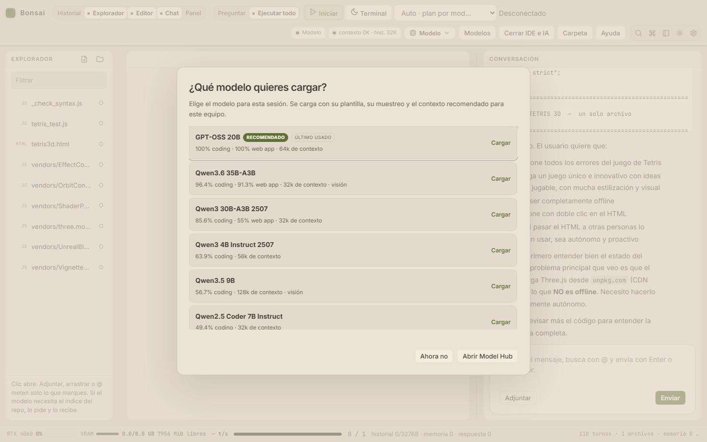

# Primer arranque desde un clon

Bonsai IDE es el código del IDE; **no incluye** los pesos GGUF, los binarios de
`llama.cpp` ni las dependencias de `chat/node_modules`. Esta guía deja un clon
limpio funcionando y explica qué hace la UI al abrirse.


## 1. Requisitos

- Windows 10/11 con PowerShell 5.1.
- Node.js 22 o superior.
- GPU NVIDIA con driver actualizado. Probado en RTX 4060 Laptop 8 GB.
- 16 GB de RAM recomendados para los MoE híbridos.
- Edge o Chrome para el navegador integrado y las pruebas de UI.

## 2. Clonar e instalar dependencias

```powershell
git clone https://github.com/Vahlame/bonsai-local-ide.git
cd bonsai-local-ide
npm ci --prefix chat
```

`.\scripts\setup-clone.ps1` hace esta comprobación por ti, valida Node y busca el
runtime antes de abrir el IDE.

## 3. Runtime de llama.cpp

El IDE necesita `llama-server.exe` con CUDA. Hay dos caminos:

### A. Compilar el build optimizado (recomendado)

Requiere Visual Studio 2022 Build Tools y conexión para descargar CUDA y el
código de llama.cpp:

```powershell
.\scripts\setup-clone.ps1 -BuildRuntime
```

El script instala la toolchain si falta y compila el build sm89 en
`.local/opt/bonsai-inference/build-RTX4060-Opt-sm89/bin/`. Tarda unos 20 minutos.
Detalle reproducible: [INFERENCE-TOOLCHAIN](INFERENCE-TOOLCHAIN.md).

### B. Usar un build CUDA ya compilado

Copia `llama-server.exe` y sus DLL en `bin\`. El lanzador también busca el build
optimizado en:

```text
.local/opt/bonsai-inference/build-RTX4060-Opt-sm89/bin/
%USERPROFILE%\.local\opt\bonsai-inference\build-RTX4060-Opt-sm89\bin\
```

Debe ser un build de llama.cpp compatible con los flags del proyecto
(`--n-cpu-moe`, `--load-mode`, `--cache-ram`, `--chat-template-file`).

## 4. Elegir modelo

Abre el IDE:

```powershell
.\scripts\bonsai-rtx4060.ps1 launch
```

Si la IA está apagada, la UI muestra **¿Qué modelo quieres cargar?**:

- con modelos instalados, el recomendado aparece primero y se carga con su
  plantilla, muestreo y contexto automáticos;
- sin modelos, el diálogo explica que el IDE funciona sin IA y ofrece **Abrir
  Model Hub**;
- **Ahora no** cierra el diálogo y deja el IDE usable sin modelo.

En el Hub puedes descargar el catálogo curado, buscar en Hugging Face, pegar una
URL o importar un `.gguf` local. Para GPT-OSS-20B el plan por defecto usa
**64k**, Harmony y muestreo oficial; el máximo probado es **128k**.

La pregunta se desactiva en **Ajustes → Preguntar modelo al iniciar**. Si se
desactiva, el IDE arranca sin cargar nada y el modelo se elige desde **Modelos**.



## 5. Comprobar que quedó bien

```powershell
npm test
npm run test:navegador
npm run docs:links
```

Para comprobar la inferencia real, con un modelo cargado:

```powershell
curl.exe http://127.0.0.1:8080/props
```

Debe devolver el `model_path` y `n_ctx` esperados. El IDE escucha en
`http://127.0.0.1:8787`.

## Problemas frecuentes

| Síntoma | Causa y solución |
|---|---|
| La UI abre pero no hay IA | No hay `llama-server.exe` en `bin\` ni en `.local\`; ejecuta `setup-clone.ps1 -BuildRuntime` o copia un build. |
| «No hay modelos instalados» | Es normal en un clon: abre el Model Hub y descarga un GGUF. |
| El modelo no cabe | Usa un modelo más pequeño o un plan MoE; el Hub muestra el plan y la VRAM estimada. |
| No aparece la pregunta de modelo | Ya hay un modelo cargado, la opción está desactivada en Ajustes o se cerró con «Ahora no» en esta sesión. |
| `npm ci` falla | Comprueba Node 22+, conexión a npm y permisos de escritura en `chat/node_modules`. |
| Falla la compilación CUDA | Revisa Visual Studio Build Tools, CUDA y `docs/RTX4060_OPTIMIZATION_GUIDE.md`. |

## Qué no se versiona

- `models/`: GGUF y proyectores de visión.
- `bin/` y `.local/`: runtime de llama.cpp.
- `chat/node_modules/`: dependencias instaladas con `npm ci`.
- Estado local del IDE: chats, ajustes, permisos y capturas.

Todo lo demás —código, catálogo curado, informes, SVG y pruebas— está en el
repositorio.
