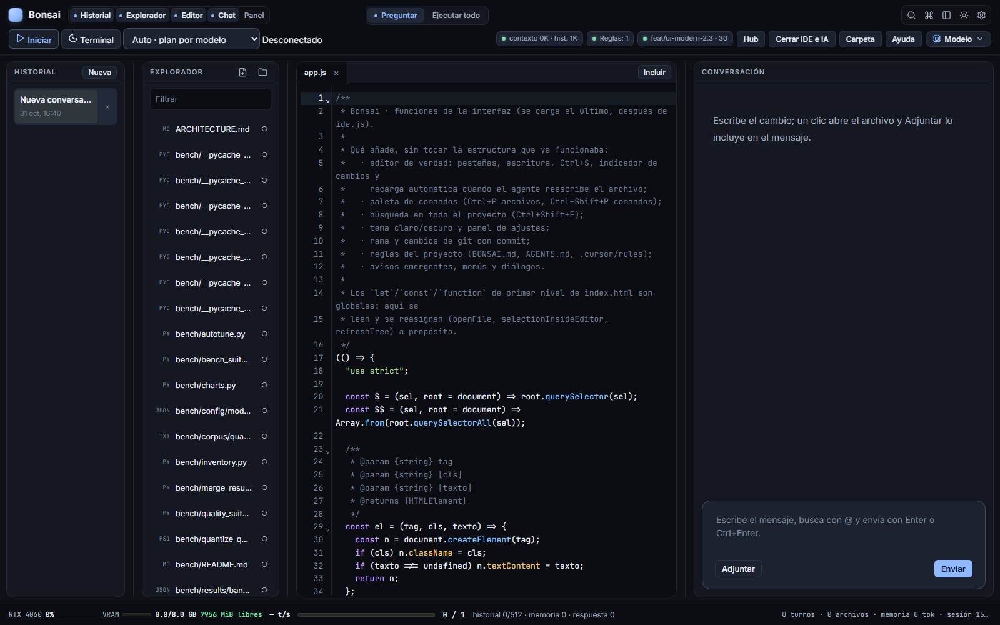
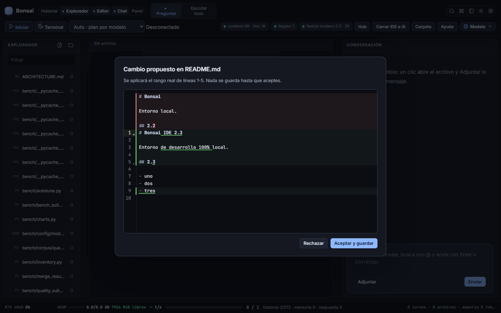
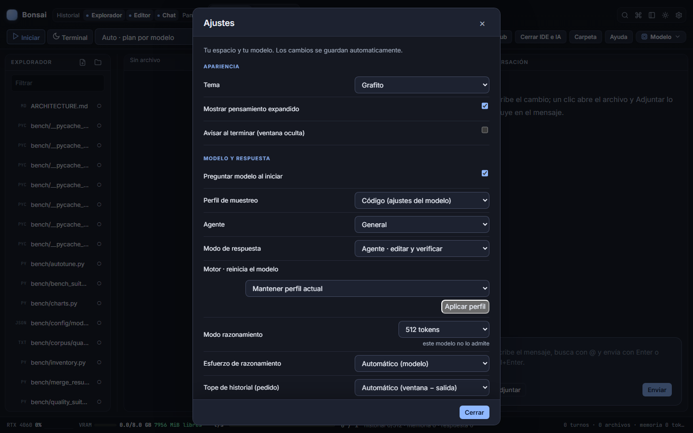
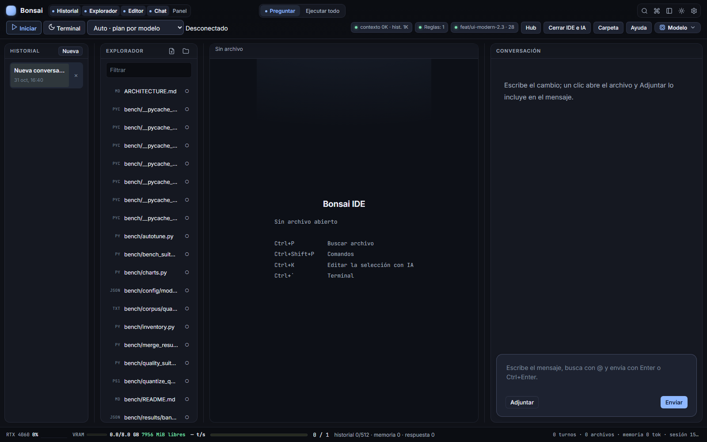

# Bonsai Local IDE 2.3.0

**Fecha:** 31 de octubre de 2026
**Tema:** un solo editor, un solo camino para las tools, una UI que se siente
como un IDE.

2.3 cierra la migración que empezó en 2.1: CodeMirror 6 deja de ser una opción y
pasa a ser el único editor. También ordena la deuda que más bugs multiplicaba
—el parser de tool calls escritas como texto— y deja el arranque en el preset
medido `AUTO`.



---

## Lo más importante

### 1. CodeMirror 6 es el único editor

- Se eliminó el editor clásico (`textarea` transparente + `pre` resaltado) y
  todos sus listeners. No queda un segundo camino que mantener.
- El editor conserva undo/redo, multi-cursor, búsqueda, plegado,
  autocompletado, resaltado por lenguaje y ajuste de línea.
- El bundle sigue siendo local (`chat/ui/vendor/editor.js`); no hay CDN.
- `npm run build:ui-vendor` reconstruye el bundle si se toca
  `chat/ui/vendor/editor-entry.js`.

### 2. Diff/merge moderno

Ctrl+K ya no previsualiza con un `<pre>`: usa `unifiedMergeView` de
`@codemirror/merge`. El documento original queda como referencia, el modificado
se muestra con líneas añadidas/borradas y números de línea reales. La versión
`pre.diff-preview` solo existe como fallback si el bundle no está disponible.



### 3. Capa visual 2.3

- Barra superior de dos filas: marca, paneles, permisos, servidor y acciones.
- Tema `slate` oscuro por defecto, con contraste revisado y paleta de sintaxis
  propia para CodeMirror (la de fábrica está pensada para fondos claros).
- Explorador con más altura útil; se retiró el hint largo que competía con el
  árbol.
- Estado vacío con atajos alineados, en vez de un párrafo en un desierto.
- Ajustes con cabecera fija, cuerpo desplazable y pie pegajoso.
- Diseño comprobado a 1280, 1440 y 1600 px, y a 390 px en Ajustes.

| Ajustes | Estado vacío |
|---|---|
|  |  |

### 4. Tool calling con una sola fuente de verdad

- Las **tool calls nativas** + **Zod/JSON Schema** son el camino canónico.
  `llguidance` sigue siendo una build opcional que fuerza el schema.
- El parser de llamadas escritas como texto quedó aislado en
  `chat/legacy-tool-parser.mjs`, detrás de `BONSAI_LEGACY_TOOL_PARSER`.
- Regla de mantenimiento: no se añaden regex para modelos concretos. Una tool
  nueva se añade con su schema nativo y su handler.
- Contrato completo: [TOOL-CALLING](TOOL-CALLING.md).

### 5. Arranque por defecto medido

- `scripts/start-ui-rtx4060-optimized.ps1` usa `AUTO` cuando no hay un preset
  guardado válido. `AUTO` deja que el plan por modelo decida contexto, KV,
  visión y reparto MoE.
- Se respeta `AUTO` o `CUSTOM` guardado; un preset antiguo guardado deja de
  forzarse en el arranque.
- El banner del lanzador ya no habla de un draft de Ornith ni lo comprueba.
  Ornith 9B sigue fuera de las recomendaciones de coding.

### 6. Acceso directo al IDE moderno

`scripts/crear-acceso-directo.ps1` crea **Bonsai IDE** en el escritorio. El
acceso directo:

- ejecuta el lanzador sin consola;
- abre `http://127.0.0.1:8787` en una ventana de aplicación de Edge/Chrome;
- usa perfil aislado y `--disable-gpu`, para no quitarle VRAM al modelo;
- abre directamente la UI 2.3, sin pasar por el editor viejo.

Verificado abriendo el `.lnk` y comprobando el proceso
`msedge --app=http://127.0.0.1:8787?uicpu=1`.

---

## Migración y compatibilidad

- **Ajustes:** al primer arranque de 2.3 se escribe `uiVersion: "2.3.0"`, se
  pone `tema: "slate"` y `editorModerno: true`. El resto de ajustes se conserva.
  Después puedes cambiar de tema desde Ajustes; la migración no se repite.
- **`editorModerno`:** se sigue aceptando por compatibilidad, pero la UI ya no
  lo usa para elegir editor. CodeMirror es siempre el editor.
- **Automatización:** el textarea clásico desapareció. Para pruebas o scripts
  externos usa `.editor-cm` y `window.bonsaiEditorCommand`
  (`getText`, `replaceAll`, `select`, `focus`). El objeto `window.bonsaiEditor()`
  sigue devolviendo archivo, texto y cursor.
- **Diff:** los selectores de test cambian de `pre.diff-preview` a
  `.diff-cm .cm-editor`. El fallback `pre.diff-preview` solo aparece si falta el
  bundle.
- **Parser legacy:** `BONSAI_LEGACY_TOOL_PARSER=0` desactiva por completo las
  heurísticas de texto. Las tools nativas siguen funcionando.
- **Preset:** si tenías un preset manual guardado y quieres seguir usándolo,
  selecciónalo explícitamente; el lanzador ya no lo impone.

No hay cambios en el formato de sesiones, chats, memoria global ni modelos.
Los GGUF y el runtime siguen fuera de Git.

---

## Verificación

| Comprobación | Resultado |
|---|---|
| `npm test` (45 suites aisladas) | **45/45** |
| `npm run test:navegador` (7 suites) | **7/7** |
| `npm run docs:links` | **0 enlaces rotos** |
| Acceso directo del escritorio | Abre Edge app mode en `127.0.0.1:8787` |
| Capturas 1280 / 1440 / 1600 | Revisadas, sin modal de arranque |
| Rendimiento | Sin regresiones: se mantienen los números medidos de 2.2 |

La suite `prueba-copia-evaluacion` ahora incluye
`chat/legacy-tool-parser.mjs` en la copia aislada; sin ese archivo el servidor
copiado no arrancaba.

---

## Actualizar desde 2.2

```powershell
git pull
npm --prefix chat install
npm run build:ui-vendor
.\scripts\crear-acceso-directo.ps1
```

Luego abre **Bonsai IDE** desde el escritorio o ejecuta:

```powershell
.\scripts\bonsai-rtx4060.ps1 launch
```

No hace falta borrar `chat/ui-settings.json`: la migración de 2.3 lo actualiza
una vez. Si quieres volver al tema anterior, cámbialo en **Ajustes → Tema**.

---

## Límites honestos

- Bonsai no compite con VS Code en amplitud: no hay debugger multi-lenguaje,
  marketplace de extensiones, notebooks ni remote development. El foco es el
  coding agent local sobre Windows + llama.cpp + GPU modesta.
- Los modelos no viajan en el repositorio. El primer arranque necesita un GGUF
  local o descargarlo desde el Model Hub.
- El parser legacy existe solo para modelos viejos que escriben tools como
  texto. Su retirada definitiva es el siguiente paso natural.
- Ornith 9B no se recomienda para coding; los perfiles y la documentación usan
  GPT-OSS-20B, Qwen3.6-35B-A3B y Qwen3-30B-A3B.
