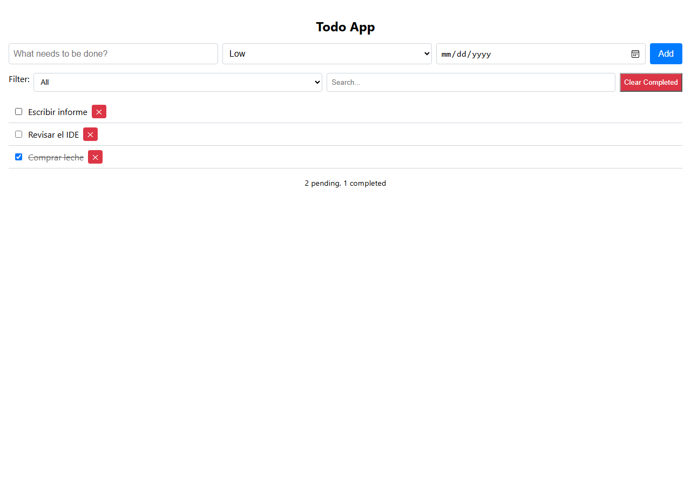
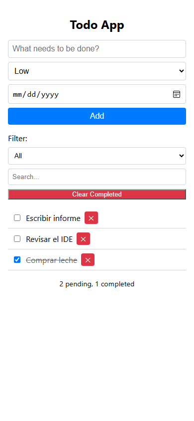

# Bonsai Local IDE 2.3.1

**Fecha:** 1 de noviembre de 2026
**Tema:** GPT-OSS como agente principal, tool calls nativas y verificación que
no se rinde antes de tiempo.

2.3.1 nace de una prueba real de punta a punta con **GPT-OSS 20B** construyendo
una to-do app completa. La prueba encontró tres fallos que no aparecían en los
tests con servidor simulado:

1. GPT-OSS dejaba llamadas como JSON en `content` cuando intentaba varias
   herramientas; el parser PEG de llama.cpp no las reconocía.
2. El parser nativo devolvía `peg-native` con varias llamadas y el turno moría.
3. El coder daba por terminada una tarea tras comprobar sintaxis, sin exigir
   todos los archivos, y los archivos fuera del índice (`.txt`) no contaban como
   cambio.

Esta release los corrige y deja el camino de GPT-OSS instrumentado.

---

## Lo que cambió

### GPT-OSS/Harmony como camino principal

- La plantilla Harmony viaja en el GGUF y se pasa con `--chat-template-file`.
- La petición usa `reasoning_effort`, **no** `enable_thinking`.
- El catálogo declara `pensar.nivel: "medium"`; `high` dispara respuestas de
  18k tokens y el autor documenta HTTP 500.
- El prompt exige **una sola tool call por respuesta**. Es la defensa principal
  contra el error `peg-native` de llama.cpp cuando el modelo intenta varias.

### Fallback JSON estructurado

Cuando el servidor deja la llamada en `content`, el dialecto `gpt-oss-json` de
`chat/adaptadores.mjs` reconoce uno o varios objetos JSON puros separados por
`;`, comas o saltos, quita el prefijo `functions.` y los pasa por
`nativeToolEffects`. No ejecuta JSON explicado con prosa ni dentro de una cerca.

### Salida cruda

`BONSAI_RAW_STREAM=1` guarda cada evento SSE en `<estado>/raw-stream.jsonl`.
Así se ve exactamente si GPT-OSS usó `delta.tool_calls` o cayó a `content`:

```json
{"choices":[{"delta":{"tool_calls":[{"index":0,"function":{"name":"archivo","arguments":"{\"ruta\":\"a.txt\""}}]}}]}
```

### Verificación del coder

- `noteWritten` añade el archivo a `touched`; `changed()` lo incluye aunque no
  esté en el índice de código. Un `.txt` nuevo ya cuenta como cambio.
- `VERIFY` exige que existan los archivos pedidos y que pasen los tests; no
  basta con que la sintaxis esté bien.
- El resumen final conserva el razonamiento activo y se pide también cuando el
  último mensaje es un resultado de tool o el assistant cerró con `content`
  vacío. GPT-OSS sin canal de análisis volcaba su monólogo interno en `content`
  y la respuesta era un “We need to…” en inglés; ahora el cierre es limpio.

### Lanzador

- `--agent-profile` se usa de verdad. `optimized*` se mapea a
  `small-local-coder`; el acceso directo ya no arranca en legacy si no hay
  ajustes guardados.
- El acceso directo sigue abriendo la UI 2.3 en Edge app mode.

---

## Prueba real con GPT-OSS

Workspace vacío, RTX 4060 8 GB, GPT-OSS 20B MXFP4, 65.536 tokens de contexto,
`pensar=512`, una tool call por respuesta.

| Intento | Resultado | Tiempo |
|---|---|---:|
| 1. Prompt amplio, sin límites de salida | Atascado en VERIFY tras 8 pasos | **19m 52s** |
| 2. Prompt corto, salida 6k | `peg-native` tras generar app.js | **3m 27s** |
| 3. Continuación | `peg-native` de nuevo | **1m 21s** |
| 4. Tarea simple (`hola.txt`) | Completada | **6,9s** |
| 5. Dos archivos | Completada | **13,6s** |
| 6. To-do app completa | Completada, 11 pasos, tests 10/10 | **10m 03s** |
| 7. Reparación (edición + README + confirm) | Completada | **2m 10s** |
| 8. Tarea simple tras reiniciar con `medium` | Completada, “Ok” | **13,7s** |

La app final tiene 7 archivos, `npm test` pasa 10/10 y la validación de
navegador pasa **11/11**: crear, completar, filtrar, buscar, editar, persistir,
IDs únicos, sin errores de consola, responsive a 390 px y limpiar completadas.
El turno completo (app + reparación) quedó en **12m 13s**. La copia validada
está en `trabajo/gpt-oss-todo/` (ignorada por Git) para poder abrirla con doble
clic.

| Escritorio | Móvil |
|---|---|
|  |  |

La app de la prueba vive en `trabajo/gpt-oss-todo/` (ignorada por Git) y las
capturas quedan como evidencia.

---

## Verificación

| Comprobación | Resultado |
|---|---|
| `npm test` (47 suites aisladas) | **47/47** |
| `npm run test:navegador` (7 suites) | **7/7** |
| `npm run docs:links` | **0 enlaces rotos** |
| App de GPT-OSS | **10/10 tests + 11/11 navegador** |
| Acceso directo | Abre la UI 2.3 en `127.0.0.1:8787` |

---

## Límites honestos

- `peg-native` sigue siendo una limitación de llama.cpp con varias llamadas o
  texto antes de la llamada. Bonsai la mitiga con una llamada por respuesta y
  el fallback JSON, pero no puede arreglar el parser del servidor.
- GPT-OSS sigue siendo un modelo de razonamiento: con presupuestos altos puede
  gastar miles de tokens antes de actuar. `pensar=512` es el equilibrio probado
  en 8 GB.
- La app generada es funcional y está probada, pero su diseño es sencillo; el
  objetivo de la prueba era el pipeline del IDE, no ganar un concurso de UI.

## Actualizar

```powershell
git pull
npm run build:ui-vendor
.\scripts\crear-acceso-directo.ps1
```

No hace falta borrar ajustes. El catálogo de GPT-OSS se actualiza a `medium` en
`config/model-catalog.json`; si tu `models/hub-catalog.json` conserva `high`,
vuelve a registrar el modelo desde el Hub o edita esa entrada.
