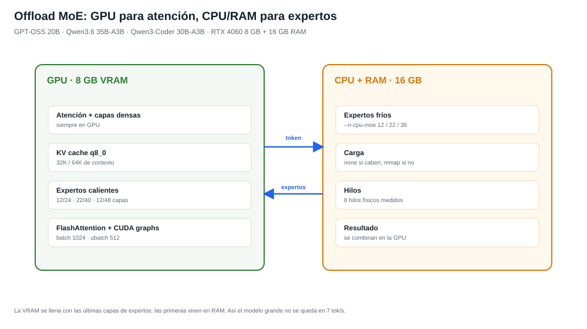

# Bonsai Local IDE 2.4.0

**Fecha:** 1 de noviembre de 2026
**Tema:** benchmark real de modelos, MoE con expertos en CPU y UI verificada.

Esta release cierra la integración de Qwen3.8-27B y añade una matriz
reproducible de **7 modelos × 4 tareas** para elegir modelo con datos, no con
impresiones. También corrige el arranque de modelos MoE desde la UI, el
pensamiento libre y varios errores de cableado que solo aparecían al abrir el
IDE con el modelo apagado.

---

## Lo más importante

### El mejor modelo para proyectos

**Qwen3.6 35B-A3B** hace las cuatro tareas (fluidos, juego, app CRUD y
Skyblock) con buena calidad y **36–40 tok/s**. En tres repeticiones mantiene
**90/100** y **12/12 verificaciones**:

| Tarea | Media |
| --- | ---: |
| Fluidos | 98 |
| Juego | 94 |
| App | 92 |
| Skyblock | 77 |

**Qwen3.5 9B** es el más rápido (45–46 tok/s) para juego/app/Skyblock, pero su
fluido no cumple el HUD. **Qwen3-Coder 30B-A3B** es el especialista de código
a 17–22 tok/s. **Qwen3 30B-A3B 2507** queda como alternativa sólida a 29–35
tok/s. **Qwen3.8 27B** sigue siendo el control lento: 7,2 tok/s.

Detalle: [TASK-BENCHMARK-2026-11-01](qwen38/TASK-BENCHMARK-2026-11-01.md) ·
[MODEL-SCORECARD-2026-11-01](qwen38/MODEL-SCORECARD-2026-11-01.md).

### Motor y offload

- MoE híbrido: atención y densos en GPU; expertos fríos en CPU/RAM.
- GPT-OSS 20B 12/24, Qwen3.6 35B-A3B 22/40, Qwen3-Coder 30B-A3B 36/48.
- `--load-mode none` cuando los expertos caben en RAM; `mmap` cuando no.
- KV q8_0, flash-attention, batch 1024/512, 8 hilos, `--cache-ram 0`,
  `--ctx-checkpoints 0`, `--no-context-shift`.
- Pensamiento libre real: `--reasoning-budget -1` y `reasoning_effort`
  `high`/`xhigh`.
- Al cargar desde la UI con visión se usa el reparto conservador del plan
  (Qwen3.6: 22 capas en CPU, no 19); así el navegador y los buffers de compute
  no provocan OOM.

### UI/UX verificada

`scripts/check-ui.cjs` abre la UI real, carga Qwen3.6 desde el diálogo de
inicio, abre el Hub, abre Ajustes y comprueba la consola. Resultado:

- **0 errores de consola**.
- 44 tarjetas en el Model Hub, incluidas las tres descargas nuevas.
- Estado **IA lista**, ventana 32K, `Sin límite` en razonamiento.
- Diálogo de inicio, Hub y Ajustes abren y cierran sin conflicto.
- Capturas: [main](../docs/graficos/ui-2.4.0-main.png),
  [Hub](../docs/graficos/ui-2.4.0-hub.png),
  [Ajustes](../docs/graficos/ui-2.4.0-settings.png).

### Modelos nuevos

- `qwen3-coder-30b-a3b` (16,45 GiB).
- `deepseek-coder-v2-lite` (9,65 GiB).
- `qwen3-8b` (4,68 GiB).

Descargados con `fast-download.mjs` a ~10,3 MiB/s y registrados en el Hub.

---

## Correcciones

- `start-server.ps1` no delegaba los modelos `moe-hibrido` al lanzador
  optimizado; GPT-OSS se rechazaba como “sin perfil de GPU completa”.
- El perfil de GPT-OSS pedía `optimized-sm89`, una ruta relativa inexistente;
  se usa `optimized-sm89-user`.
- El catálogo de GPT-OSS apuntaba a un GGUF que no existe; ahora usa
  `gpt-oss-20b-gpt-oss-20b-MXFP4.gguf`.
- `configurationFromMarker()` rechazaba `pensar=-1`; impedía cambiar de modelo
  con pensamiento libre.
- `start-server.ps1` trataba `-1` como automático; ahora `-2` es automático y
  `-1` es **sin límite**. `start-ui.ps1`/`start-chat.ps1` propagan el valor.
- El helper de benchmark imprimía emojis con cp1252 y se caía; ahora usa UTF-8.
- El checker de fluidos no aceptaba una simulación pausada y contaba el 404 de
  favicon; ambos corregidos.
- El medidor de la UI conservaba la ventana del modelo anterior (65536) tras
  cambiar a uno de 32768; `/api/state` usa la ventana actual.
- El diálogo de inicio no actualizaba la etiqueta `ventana`; ahora la fija al
  cargar el modelo.

## Verificación

- `node scripts/run-tests.mjs`: **51/51 OK**.
- `node scripts/check-ui.cjs`: **0 errores de consola**, `IA lista`, 44 tarjetas,
  diálogo de inicio, Hub y Ajustes; captura principal incluida.
- `node scripts/check-doc-links.mjs`: **0 enlaces rotos**.
- Arranque real con `launch-ide.ps1 -NoBrowser`: Qwen3.6 a 32768, 22 capas de
  expertos en CPU, visión CPU y `--reasoning-budget -1`.

## Compatibilidad

- Windows 10/11, Node ≥ 22, GPU CUDA (RTX 4060 8 GB probada).
- Los GGUF y binarios no viajan en Git.
- El perfil `qwen38-27b-perf-iq4` y su GGUF original se conservan para
  rollback.
- El cierre de la UI y el modelo sigue el contrato de `LIFECYCLE.md`.

## Evidencia

- [Benchmark de tareas](qwen38/TASK-BENCHMARK-2026-11-01.md)
- [Scorecard de Qwen3.6](qwen38/MODEL-SCORECARD-2026-11-01.md)
- [Resultados crudos](qwen38/task-benchmark-results.json)
- [Capturas](qwen38/task-benchmark-shots/)
- [Gráficos del motor](../docs/graficos/)
- [Checklist de UI](../scripts/check-ui.cjs)
