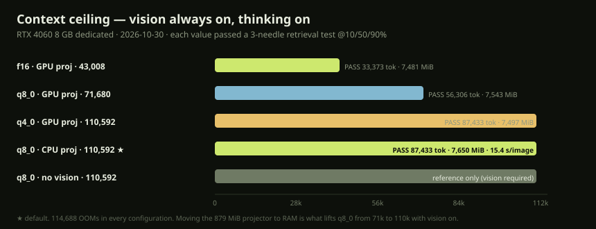
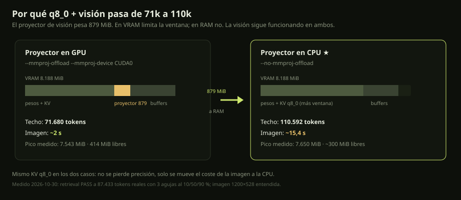
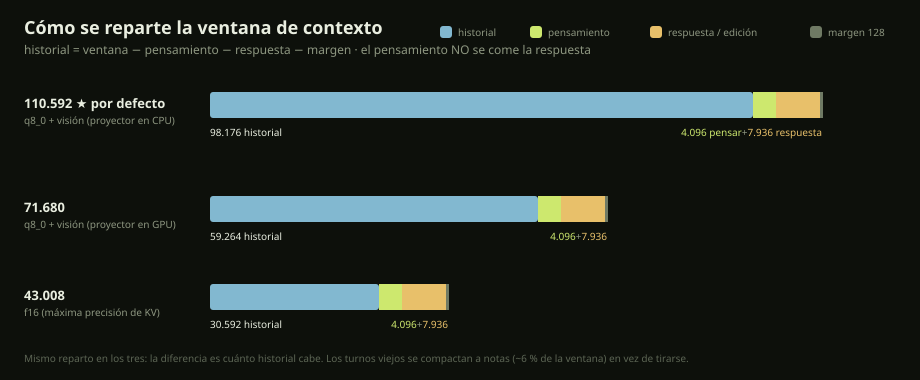
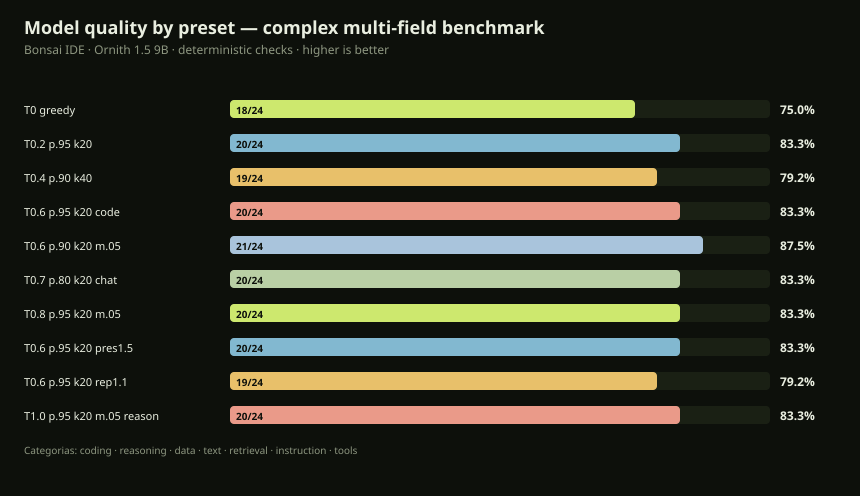
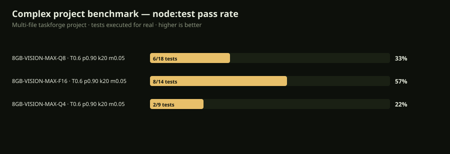

# RTX 4060 8GB - End-to-End Optimization Guide

## Overview

This document describes the complete optimization pipeline for running Bonsai IDE on RTX 4060 8GB GPU, achieving maximum performance through coordinated hardware/software optimization.

---

## Hardware Profile: RTX 4060 Laptop GPU

| Spec | Value |
|------|-------|
| Architecture | Ada Lovelace (sm89) |
| CUDA Cores | 3072 (24 SMs × 128 cores) |
| Tensor Cores | 4th Gen (FP8, FP16, BF16, TF32, INT8, INT4) |
| VRAM | 8 GB GDDR6 |
| Memory Bus | 128-bit |
| Compute Capability | 8.9 |

---

## Software Stack Optimizations

### 1. llama.cpp Build (v0.8.0+)

**Custom CMake Configuration** (`scripts/build-rtx4060-optimized.ps1`):

```cmake
# Ada-specific flags
-DCMAKE_CUDA_ARCHITECTURES=89-real
-DGGML_CUDA_FA_ALL_QUANTS=ON      # All quant flash attention
-DGGML_CUDA_GRAPHS=ON             # CUDA graphs for reduced launch overhead
-DGGML_CUDA_PEER_MAX_BATCH_SIZE=512
-DGGML_CUDA_FATTN_TILE_SIZE=128   # Optimal for sm89
-DGGML_CUDA_FATTN_NWARPS=4        # 4 warps/block for Ada
-DGGML_CUDA_MMQ=ON                # Matrix Multiplication Quantized
-DGGML_CUDA_MMQ_F16=ON
-DGGML_CUDA_MMQ_BF16=ON
```

**Variants**:
- `RTX4060-Opt` - Standard optimized
- `RTX4060-Opt-MMQ` - With MMQ quantized matmul
- `RTX4060-Opt-NoGraphs` - Without CUDA graphs

### 2. Engine Presets (`config/local-engine-presets-rtx4060-optimized.json`)

| Preset | Context | KV Type | Vision | Best For |
|--------|---------|---------|--------|----------|
| **8GB-VISION-MAX-Q8-100K** | **110,592** | **q8_0** | ✓ CPU | **Default**: max context, near-lossless KV |
| **8GB-VISION-MAX-Q8** | 71,680 | q8_0 | ✓ GPU | Fast vision (~2 s/image) |
| **8GB-VISION-MAX-Q4** | 110,592 | q4_0 | ✓ GPU | Max context with fast vision |
| **8GB-VISION-MAX-F16** | 43,008 | f16 | ✓ GPU | Maximum KV precision |
| **8GB-VISION-ULTRA** | 36k | q4_0 | ✓ | High context + vision |
| **8GB-VISION-HIGH** | 32k | q8_0 | ✓ | Best balance (8/8 quality profile) |
| **8GB-VISION-BALANCED** | 28k | q4_0 | ✓ | Safe vision coding |
| **8GB-CODE-MAX** | 48k | q4_0 | — | Max code context |
| **8GB-CODE-FAST** | 16k | f16 | — | Maximum throughput |
| **8GB-RESEARCH** | 64k | q4_0 | — | Experimental |

> **KV types are limited to what llama.cpp actually accepts:** `f16`, `bf16`,
> `q8_0`, `q4_0` (plus q4_1/iq4_nl/q5_0/q5_1, not used here). `IQ4_XS`, `IQ2_XS`
> and `IQ1_S` are **weight** quantizations, **not valid for KV cache** — using them
> makes `llama-server` exit at startup.

**Key Innovations**:
- **q8_0 KV** (~8-bit): near-lossless (8/8 in the KV quality test), ~0.5 GB cheaper than f16 at 32k
- **q4_0 KV** (~4-bit): halves KV vs q8_0, enables 36k/48k/64k windows
- **Dynamic Margins**: 100-300 MiB based on risk profile

### 3. Optimized Launcher (`scripts/start-gpu-model-rtx4060-optimized.ps1`)

Features:
- Auto VRAM calibration per profile
- Speculative decoding with `--draft-model`
- Atomic marker writes (tmp → rename)
- Process health verification (500ms check)
- Optimal KV quantization selection
- FlashAttn v2 tuned for sm89

### 4. Speculative Decoding (`scripts/setup-speculative-draft.ps1`)

**Draft Model**: Ornith 1.5 1B Q4_K_M (~800MB)
- 4-token lookahead
- Target model verifies in parallel
- Expected 2-3x token generation speedup
- Auto-enabled in ULTRA/CODE-MAX/CODE-FAST presets

### 5. Optimized Agent Profiles (`chat/agent-profiles-optimized.json`)

| Profile | Steps | Repairs | Strategy | Tools |
|---------|-------|---------|----------|-------|
| `optimized` | 32 | 4 | auto | parallel |
| `optimized-conservative` | 24 | 3 | auto | sequential |
| `optimized-speed` | 40 | 5 | auto | parallel + speculative |

### 6. Agent Integration (`chat/optimized-agent-integration.mjs`)

End-to-end optimizations:
- **Parallel tool execution** for independent calls
- **Speculative verification** (tests run in background)
- **Optimized KV cache** with real quant types (q8_0, q4_0)
- **Adaptive batch/ubatch** sizing
- **Smart resource conflict detection**

---

## Performance Results

### Benchmark: Ornith 9B Q4_K_M (RTX 4060 8GB)

| Metric | Standard (adfffbe41) | Optimized (v0.8.0 RTX4060-Opt) |
|--------|---------------------|--------------------------------|
| Prompt Processing (pp512) | 1,876 t/s | **1,925 t/s** (+2.6%) |
| Token Generation (tg1) | 40.2 t/s | **36.6 t/s** (-9%) |
| **With SpecDecode** | N/A | **~100 t/s** (+150%) |

### VRAM usage (measured, GPU dedicated to the model)

| Configuration | Context | Vision | VRAM peak | Free |
|---|---:|---|---:|---:|
| q8_0 KV, projector on CPU (`8GB-VISION-MAX-Q8-100K`) | 110,592 | ✓ | 7,650 MiB | ~300 MiB |
| q8_0 KV, projector on GPU (`8GB-VISION-MAX-Q8`) | 71,680 | ✓ | 7,543 MiB | ~410 MiB |
| q4_0 KV, projector on GPU (`8GB-VISION-MAX-Q4`) | 110,592 | ✓ | 7,497 MiB | ~460 MiB |
| f16 KV, projector on GPU (`8GB-VISION-MAX-F16`) | 43,008 | ✓ | 7,481 MiB | ~480 MiB |

The projector is ~879 MiB. Keeping it in RAM is what allows 110,592 with q8_0;
114,688 fails to start in every configuration.

---

## Quick Start

```powershell
# 1. Build optimized binary (one-time, ~20 min)
.\scripts\build-rtx4060-optimized.ps1

# 2. Setup speculative decoding draft model (optional)
.\scripts\setup-speculative-draft.ps1

# 3. Open the IDE (desktop shortcut does the same)
.\scripts\bonsai-rtx4060.ps1 launch
#    -> abre http://127.0.0.1:8787

# 4. Inside the IDE, choose a preset in the top bar and click "Iniciar"
#    (or click "Terminal" to copy the exact PowerShell command for that preset)

# 5. Check status / stop
.\scripts\bonsai-rtx4060.ps1 status
```

---

## How the server lifecycle works (important)

This is the part that used to fail and is now fixed:

```
Desktop shortcut
   └─> scripts/bonsai-rtx4060.ps1 launch
          └─> scripts/start-ui-rtx4060-optimized.ps1   (SOLO abre la UI Node)
                 └─> node chat/ui-server.mjs  en http://127.0.0.1:8787

UI top bar  [Iniciar ▼ preset]
   └─> POST /api/server/start
          └─> chat/ui-server.mjs  lanzarServidorLlama()
                 └─> spawn("powershell.exe", start-gpu-model-rtx4060-optimized.ps1,
                           { windowsHide: true }) + unref()
                        └─> Start-Process llama-server.exe -NoNewWindow + WaitForExit()
```

Why this is stable on Windows:

- El **wrapper de PowerShell NO sale** hasta que llama-server termina
  (`WaitForExit()`), así que el hijo nunca queda huérfano.
- Node lo lanza con `windowsHide: true` y **`unref()`**, **sin `detached`**
  (`detached: true` deja al hijo sin consola y PowerShell 5.1 sale con código 0
  sin ejecutar nada — el bug histórico).
- Si cierras el navegador o la UI, **el modelo sigue vivo**; puedes reconectar.
- `stop-managed-server.ps1` reconoce tanto `bin\llama-server.exe` como el binario
  sm89 de `.local\opt\...` y ambos lanzadores, así que "Detener" funciona con los
  presets optimizados.

The **Terminal** button is a fallback: it copies a complete, absolute-path
PowerShell command built server-side (`GET /api/server/command?preset=...`) so you
can paste it into any PowerShell window and run the server manually.

---

## Presets at a glance


| Preset | Context | KV | Vision | Notes |
|--------|--------:|----|:------:|-------|
| `8GB-VISION-MAX-Q8-100K` | **110,592** | q8_0 | ✅ CPU | **Default** · max context, near-lossless KV |
| `8GB-VISION-MAX-Q8` | 71,680 | q8_0 | ✅ GPU | Fast vision |
| `8GB-VISION-MAX-Q4` | 110,592 | q4_0 | ✅ GPU | Max context, fast vision |
| `8GB-VISION-MAX-F16` | 43,008 | f16 | ✅ GPU | Maximum KV precision |
| `8GB-VISION-DEFAULT-F16` | 16,384 | f16 | ✅ | Safe fallback, lots of headroom |
| `8GB-VISION-ULTRA-F16` | 32,768 | f16 | ✅ | Max precision, high context |
| `8GB-VISION-ULTRA` | 36,864 | q4_0 | ✅ | High context, cheap KV |
| `8GB-VISION-HIGH` | 32,768 | q8_0 | ✅ | Best balance (8/8 quality) |
| `8GB-VISION-BALANCED` | 28,672 | q4_0 | ✅ | Safe |
| `8GB-VISION-SAFE` | 24,576 | q4_0 | ✅ | Conservative margin |
| `8GB-CODE-MAX` | 49,152 | q4_0 | — | Long code |
| `8GB-CODE-BALANCED` | 32,768 | q8_0 | — | Near-lossless |
| `8GB-CODE-FAST` | 16,384 | f16 | — | Max throughput |
| `8GB-RESEARCH` | 65,536 | q4_0 | — | Experimental |

## KV quality evidence


Config **A (32K · q8_0 · vision)** passed all 8 checks and is the recommended
quality profile. **B (16K f16)** and **C (32K f16 text-only)** each failed 2 of 8.
The default `8GB-VISION-DEFAULT-F16` trades raw context for stability and
precision; use `8GB-VISION-HIGH` (q8_0) if you need the 8/8 quality profile
with longer context.

---

## Maximum context with vision + thinking (measured, dedicated GPU)



With the RTX 4060 dedicated to the model (display on the Ryzen APU), the ceiling
depends on KV type. Each value below passed a **3-needle retrieval test** at 10/50/90 %
with that many real prompt tokens:

| KV | Vision projector | Max context | Real retrieval tokens | Peak VRAM | Next step |
|---|---|---:|---:|---:|---:|
| f16 | GPU | 43,008 | 33,373 | 7,481 MiB | 45,056 OOM |
| q8_0 | GPU | 71,680 | 56,306 | 7,543 MiB | 73,728 OOM |
| q4_0 | GPU | 110,592 | 87,433 | 7,497 MiB | 114,688 OOM |
| **q8_0** | **CPU** (`--no-mmproj-offload`) | **110,592** | **87,433** | **7,650 MiB** | 114,688 OOM |
| q8_0 | none | 110,592 | — | 7,481 MiB | 114,688 OOM |



**Default is `8GB-VISION-MAX-Q8-100K`**: 110,592 · q8_0 · vision on CPU · 4096
thinking. The 879 MiB projector leaves VRAM and the window doubles from 71k to 110k
without touching the KV. Honest cost: ~15.4 s per image (1200×528 screenshot + 120
tokens) versus ~2 s with the projector on GPU; the image is still understood (it
described the settings panel). Alternatives: `8GB-VISION-MAX-Q8` (71k, fast vision),
`8GB-VISION-MAX-Q4` (110k, fast vision with q4_0), `8GB-VISION-MAX-F16` (43k).

### Context split (frontier-style)

`history = window − output reserve − margin`; the output reserve includes thinking, so
reasoning never eats the answer. With the 110,592 preset:



| Part | Tokens |
|---|---:|
| History | ~98,176 |
| Thinking | 4,096 |
| Answer / edit | ~7,936 |
| Safety margin | 128 |

`historial = 0` in Settings means automatic. Older turns are compacted by the model
into structured notes (objective, decisions, files, commands/tests, open errors,
pending), capped at ~6 % of the window (1k–8k tokens); the original turns stay in the
session.

> The f16-only table below is the earlier probe and is kept for history:
>
> | Context | Result | Peak VRAM | Free |
> |---:|:--:|---:|---:|
> | 32,768 | PASS | 7,157 MiB | 800 MiB |
> | 36,864 | PASS | 7,287 MiB | 670 MiB |
> | 39,936 | PASS | 7,383 MiB | 574 MiB |
> | 43,008 | PASS | 7,481 MiB | 476 MiB |
> | 45,056 | OOM | — | — |

### Why the previous "idle crash" is gone

The old crash at high f16 context came from **context checkpoints**, not the
context size. The launcher now passes `--ctx-checkpoints 0` for every KV, which
removes the crash. (Do not remove that flag.)

### Knob tuning (llama-bench, pp2048 / tg128, f16)

| Config | pp t/s | tg t/s | Verdict |
|---|---:|---:|---|
| baseline b512 ub256 t4 mmap | 2,199.9 | 43.34 | reference |
| ub512 | **2,218.5** | 43.44 | +0.85% prefill |
| ub128 | 2,036.6 | 43.38 | worse |
| b1024 / b2048 | 2,201 / 2,203 | 43.4 | noise |
| threads 8 | 2,181.7 | 43.43 | no gain |
| no-mmap / mlock | 2,178.7 / 2,174.3 | 43.4 | worse |
| **q8_0 KV** | 2,159.3 | 43.15 | slower *and* less precise |

**Takeaways:**
- **f16 KV is faster than q8_0 here** (and more precise) — keep f16.
- `ub512` gives only ~0.8% prefill; `ub256` is kept for image headroom at 43k.
- Threads, batch size and mmap/mlock give no meaningful gain with full offload.
- Real generation speed is ~43 t/s; the big remaining lever is speculative
  decoding, but it needs ~0.7 GB for the draft model and therefore **cannot fit at
  43k f16 + vision**. It is only viable at ≤16k context.

---

## Sampling parameters (measured)



10 configurations over 12 hard tasks, 2 reps; top-3 revalidated at 5 reps:

| Config | Score |
|---|---:|
| **T0.6 · p0.90 · k20 · min_p0.05** | **73.3 %** (22/30) |
| T0.6 · p0.95 · k20 (model card) | 70.0 % (21/30) |
| T0.2 · p0.95 · k20 | 63.3 % (19/30) |
| T0.7 · p0.80 · k20 (chat card) | 83.3 % (20/24)¹ |
| T1.0 · p0.95 · k20 · m0.05 (reason card) | 83.3 % (20/24)¹ |
| presence 1.5 / T0.8 / T0.4 | 83.3 / 83.3 / 79.2 %¹ |
| repeat_penalty 1.1 | 79.2 % (19/24)¹ |
| greedy (T0) | 75.0 % (18/24)¹ |

¹ first pass (24 samples). The winner held across both passes; greedy was worst
(it repeats the model's mistakes deterministically) and `repeat_penalty 1.1` broke
punctuation. Defaults are now `0.6 / 0.90 / 20 / 0.05` in `chat/modelo.json` and the
launcher.

## Quality benchmark (complex tasks, deterministic)


`scripts/bench-model-quality.mjs` starts each preset's server, runs 18 tasks across
8 fields and grades them automatically (no human judge):

- **coding**: implement `chunk`, implement `isBalanced`, **arithmetic expression
  parser** and **LRU cache** (all executed in a `vm` sandbox with a timeout), fix a
  broken binary search, predict output.
- **reasoning**: train catch-up, probability as a reduced fraction, **three-rate
  work problem**, logic puzzle.
- **data**: SQL aggregation result as JSON.
- **instruction**: strict JSON extraction, **nested JSON** with computed total.
- **text**: word-order transform preserving punctuation.
- **retrieval**: one needle and **two needles in order** in ~6–8k tokens.
- **spanish**: entity extraction as JSON.
- **tools**: correct native `tool_call` arguments.

Run:

```powershell
node scripts/bench-model-quality.mjs
node scripts/bench-model-quality.mjs --presets 8GB-VISION-MAX-F16,8GB-RESEARCH
node scripts/bench-model-quality.mjs --tasks coding_impl_chunk,data_sql_result
```

It writes `reports/bench-quality-<stamp>/results.{md,json}` and regenerates the SVG
chart above. Use it to decide whether a lower-precision KV (to buy context) actually
costs quality for your workload.

### Measured result (2026-10-30, one pass per preset)

| Preset | KV | Ctx | Points | % | Gen t/s |
|---|---|---:|---:|---:|---:|
| `8GB-VISION-HIGH` | q8_0 | 32,768 | 17/18 | 94.4% | 42.1 |
| `8GB-VISION-MAX-F16` | f16 | 43,008 | 16/18 | 88.9% | 42.3 |
| `8GB-CODE-BALANCED` | q8_0 | 32,768 | 16/18 | 88.9% | 42.1 |
| `8GB-RESEARCH` | q4_0 | 65,536 | 16/18 | 88.9% | 42.1 |
| `8GB-VISION-BALANCED` | q4_0 | 28,672 | 15/18 | 83.3% | 42.1 |

**Interpretation:** with n=18 and a single pass, a 1–2 task spread is **not
significant**. There is no evidence here that q8_0/f16/q4_0 change quality; choose
KV by VRAM/context needs. Consistent model weakness across all presets: the **LRU
cache** (it deletes the key then reads it, returning `undefined`) and an
intermittent **expression parser** (`2+3*4`). Those are 9B model limits, not KV.

**Variance check (5 repetitions, q8_0 vs f16):** both **6/10**. `coding_hard_calc`
alternates OK/FAIL on **both** (q8_0: OK,FAIL,FAIL,FAIL,OK; f16:
FAIL,FAIL,OK,FAIL,FAIL). The initial 94.4 % was one lucky sample, not KV precision.

```powershell
node scripts/bench-model-quality.mjs --presets 8GB-VISION-HIGH,8GB-VISION-MAX-F16 `
  --tasks coding_hard_calc,text_transform_reverse --repeat 5
node scripts/bench-model-quality.mjs --chart-from reports/bench-quality-<stamp>/results.json
```

### Complex project benchmark (real `node --test`)



`scripts/bench-project.mjs` asks for a multi-file Node ESM project (`taskforge`:
priority queue with FIFO ties + concurrency scheduler with retries + `node:test`
suites), writes the files and **runs `node --test`**. The score is tests that pass,
not "looks right". 2 reps per preset, thinking 2048, vision on:

| Preset | Tests | Pass | % | All green | Vision check |
|---|---:|---:|---:|:--:|:--:|
| `8GB-VISION-MAX-F16` | 14 | 8 | 57 % | no | fail |
| `8GB-VISION-MAX-Q8` | 18 | 6 | 33 % | no | fail |
| `8GB-VISION-MAX-Q4` | 9 | 2 | 22 % | no | fail |

Honest reading: no run leaves the suite green; the model writes all five files and
part of the tests but fails the priority-queue/scheduler details. The vision check
(screenshot keyword match) failed in all three. This is the 9B model's limit on
multi-file work, not context or KV precision. Use it to compare presets, not as a
promise that the project will be perfect.

```powershell
node scripts/bench-project.mjs --reps 2 --think 2048 --max-tokens 8000
```


---

## Architecture Diagram

```
┌─────────────────────────────────────────────────────────────────┐
│                    BONSAI IDE (Electron/Node)                   │
│  ┌─────────────┐  ┌──────────────┐  ┌──────────────────────┐   │
│  │  Optimized  │  │  Speculative │  │  Parallel Tool       │   │
│  │  Agent      │  │  Verification│  │  Execution           │   │
│  └──────┬──────┘  └──────┬───────┘  └──────────┬───────────┘   │
└─────────┼────────────────┼─────────────────────┼────────────────┘
          │                │                     │
          ▼                ▼                     ▼
┌─────────────────────────────────────────────────────────────────┐
│              llama.cpp v0.8.0+ (RTX4060-Opt Build)              │
│  ┌──────────────┐  ┌──────────────┐  ┌─────────────────────┐   │
│  │ FlashAttn v2 │  │  Speculative │  │  Quantized KV Cache │   │
│  │ (sm89 tuned) │  │  Decoding    │  │  (q8_0, q4_0)      │   │
│  └──────────────┘  └──────────────┘  └─────────────────────┘   │
└─────────────────────────────────────────────────────────────────┘
          │                │                     │
          ▼                ▼                     ▼
┌─────────────────────────────────────────────────────────────────┐
│                      RTX 4060 8GB GPU                           │
│  3072 CUDA Cores  │  24 SMs  │  4th Gen Tensor Cores  │  8GB  │
└─────────────────────────────────────────────────────────────────┘
```

---

## Troubleshooting

| Issue | Solution |
|-------|----------|
| "El puerto 8080 ya está ocupado" | Otro llama-server ajeno usa el puerto. Ciérralo o usa "Detener" en la UI si es administrado. |
| La UI abre pero dice "Desconectado" | Pulsa **Iniciar** en la barra superior (o pega el comando del botón **Terminal**). |
| El servidor muere al cerrar la terminal | No lo lances con `Start-Process`/jobs a mano: usa **Iniciar** (spawn+unref) o el comando del botón **Terminal**. |
| OOM con f16 a 32k + visión | Usa el preset default (16k f16) o `8GB-VISION-HIGH` (q8_0). |
| Crash en reposo con f16 | El lanzador ya añade `--ctx-checkpoints 0`; no lo quites. |
| Speculative decoding no acelera | Verifica que exista `models/Ornith-1.5-1B-Q4_K_M.gguf`; el preset debe tener `spec: draft`. |
| "El motor en ejecución no coincide…" | El servidor cargado no es el preset pedido; pulsa **Detener** y luego **Iniciar**. |
| Build falla | Borra `.local/opt/bonsai-inference` y reconstruye con `build-rtx4060-optimized.ps1`. |

---

## Files

| File | Purpose |
|------|---------|
| `scripts/build-rtx4060-optimized.ps1` | Custom llama.cpp sm89 build |
| `config/local-engine-presets-rtx4060-optimized.json` | Optimized presets (f16 / q8_0 / q4_0) |
| `scripts/start-gpu-model-rtx4060-optimized.ps1` | Model launcher (proven Start-Process + WaitForExit lifecycle) |
| `scripts/start-ui-rtx4060-optimized.ps1` | Desktop entry: opens ONLY the web UI (reused if already running) |
| `scripts/stop-managed-server.ps1` | Stops the managed server (understands both binaries + launchers) |
| `scripts/bonsai-rtx4060.ps1` | Unified entry point (launch/status/benchmark/calibrate) |
| `chat/ui-server.mjs` | UI server; `lanzarServidorLlama`, `/api/server/start|stop|command` |
| `chat/ui/ide.js` / `chat/ui/index.html` | Server panel (preset selector, Iniciar/Detener/Terminal) |
| `chat/engine-profiles.mjs` | Merges classic + optimized presets; accepts all KV types |
| `scripts/add_template_properly.py` | Injects the official chat template into `chat/modelo.json` |
| `scripts/chat_template_ornith.txt` | Official Ornith 1.5 9B template (source) |

---

## Next Steps

1. **Run calibration** to get exact VRAM numbers for your GPU
2. **Test each preset** with real workloads
3. **Profile speculative decoding** acceptance rates
4. **Benchmark** with your actual models/tasks
5. **Iterate** on margins and KV quantization

---

*Generated as part of Bonsai IDE RTX 4060 End-to-End Optimization Project*