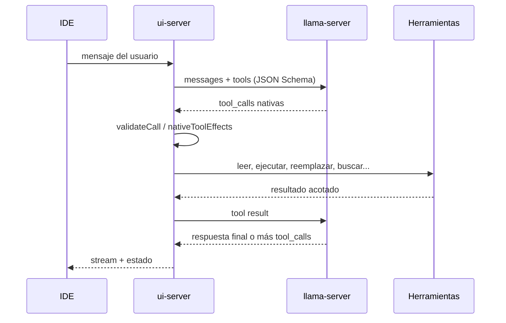

# Tool calling en Bonsai 2.3

Este documento fija el contrato de herramientas del agente. La regla es simple:
**las tool calls nativas son el camino canónico; el texto libre no es una API.**

## Fuente de verdad

| Pieza | Archivo | Papel |
|---|---|---|
| Definición de tools | `chat/coder-harness.mjs` (`CODER_TOOLS`) | Nombre, descripción, parámetros JSON Schema, `strict: true` |
| Validación | `chat/coder-harness.mjs` (`validateCall`) | Rechaza campos desconocidos, tipos incorrectos y JSON incompleto |
| Schemas Zod | `chat/tool-schemas.mjs` | Contratos de las tools nuevas y JSON Schema reproducible |
| Efectos | `chat/actions.mjs` (`nativeToolEffects`) | Traduce una tool call válida a escrituras, comandos, lecturas, etc. |
| Bucle del agente | `chat/ui-server.mjs` | Envía `tools`, recibe `tool_calls`, ejecuta y devuelve resultados |
| Compatibilidad legacy | `chat/legacy-tool-parser.mjs` | Parser de texto para modelos viejos, aislado y apagable |

`CODER_TOOLS` marca todas las funciones con `strict: true` y
`additionalProperties: false`. Un argumento que no está en el schema no se
ignora: la llamada falla y el modelo recibe el error para corregirla.

## Flujo de un turno



## Herramientas principales

| Tool | Para qué |
|---|---|
| `leer` | Leer un archivo por rango, símbolo o alrededor de una línea |
| `indice` | Mapa compacto de archivos, símbolos y dependencias |
| `buscar_codigo` | Búsqueda textual literal |
| `buscar_estructural` | Patrones AST con `$X` y `$$$ARGS` en JS/TS/TSX/HTML/CSS |
| `simbolo` | Definiciones o referencias de un símbolo |
| `reemplazar` | Cambio localizado con texto exacto |
| `archivo` | Crear o reemplazar un archivo |
| `escribir_partes` | Archivos nuevos grandes por partes |
| `ejecutar` | Comando de desarrollo o tests |
| `proceso` | Gestionar procesos en segundo plano |
| `borrar` / `mover` | Operaciones de archivos |
| `git_diff` | Diff actual de Git |
| `plan` | Plan operativo persistente |
| `navegador` / `mcp_playwright` | Navegador aislado y Playwright MCP |
| `buscar` / `leer_web` | Investigación web |

## Ejemplo de llamada nativa

El servidor recibe algo así:

```json
{
  "id": "call_1",
  "type": "function",
  "function": {
    "name": "reemplazar",
    "arguments": "{\"ruta\":\"chat/ui/app.js\",\"buscar\":\"editorModerno: false\",\"poner\":\"editorModerno: true\"}"
  }
}
```

`nativeToolEffects` la convierte en una edición con `ruta`, `buscar` y `poner`.
Si el JSON está cortado o falta un campo obligatorio, se devuelve una nota al
modelo y **no se escribe nada**.

## Schemas y llguidance

`chat/tool-schemas.mjs` valida las tools nuevas con Zod y puede emitir JSON
Schema:

```js
import { validarHerramienta, jsonSchemaDe } from "./tool-schemas.mjs";

validarHerramienta("buscar_estructural", {
  patron: "console.log($$$ARGS)",
  lenguaje: "ts",
});
```

La build opcional con **llguidance** usa el mismo schema para restringir la
decodificación. No es un camino distinto: es una garantía extra de que el modelo
emite argumentos conformes.

## Parser legacy

Algunos modelos pequeños escriben las tools como texto:

~~~~text
```ejecutar
node --version
```
~~~~

o `<tool_call>...</tool_call>`, o anuncian “voy a ejecutar…”. El parser que
reconoce esos formatos vive en `chat/legacy-tool-parser.mjs` y solo se aplica
cuando no hay tool calls nativas.

```powershell
# Desactivar por completo las heurísticas legacy.
$env:BONSAI_LEGACY_TOOL_PARSER = "0"
```

Con el flag en `0`, `legacyCommands`, `legacyWrites`, `legacyReads`,
`legacySearches`, `legacyIndexScope` y `legacyImpliedAction` devuelven listas
vacías. Las tools nativas no se ven afectadas.

### Política de mantenimiento

1. **No añadir regex nuevas para un modelo concreto.** Si un modelo no llama
   bien a una tool, se corrige su plantilla, su prompt o su schema.
2. Una tool nueva se añade a `CODER_TOOLS` (o a `tool-schemas.mjs` si es una
   tool nueva validada con Zod) y a `nativeToolEffects`.
3. El parser legacy no crece. Su objetivo es desaparecer cuando los modelos
   locales soporten tool calls de forma fiable.

## Pruebas

```powershell
node chat/prueba-tool-schemas.mjs
node chat/actions.mjs
node chat/prueba-small-coder.mjs
node chat/prueba-copia-evaluacion.mjs
```

La copia aislada de evaluación incluye `legacy-tool-parser.mjs`; si se añade un
módulo nuevo al servidor, hay que agregarlo también a
`chat/evaluar/copia-app.mjs`.
