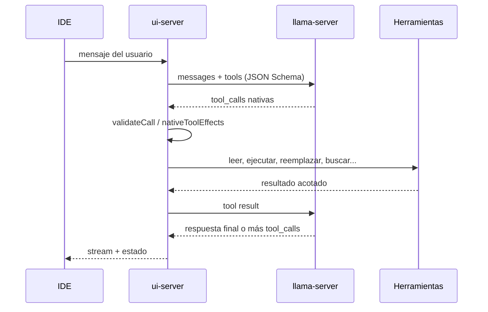

# Tool calling en Bonsai 2.4

Este documento fija el contrato de herramientas del agente. La regla es simple:
**las tool calls nativas son el camino canónico; el texto libre no es una API.**

## Fuente de verdad

| Pieza | Archivo | Papel |
|---|---|---|
| Definición de tools | `chat/coder-harness.mjs` (`CODER_TOOLS`) | Nombre, descripción, parámetros JSON Schema, `strict: true` |
| Validación | `chat/coder-harness.mjs` (`validateCall`) | Rechaza campos desconocidos, tipos incorrectos y JSON incompleto |
| Schemas Zod | `chat/tool-schemas.mjs` | Contratos de las tools nuevas y JSON Schema reproducible |
| Efectos | `chat/actions.mjs` (`nativeToolEffects`) | Traduce una tool call válida a escrituras, comandos, lecturas, etc. |
| Bucle del agente | `chat/ui-server.mjs` | Envía `tools`, recibe `tool_calls`, ejecuta y devuelve resultados |
| Compatibilidad legacy | `chat/legacy-tool-parser.mjs` | Parser de texto para modelos viejos, aislado y apagable |

`CODER_TOOLS` marca todas las funciones con `strict: true` y
`additionalProperties: false`. Un argumento que no está en el schema no se
ignora: la llamada falla y el modelo recibe el error para corregirla.

## Flujo de un turno



## Herramientas principales

| Tool | Para qué |
|---|---|
| `leer` | Leer un archivo por rango, símbolo o alrededor de una línea |
| `indice` | Mapa compacto de archivos, símbolos y dependencias |
| `buscar_codigo` | Búsqueda textual literal |
| `buscar_estructural` | Patrones AST con `$X` y `$$$ARGS` en JS/TS/TSX/HTML/CSS |
| `simbolo` | Definiciones o referencias de un símbolo |
| `reemplazar` | Cambio localizado con texto exacto |
| `archivo` | Crear o reemplazar un archivo |
| `escribir_partes` | Archivos nuevos grandes por partes |
| `ejecutar` | Comando de desarrollo o tests |
| `proceso` | Gestionar procesos en segundo plano |
| `borrar` / `mover` | Operaciones de archivos |
| `git_diff` | Diff actual de Git |
| `plan` | Plan operativo persistente |
| `navegador` / `mcp_playwright` | Navegador aislado y Playwright MCP |
| `buscar` / `leer_web` | Investigación web |

## Ejemplo de llamada nativa

El servidor recibe algo así:

```json
{
  "id": "call_1",
  "type": "function",
  "function": {
    "name": "reemplazar",
    "arguments": "{\"ruta\":\"chat/ui/app.js\",\"buscar\":\"editorModerno: false\",\"poner\":\"editorModerno: true\"}"
  }
}
```

`nativeToolEffects` la convierte en una edición con `ruta`, `buscar` y `poner`.
Si el JSON está cortado o falta un campo obligatorio, se devuelve una nota al
modelo y **no se escribe nada**.

## GPT-OSS 20B y Harmony

El agente recomendado por defecto es **Qwen3.6 35B-A3B**, con tool calls
nativas y pensamiento libre. **GPT-OSS 20B** se conserva como alternativa
Harmony para proyectos desde cero. Su plantilla no es genérica: es **Harmony**
y viaja en el GGUF. El lanzador la escribe en
`logs/chat_template_<puerto>.jinja` y arranca `llama-server` con `--jinja` y
`--chat-template-file`. El servidor expone en `/props`:

- `chat_template_caps.supports_tools = true`
- `chat_template_caps.supports_tool_calls = true`
- `chat_template_caps.supports_reasoning_effort = true`
- `supports_parallel_tool_calls = false`

La petición usa `chat_template_kwargs.reasoning_effort` (por defecto `medium`),
**no** `enable_thinking`: esa clave es de otras plantillas y en Harmony solo
añade ruido. El presupuesto va en `thinking_budget_tokens`, en la raíz de la
petición.

### Cómo se ve una llamada nativa

En el stream SSE, una llamada nativa llega en `delta.tool_calls`:

```json
{"choices":[{"delta":{"tool_calls":[{"index":0,"id":"call_1","type":"function","function":{"name":"archivo","arguments":"{\"ruta\":\"a.txt\""}}]}}]}
```

Los fragmentos de `arguments` se funden por `index`; no se pierde un archivo
grande porque llegue en varios trozos. El resultado se valida con
`validateCall` y se ejecuta con `nativeToolEffects`.

### Sin parser nativo: Harmony propio

GPT-OSS arranca con `--skip-chat-parsing` para que el parser PEG de llama.cpp
no pueda tumbar el turno. El servidor devuelve Harmony crudo en `content` y
`chat/harmony.mjs` lo separa:

- `analysis` → panel de pensamiento.
- `final` → respuesta visible.
- `commentary to=functions.NOMBRE` → tool call nativa, con sus argumentos JSON.

No se muestran los marcadores `<|channel|>`. Si el texto no trae marcadores, se
deja intacto para el fallback `gpt-oss-json`.

### Guía de herramientas en el prompt

Para GPT-OSS, `BonsaiChat` añade una guía compacta con el nombre, los argumentos
obligatorios y un ejemplo de cada tool. No sustituye a los JSON Schema de la
plantilla: es una referencia práctica para que el modelo no tenga que adivinar
la forma de `archivo`, `leer`, `reemplazar` o `buscar_codigo`.

Los campos extra que no están en el schema se ignoran; un `ruta` de más en una
búsqueda no tumba el turno. Los campos obligatorios y los tipos sí se validan.
Si una llamada llega con el JSON truncado, no se guarda en el historial y el
modelo recibe una nota para repetirla; así el siguiente turno no falla al
serializar argumentos inválidos.

### Fallback JSON de GPT-OSS

El parser PEG nativo de llama.cpp puede dejar una llamada en `content` en vez
de `delta.tool_calls` cuando el modelo intenta varias llamadas o antepone texto.
GPT-OSS suele escribir, en ese caso:

```json
{"name":"functions.archivo","arguments":{"ruta":"a.txt","contenido":"uno"}}
```

El dialecto `gpt-oss-json` de `chat/adaptadores.mjs` reconoce **solo** textos
que son uno o varios objetos JSON separados por `;`, comas o saltos, quita el
prefijo `functions.` y los pasa por el mismo `nativeToolEffects`. No ejecuta
JSON explicado con prosa ni JSON dentro de una cerca de código. Está declarado
en el catálogo como `"toolcalls": "nativo gpt-oss-json"`.

Con el parser Harmony propio, el prompt **ya no limita a una sola tool call**:
varias llamadas independientes pueden viajar en el mismo turno y el host
devuelve un resultado por cada una. Las dependientes esperan el resultado
anterior. El error de llama.cpp:

```text
The model produced output that does not match the expected peg-native format
```

solo puede aparecer si el servidor se arranca sin `--skip-chat-parsing`. En ese
caso el turno **no se pierde**: Bonsai reintenta una vez sin `tools` nativas,
con el catálogo de herramientas como
texto en el system prompt y la instrucción de responder solo con un objeto JSON
`{"name":..., "arguments":...}`. GPT-OSS devuelve ese JSON en `content`, el
dialecto `gpt-oss-json` lo convierte y el agente sigue con el resultado. Si el
reintento también falla, el error se propaga; no se finge una respuesta.

La salida cruda permite diagnosticarlo.

### Ver la salida cruda

Con `BONSAI_RAW_STREAM=1`, cada evento SSE se guarda en
`<estado>/raw-stream.jsonl` (por defecto `chat/raw-stream.jsonl`). También
acepta una ruta explícita:

```powershell
$env:BONSAI_RAW_STREAM = "C:\ruta\raw-gpt-oss.jsonl"
```

El archivo conserva `content`, `reasoning_content`, `tool_calls`, `finish_reason`
y errores, con la hora de cada evento. Es la forma de comprobar si GPT-OSS está
usando el canal nativo o cayendo al JSON de `content`.

### Razonamiento

El catálogo de GPT-OSS declara `pensar.nivel: "medium"` y
`presupuesto: 2048`. No se usa `high`: el autor del modelo documenta que puede
devolver HTTP 500 y, en la práctica, dispara respuestas de 18k tokens de
razonamiento que consumen todo el hueco de salida. El presupuesto por petición
(`thinking_budget_tokens`) sigue mandando; `pensar=512` es un buen equilibrio
para coding en 8 GB.

## Schemas y llguidance

`chat/tool-schemas.mjs` valida las tools nuevas con Zod y puede emitir JSON
Schema:

```js
import { validarHerramienta, jsonSchemaDe } from "./tool-schemas.mjs";

validarHerramienta("buscar_estructural", {
  patron: "console.log($$$ARGS)",
  lenguaje: "ts",
});
```

La build opcional con **llguidance** usa el mismo schema para restringir la
decodificación. No es un camino distinto: es una garantía extra de que el modelo
emite argumentos conformes.

## Parser legacy

Algunos modelos pequeños escriben las tools como texto:

~~~~text
```ejecutar
node --version
```
~~~~

o `<tool_call>...</tool_call>`, o anuncian “voy a ejecutar…”. El parser que
reconoce esos formatos vive en `chat/legacy-tool-parser.mjs` y solo se aplica
cuando no hay tool calls nativas.

```powershell
# Desactivar por completo las heurísticas legacy.
$env:BONSAI_LEGACY_TOOL_PARSER = "0"
```

Con el flag en `0`, `legacyCommands`, `legacyWrites`, `legacyReads`,
`legacySearches`, `legacyIndexScope` y `legacyImpliedAction` devuelven listas
vacías. Las tools nativas no se ven afectadas.

### Política de mantenimiento

1. **No añadir regex nuevas para un modelo concreto.** Si un modelo no llama
   bien a una tool, se corrige su plantilla, su prompt o su schema.
2. Una tool nueva se añade a `CODER_TOOLS` (o a `tool-schemas.mjs` si es una
   tool nueva validada con Zod) y a `nativeToolEffects`.
3. El parser legacy no crece. Su objetivo es desaparecer cuando los modelos
   locales soporten tool calls de forma fiable.

## Pruebas

```powershell
node chat/prueba-tool-schemas.mjs
node chat/harmony.mjs
node chat/prueba-gpt-oss-tools.mjs
node chat/prueba-coder-archivos.mjs
node chat/actions.mjs
node chat/prueba-small-coder.mjs
node chat/prueba-copia-evaluacion.mjs
```

La copia aislada de evaluación incluye `legacy-tool-parser.mjs`; si se añade un
módulo nuevo al servidor, hay que agregarlo también a
`chat/evaluar/copia-app.mjs`.
