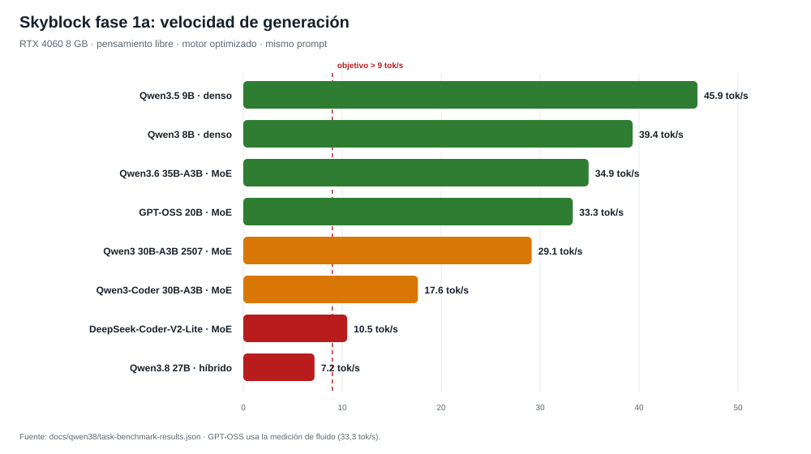
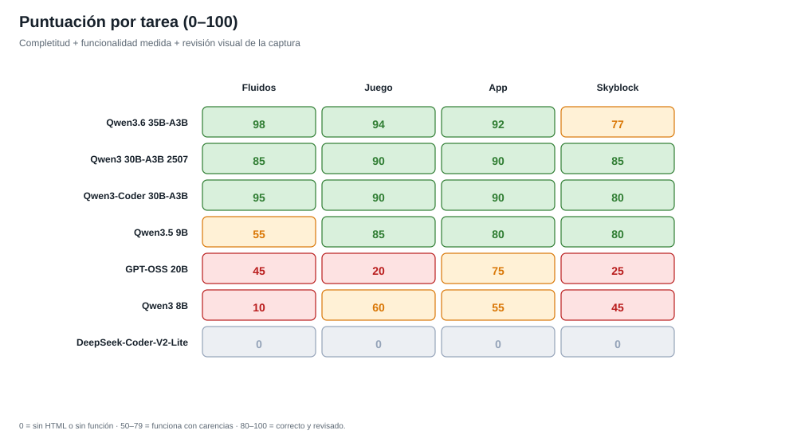
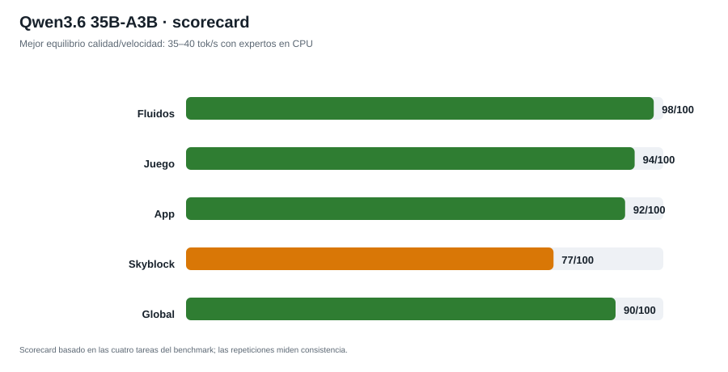
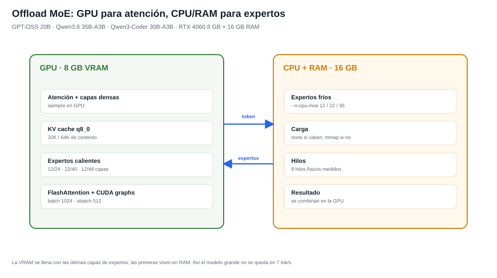
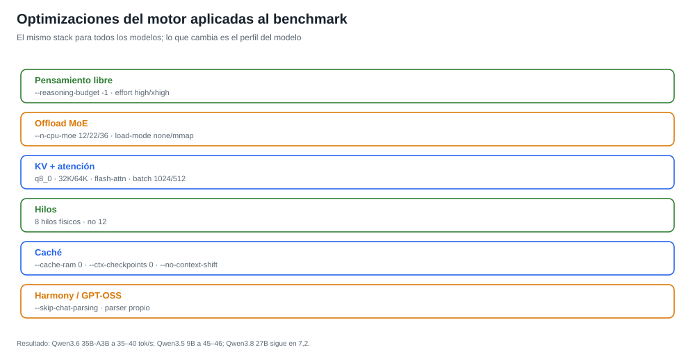

# Qwen3.8-27B y benchmark de modelos: runtime, caché y validación

Esta carpeta reúne los informes de la integración local de Qwen3.8-27B en el
IDE. El modelo y los binarios no se guardan en Git; aquí quedan las recetas,
los resultados y el parche de runtime.

## Runtime

El perfil de entrega es **`qwen38-27b-perf-iq4`**:

- GGUF mixto `qwen38-27b-perf-iq4_xs-floor4.gguf` (suelo de cuatro bits);
- `-ngl 27`, contexto 32768, KV q8_0, batch 512, ubatch 256, 16 hilos;
- MTP 2, `--cache-ram 512`, `--cache-recurrent-prefix`,
  `LLAMA_MMAP_TRIM_GPU=1`;
- pensamiento libre: `--reasoning-budget -1`, `--reasoning-effort xhigh`,
  `thinking_budget_tokens: -1`.

El perfil original `qwen38-27b` y el GGUF original se conservan para rollback.

`fork-runtime.patch` contiene el diff de `common`, `ggml`, `src`, `tools` y
`scripts` del fork local sobre `dde879b`. Se aplica en un fork de llama.cpp,
no en `ggml-org/llama.cpp`. `fork-commits.txt` lista los commits. El binario de
entrega se identifica por SHA-256 y por
`build-Qwen38-sm89/bin/qwen38-build.json`; el `build_info` de `/props` puede
ser de un configure anterior.

## Informes

| Informe | Contenido |
|---|---|
| [CLOSING-2026-11-01](CLOSING-2026-11-01.md) | Cierre: estado, resultados, pendientes y rollback |
| [HANDOFF-CONTINUATION](HANDOFF-CONTINUATION-2026-11-01.md) | Relevo operativo de la continuación |
| [cache-agent-prefix](cache-agent-prefix.md) | Checkpoints en pasos de agente: 6508 tokens reutilizados |
| [cache-anchor](cache-anchor.md) | Ancla estable para turnos nuevos: 4551 tokens |
| [cache-long-context-final](cache-long-context-final.md) | 6K/12K/25K con el GGUF mixto final |
| [cache-transfer-4b](cache-transfer-4b.md) | Transferencia a Qwen3.8 4B híbrido |
| [cache-transfer-3b](cache-transfer-3b.md) | Regresión en un transformer 3B |
| [tool-calling-qwen](tool-calling-qwen.md) | Tool calls nativas, paralelas, UTF-8 y recuperación |
| [ide-multiturn](ide-multiturn.md) | Dos turnos de agente, 4/4 tests y caché |
| [ide-cancellation](ide-cancellation.md) | Cancelación de generación y comando, sin huérfanos |
| [ide-read-smoke-explained](ide-read-smoke-explained.md) | Por qué se cortó el smoke y qué se corrigió |
| [final-ide-smoke](final-ide-smoke.md) | Smoke final aceptado |
| [memory-faults](memory-faults.md) | ETW: carga del GGUF, pagefile y working set |
| [memory-browser-pressure](memory-browser-pressure.md) | 512 MiB de navegador headless |
| [prefill-column-reuse](prefill-column-reuse.md) | Prefill IQ4_XS por columnas: rechazado |
| [prefill-ubatch](prefill-ubatch.md) | Ubatch 384: rechazado |
| [mtp-pmin](mtp-pmin.md) | MTP `p-min 0.1`: rechazado |
| [backend-sampling](backend-sampling.md) | Draft backend sampling: rechazado |
| [SKYBLOCK-2026-11-01](SKYBLOCK-2026-11-01.md) | Diagnóstico del Skyblock con Qwen3.8: timeouts y slice |
| [SKYBLOCK-BENCHMARK-PLAN](SKYBLOCK-BENCHMARK-PLAN.md) | Plan de benchmark de modelos con Skyblock |
| [TASK-BENCHMARK-2026-11-01](TASK-BENCHMARK-2026-11-01.md) | 7 modelos × 4 tareas, puntuaciones y capturas |
| [MODEL-SCORECARD-2026-11-01](MODEL-SCORECARD-2026-11-01.md) | Qwen3.6 × 3 repeticiones: 90/100 y 36–40 tok/s |
| [prompts](prompts/) | Prompts de fluidos, juego, app y Skyblock |

## Benchmark de modelos

La misma matriz de cuatro tareas (fluidos, juego, app y Skyblock) con el motor
optimizado y pensamiento libre. **Qwen3.6 35B-A3B** es el mejor equilibrio
calidad/velocidad; **Qwen3.5 9B** es el más rápido; **Qwen3-Coder 30B-A3B** es
el especialista de código.

Resultados crudos en
[task-benchmark-results.json](task-benchmark-results.json); capturas en
[task-benchmark-shots](task-benchmark-shots/).

## Límites

Los porcentajes y tok/s son de esta máquina y de las cargas indicadas. No son
una promesa universal ni una transferencia automática a otros modelos. La
caché de 25K es un prefijo repetido/residente; los turnos reales con
herramientas se validaron por separado. La memoria no demuestra paging cero:
quedan 59 hard faults de pagefile (0,85 MB) en la captura de entrega.
