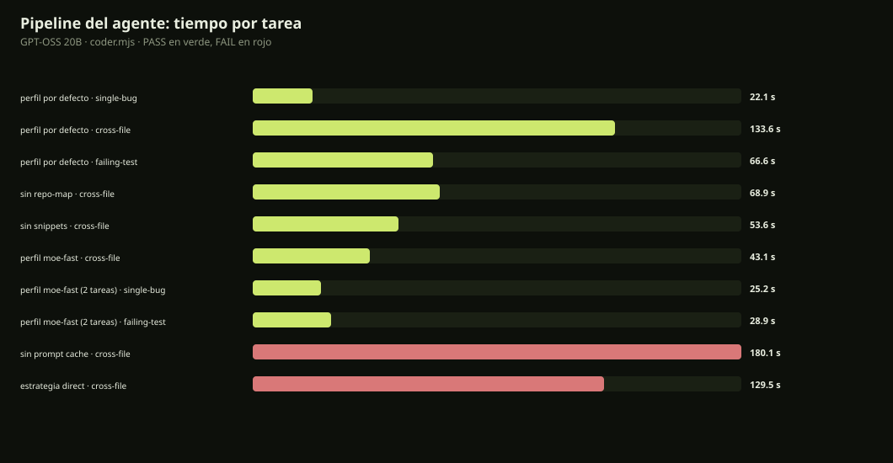

# Pipeline del agente de coding · GPT-OSS 20B

Medido con `chat/evaluar/coder.mjs` (agente real con herramientas, no one-shot) sobre el mismo modelo GPT-OSS-20B en 8080.

| Corrida | Tarea | Resultado | Tiempo | Llamadas | Prompt tokens | Cacheados | Herramientas |
|---|---|:--:|---:|---:|---:|---:|---:|
| perfil por defecto | single-bug | PASS | 22.1 s | 2 | 6145 | 2708 | 1 |
| perfil por defecto | cross-file | PASS | 133.6 s | 13 | 50197 | 31063 | 12 |
| perfil por defecto | failing-test | PASS | 66.6 s | 5 | 16246 | 11857 | 4 |
| sin repo-map | cross-file | PASS | 68.9 s | 8 | 27599 | 15677 | 7 |
| sin snippets | cross-file | PASS | 53.6 s | 8 | 26124 | 21210 | 7 |
| perfil moe-fast | cross-file | PASS | 43.1 s | 8 | 26170 | 21249 | 7 |
| perfil moe-fast (2 tareas) | single-bug | PASS | 25.2 s | 5 | 15159 | 11281 | 4 |
| perfil moe-fast (2 tareas) | failing-test | PASS | 28.9 s | 6 | 20445 | 16028 | 5 |
| sin prompt cache | cross-file | FAIL | 180.1 s | 10 | 35528 | 0 | 9 |
| estrategia direct | cross-file | FAIL | 129.5 s | 17 | 77391 | 56012 | 16 |



## Conclusiones

- **Perfil por defecto: 3/3** tareas (single-bug, cross-file y failing-test), con el bucle de herramientas y verificación real.
- **Quitar snippets** reduce cross-file de **133,6 s a 43,1 s** (3,1×) y failing-test de **66,6 s a 28,9 s** (2,3×), manteniendo PASS. El perfil `chat/coder-profile-moe.json` lo deja activado de forma opt-in.
- **Quitar repo-map** también mejora (68,9 s), pero menos que quitar snippets; para este proyecto los archivos se leen con herramientas y el mapa no aporta.
- **Quitar el prompt cache hace fallar** cross-file (timeout de 180 s). El cache es obligatorio en este hardware.
- **Forzar estrategia direct** hace fallar cross-file (17 llamadas, 77k tokens). La estrategia `auto`/plan es la que funciona.

## Cómo activar el perfil rápido

```powershell
$env:BONSAI_CODER_CONFIG = "chat/coder-profile-moe.json"
npm run start:ui   # o el arranque habitual del IDE
```

Sin esa variable se usa `chat/coder-profile.json` (perfil histórico). El perfil rápido baja `snippetTokens` a 0 y mantiene repo-map 600; está pensado para MoE con herramientas y se midió con GPT-OSS.

Resultados crudos: `reports/coder-gptoss-*`.