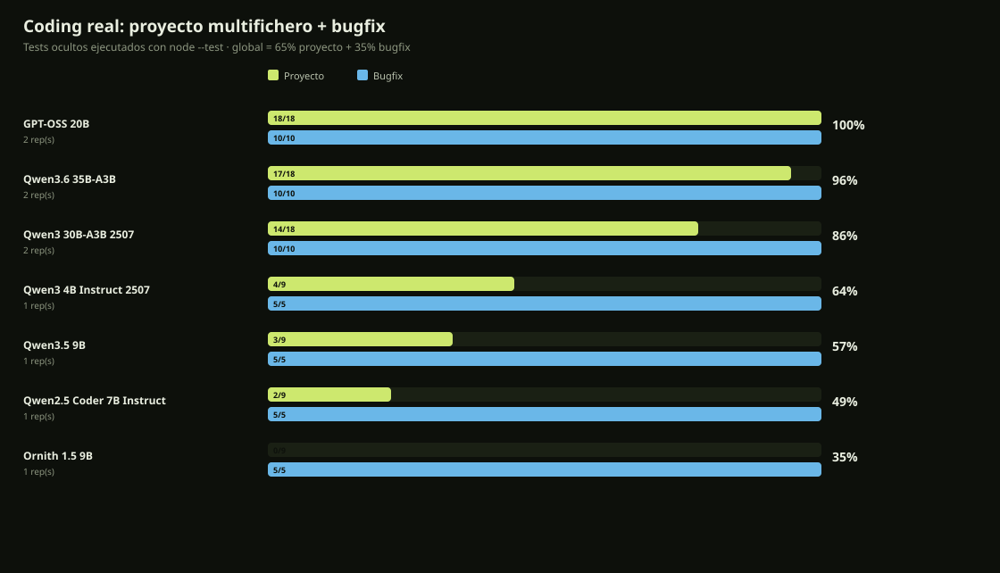
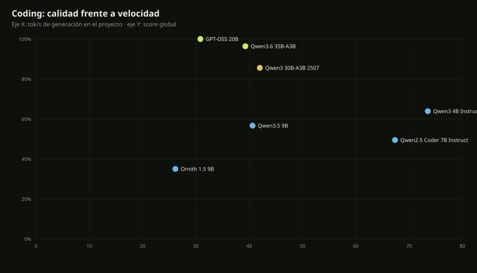

# Coding real en Bonsai · 31-oct-2026

Prueba de proyecto complicado, no preguntas sueltas. Dos tareas con **tests ocultos** que el modelo no escribe; se ejecutan de verdad con `node --test`.

## Tareas

| Tarea | Qué pide | Tests ocultos |
|---|---|---:|
| `project` | Proyecto Node ESM multifichero: `PriorityQueue` (min-heap, FIFO en empate) y `Scheduler` (prioridad, concurrencia, reintentos, orden de finalización) | 9 |
| `bugfix` | Corregir un carrito con dos bugs: descuento porcentual y multiplicación por cantidad | 5 |

El score global es **65 % proyecto + 35 % bugfix**. Un archivo de test que no arranca, un timeout o un archivo que no se puede aplicar cuentan como fallo: el denominador es fijo (9 y 5), no lo que el modelo consiga ejecutar.

## Ranking

| # | Modelo | Global | Proyecto | Bugfix | Reps | tok/s | Tiempo proyecto |
|---:|---|---:|---:|---:|---:|---:|---:|
| 1 | **GPT-OSS 20B** | **100%** | 18/18 (100%) | 10/10 (100%) | 2 | 31 | 76 s |
| 2 | **Qwen3.6 35B-A3B** | **96%** | 17/18 (94%) | 10/10 (100%) | 2 | 39 | 115 s |
| 3 | **Qwen3 30B-A3B 2507** | **86%** | 14/18 (78%) | 10/10 (100%) | 2 | 42 | 14 s |
| 4 | **Qwen3 4B Instruct 2507** | **64%** | 4/9 (44%) | 5/5 (100%) | 1 | 74 | 11 s |
| 5 | **Qwen3.5 9B** | **57%** | 3/9 (33%) | 5/5 (100%) | 1 | 41 | 78 s |
| 6 | **Qwen2.5 Coder 7B Instruct** | **49%** | 2/9 (22%) | 5/5 (100%) | 1 | 67 | 7 s |
| 7 | **Ornith 1.5 9B** | **35%** | 0/9 (0%) | 5/5 (100%) | 1 | 26 | 121 s |





## Lectura

- **GPT-OSS-20B** es el mejor para el proyecto complejo: **18/18 tests en 2 repeticiones** (y 27/27 en una tanda previa de 3). También hace 5/5 en bugfix. Es el recomendado para arquitectura desde cero.
- **Qwen3.6-35B-A3B** queda a un test del líder (17/18) y es perfecto en bugfix (10/10). Además genera a ~39 tok/s, más rápido que GPT-OSS (~30).
- **Qwen3-30B-A3B 2507** es el más rápido de los grandes (~42 tok/s) y hace 14/18 + 10/10; la mejor relación velocidad/calidad si el tiempo importa.
- Los densos pequeños (**Qwen3 4B, Qwen3.5 9B, Qwen2.5 Coder 7B, Ornith 9B**) aprueban el bugfix pero se quedan en 0–4/9 en el proyecto multifichero. Sirven para tareas guiadas y ediciones, no para diseñar un scheduler desde cero.
- **Ornith** está ajustado para el agente del IDE, no para generar un proyecto entero de una sola respuesta; su 0/9 aquí no invalida su uso como agente. Es un aviso de que el benchmark mide generación one-shot, no el bucle de herramientas.

## Hallazgos de pipeline (lo que cambió el resultado)

| Problema | Efecto medido | Corrección |
|---|---|---|
| El modelo envuelve el archivo en ```mjs | Qwen3-30B: 2/9 → 5/9 en la primera iteración | `limpiarCuerpo()` quita cercas exteriores |
| El modelo escribe `discount.mjs` sin `src/` | GPT-OSS bugfix: 1/5 → 5/5 | normalización de rutas por nombre base |
| Un scheduler con deadlock cuelga `node --test` | 60 s perdidos y score 0/0 | timeout por test + `taskkill /T` y denominador fijo |
| `max_tokens` corta el proyecto | Qwen3.6: 0/9 → 9/9 al dar 12k | 12k proyecto / 8k bugfix y continuación si `finish=length` |
| Un archivo de test no arranca y `# tests` baja | score inflado (4/5 = 80 %) | denominador fijo 9/5; 4/9 = 44 % |

Además, el benchmark usa el mismo pipeline que el IDE: plantilla `tokenizer.chat_template`, `/v1/chat/completions` con system+user, `--load-mode none` para los MoE que caben en RAM, 12 hilos y batch 1024/512.

El **agente real del IDE** con GPT-OSS pasó 3/3 tareas y el perfil `moe-fast` redujo `cross-file` de 133,6 s a 43,1 s. Detalle: [CODER-PIPELINE-2026-10-31.md](CODER-PIPELINE-2026-10-31.md).

## Reproducir

```powershell
node scripts/bench-coding.mjs --models gpt-oss-20b,qwen36-35b-a3b,qwen3-30b-a3b-2507 --reps 2
node scripts/bench-coding.mjs --models ornith9b,qwen25-coder-7b,qwen35-9b,qwen3-4b-2507 --reps 1
node scripts/coding-report.mjs
```

Resultados crudos: `reports/coding-bench-2026-10-31T09-29-38/` (head-to-head) y `reports/coding-bench-2026-10-31T09-44-42/` (densos).

## Limitaciones

- 2 repeticiones en los tres grandes y 1 en los densos; no es un ranking estadístico. La varianza medida es real: GPT-OSS hizo 5/5, 5/5 y 1/5 en bugfix antes de normalizar rutas; Qwen3.6 hizo 4/9, 4/9 y 7/9 en proyecto antes de subir el presupuesto.
- El formato `===FILE===` es artificial; el IDE usa herramientas y edición incremental. Un modelo puede rendir mejor en el bucle del agente que en one-shot.
- Solo una máquina (RTX 4060 8 GB, 16 GB RAM).