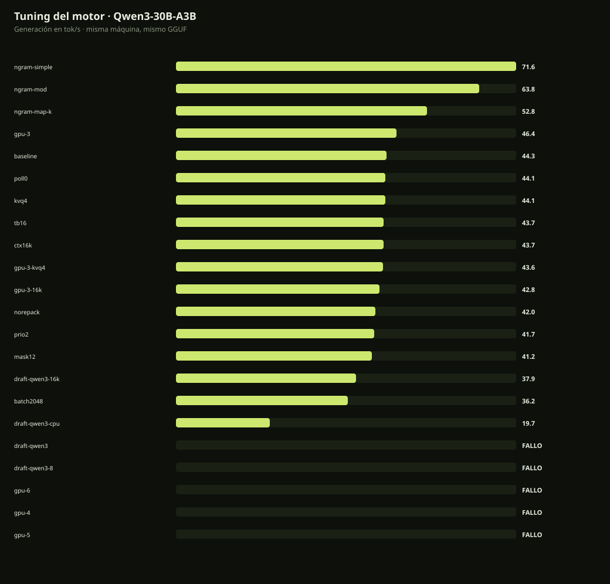

# Tuning del motor · Qwen3-30B-A3B · 31-oct-2026

Mismo GGUF, mismo plan (32k, q8_0, 19/48 capas GPU), misma máquina. Variante base: `--load-mode none`, 12 hilos, batch 1024/512.

| Variante | Generación | Chat | Prompt | VRAM | Resultado |
|---|---:|---:|---:|---:|---|
| ngram-simple | 71.6 tok/s | 44.5 tok/s | 1011 tok/s | 6891 MiB | OK |
| ngram-mod | 63.8 tok/s | 44.8 tok/s | 1009.8 tok/s | 6891 MiB | OK |
| ngram-map-k | 52.8 tok/s | 44.5 tok/s | 1011.1 tok/s | 6891 MiB | OK |
| gpu-3 | 46.4 tok/s | 45.5 tok/s | 1056 tok/s | 7537 MiB | OK |
| baseline | 44.3 tok/s | 44.5 tok/s | 1011.8 tok/s | 6889 MiB | OK |
| poll0 | 44.1 tok/s | 44.8 tok/s | 1011.5 tok/s | 6889 MiB | OK |
| kvq4 | 44.1 tok/s | 44.5 tok/s | 952.8 tok/s | 6121 MiB | OK |
| tb16 | 43.7 tok/s | 43.1 tok/s | 1009.2 tok/s | 6889 MiB | OK |
| ctx16k | 43.7 tok/s | 44.1 tok/s | 1010.1 tok/s | 6057 MiB | OK |
| gpu-3-kvq4 | 43.6 tok/s | 43.7 tok/s | 985.3 tok/s | 6769 MiB | OK |
| gpu-3-16k | 42.8 tok/s | 43.7 tok/s | 1051.3 tok/s | 6705 MiB | OK |
| norepack | 42 tok/s | 42.5 tok/s | 1005.2 tok/s | 6889 MiB | OK |
| prio2 | 41.7 tok/s | 40.5 tok/s | 1011.7 tok/s | 6889 MiB | OK |
| mask12 | 41.2 tok/s | 42.1 tok/s | 1009.4 tok/s | 6889 MiB | OK |
| draft-qwen3-16k | 37.9 tok/s | 24.5 tok/s | 935.1 tok/s | 7273 MiB | OK |
| batch2048 | 36.2 tok/s | 41 tok/s | 1343.6 tok/s | 6991 MiB | OK |
| draft-qwen3-cpu | 19.7 tok/s | 19.1 tok/s | 524.4 tok/s | 7169 MiB | OK |
| draft-qwen3 | — | — | — | — MiB | OOM/fallo |
| draft-qwen3-8 | — | — | — | — MiB | OOM/fallo |
| gpu-6 | — | — | — | — MiB | OOM/fallo |
| gpu-4 | — | — | — | — MiB | OOM/fallo |
| gpu-5 | — | — | — | — MiB | OOM/fallo |

## Qué funciona

- **`--load-mode none` + 12 hilos + batch 1024/512** sigue siendo la base: 44,3 tok/s y 1.012 tok/s de prompt.
- **3 capas más de expertos en GPU** (`gpu-3`): **46,4 tok/s** (+4,7 %) y 1.056 tok/s de prompt, con 7.537 MiB de VRAM. 4 capas ya producen OOM.
- **`ngram-simple`**: 71,6 tok/s en generación cruda (+62 %), pero **44,5 tok/s en chat real**, igual que la base. La ganancia viene de texto repetido del prompt, no del uso conversacional. No se integra por defecto.
- **`batch 2048/1024`**: 1.343 tok/s de prompt (+33 %), pero generación baja a 36,2 tok/s (-18 %). Útil para prefill/RAG, no para chat.

## Qué no funciona

- **Draft Qwen3 0.6B**: 37,9 tok/s con 16k y KV q4; 19,7 tok/s en CPU. No compensa el coste de VRAM/RAM.
- **`prio2`, `poll0`, `tb16`, `norepack`, `mask12`**: neutros o peores (41–44 tok/s).
- **KV q4_0** y **contexto 16k**: misma generación (43–44 tok/s); solo ahorran VRAM.
- **Bloquear relojes a 2800 MHz**: 45,7 tok/s, dentro del ruido; no se justifica el riesgo térmico.
- **Power plan**: ya estaba en High performance; no hay margen.

## Recomendación

Mantener la base. Si el usuario quiere exprimir 5 % más y acepta menos margen de VRAM, usar `-GpuExtra 3` en el lanzador (o `--n-cpu-moe` tres capas por debajo del plan; medido como `gpu-3`). No usar ngram/draft como mejora de chat con estos datos.

Resultados crudos: `reports/moe-bench-2026-10-31T14-*`.