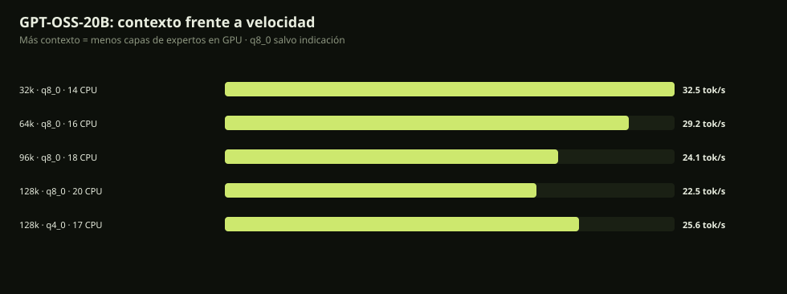
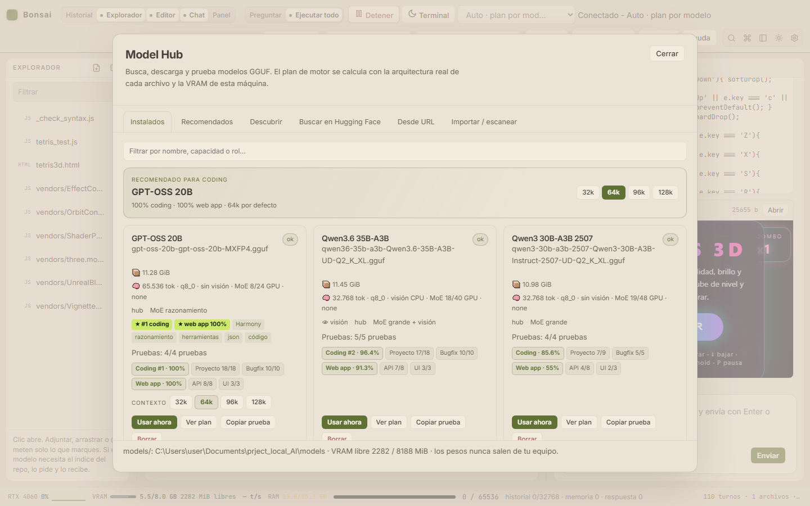

# GPT-OSS-20B en Bonsai · perfil recomendado

**Fecha:** 31-oct-2026 · RTX 4060 Laptop 8 GB · Ryzen 7 7840HS · 16 GB RAM

GPT-OSS-20B es el mejor modelo de este equipo para proyecto complejo y web app.
Este documento reúne su plantilla, muestreo, contexto, reparto de memoria y la
integración en el IDE.

## 1. Plantilla y capacidades

- **Harmony**: el GGUF trae `tokenizer.chat_template` (16.714 caracteres) y se
  pasa con `--jinja --chat-template-file`. Probados system/user, razonamiento,
  tool-calling nativo y JSON.
- **Razonamiento**: `--reasoning-effort high` (el nivel se fija al arrancar) y
  `--reasoning-budget` para el tope de tokens. El IDE muestra el pensamiento
  separado de la respuesta.
- **Herramientas**: devuelve `tool_calls` nativos de Harmony. Verificado con
  `convertir({"monto":250,"de":"USD","a":"EUR"})`.
- **Sin visión**: GPT-OSS-20B es texto; el Hub lo marca como “sin visión”.
- **Muestreo oficial**: `temperature 1.0`, `top_p 1.0`, `top_k 0`,
  `min_p 0.01`. El perfil antiguo (0.6/0.9/20/0.05) también pasaba 5/5, pero el
  oficial es el recomendado por OpenAI y queda integrado por modelo.

## 2. Contexto: 32k → 128k

Con 8 GB, el contexto se paga en capas de expertos que pasan a CPU. Medido con
el mismo GGUF, `--load-mode none`, 12 hilos y batch 1024/512:

| Contexto | KV | Capas CPU | Generación | Prompt | VRAM | RAM |
|---:|---|---:|---:|---:|---:|---:|
| 32k | q8_0 | 14 | **32,5 tok/s** | 971 tok/s | 6.069 MiB | 6,9 GiB |
| **64k** | q8_0 | 16 | **29,2 tok/s** | 897 tok/s | 5.699 MiB | 7,7 GiB |
| 96k | q8_0 | 18 | 24,1 tok/s | 767 tok/s | 5.359 MiB | 8,6 GiB |
| 128k | q8_0 | 20 | 22,5 tok/s | 737 tok/s | 5.053 MiB | 9,4 GiB |
| 128k | q4_0 | 17 | 25,6 tok/s | 771 tok/s | 5.495 MiB | 8,2 GiB |

- **64k es el defecto**: pierde solo un 10 % frente a 32k y deja margen de RAM.
- **128k funciona** y es el máximo real; q4 sube a 25,6 tok/s pero puede degradar
  calidad.
- **Aguja a 61.070 tokens**: respuesta correcta `QX-7419`, prefill 777 tok/s.
  No es solo “asignar KV”: el modelo usa el contexto.



## 3. Reparto y motor

- `--n-cpu-moe 16` a 64k (8/24 capas de expertos en GPU), `--load-mode none`.
- `-b 1024 -ub 512 -t 12`.
- `--cache-ram 0`, `--ctx-checkpoints 0`, flash-attention on.
- `-GpuExtra 3` opcional: +4,7 % a 32k, con riesgo de OOM; 4 capas ya no caben.
- No se usa ngram/draft: ngram acelera la generación cruda pero no el chat real;
  el draft Qwen3 0.6B no compensa.

## 4. Resultados

| Prueba | Resultado |
|---|---|
| Coding real (proyecto + bugfix, tests ocultos) | **100 %** (18/18 + 10/10, 2 reps) |
| Web app Taskboard (API + Playwright) | **100 %** (8/8 API + 3/3 UI) |
| Agente real del IDE | **3/3** tareas |
| Calidad 5 tareas | **5/5** |
| Aguja 61k | **QX-7419** |

## 5. Integración en el IDE

- El Hub muestra **“Recomendado para coding”**, KPIs de coding/web app, chips de
  capacidades (`Harmony`, razonamiento, herramientas, JSON, código) y botones de
  contexto **32k / 64k / 96k / 128k**.
- El perfil por defecto es 64k. Al elegir otro contexto, el lanzador recalcula
  `--n-cpu-moe` y el KV; no hay que editar flags a mano.
- Ajustes incluye **Esfuerzo de razonamiento** (automático/minimal/low/medium/
  high/xhigh).
- El modelo sigue disponible en **Modelos → Instalados → Usar ahora**.



## 6. Reproducir

```powershell
node scripts/moe-bench.mjs --model gpt-oss-20b --variant baseline,ctx64,ctx96,ctx128,ctx128q4
node scripts/bench-coding.mjs --models gpt-oss-20b --reps 2
node scripts/bench-webapp.mjs --models gpt-oss-20b
node scripts/engine-report.mjs
```

Resultados crudos en `reports/moe-bench-2026-10-31T15-00-51`,
`reports/coding-bench-*`, `reports/webapp-bench-*` y `reports/ENGINE-2026-10-31.md`.
