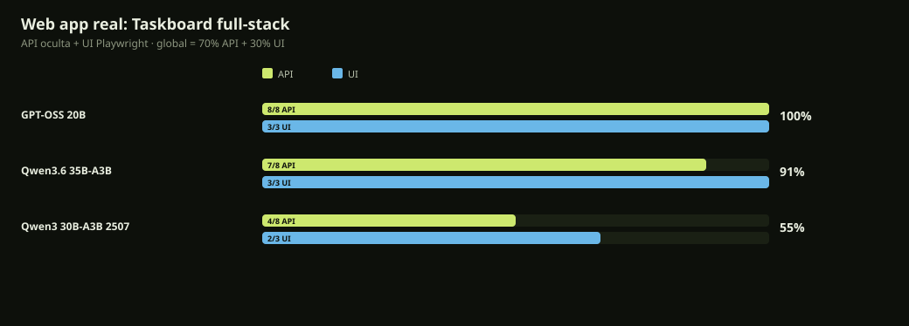

# Web app real · 31-oct-2026

Tarea: construir una **Taskboard full-stack** Node ESM sin dependencias: API CRUD + stats, persistencia `data.json`, HTML/CSS/JS y UI de tablero.

Tests ocultos: **8 de API** con fetch (crear, listar, cambiar estado, stats, borrar, estáticos) y **3 de UI** con Playwright/Edge (input, botón y tarea visible). El modelo no escribe tests.

| # | Modelo | Global | API | UI | Tiempo | tok/s | Captura |
|---:|---|---:|---:|---:|---:|---:|---|
| 1 | **GPT-OSS 20B** | **100%** | 8/8 | 3/3 | 150 s | 27 | [ver](../docs/graficos/webapp-gpt-oss-20b.png) |
| 2 | **Qwen3.6 35B-A3B** | **91%** | 7/8 | 3/3 | 140 s | 44 | [ver](../docs/graficos/webapp-qwen36-35b-a3b.png) |
| 3 | **Qwen3 30B-A3B 2507** | **55%** | 4/8 | 2/3 | 104 s | 39 | [ver](../docs/graficos/webapp-qwen3-30b-a3b-2507.png) |



## Qué pasó

- **GPT-OSS-20B: 100 %.** API completa, estáticos correctos y UI funcional; la captura lo confirma.
- **Qwen3.6-35B-A3B: 91 %.** La API y la UI funcionan, pero inlinó JS/CSS y no sirvió `app.js`/`styles.css` como archivos separados.
- **Qwen3-30B-A3B: 55 %.** Bug real en `PATCH`/`DELETE`: `path.slice(13)` corta dos caracteres del id y devuelve 404; además no sirve los estáticos y la UI no añade tareas.

## Fallos concretos

### GPT-OSS 20B

- Sin fallos: 8/8 API y 3/3 UI.

### Qwen3.6 35B-A3B

- API estaticos: app.js=404 styles.css=404

### Qwen3 30B-A3B 2507

- API cambiar-estado: HTTP 404 null
- API stats: HTTP 200 {"todo":1,"doing":0,"done":0,"total":1}
- API estaticos: app.js=404 styles.css=404
- API borrar: HTTP 404
- UI tarea-visible: 0 coincidencias

## Lectura

Para una web app completa, **GPT-OSS-20B** es el que mejor sigue el contrato de archivos y API. **Qwen3.6** está muy cerca y es más rápido generando, pero tiende a simplificar la estructura. **Qwen3-30B** es rápido, pero un error de una línea en el parseo del id tumba PATCH/DELETE.

## Reproducir

```powershell
node scripts/bench-webapp.mjs --models gpt-oss-20b,qwen36-35b-a3b,qwen3-30b-a3b-2507 --reps 1
```

Resultados crudos: `reports/webapp-bench-*`.